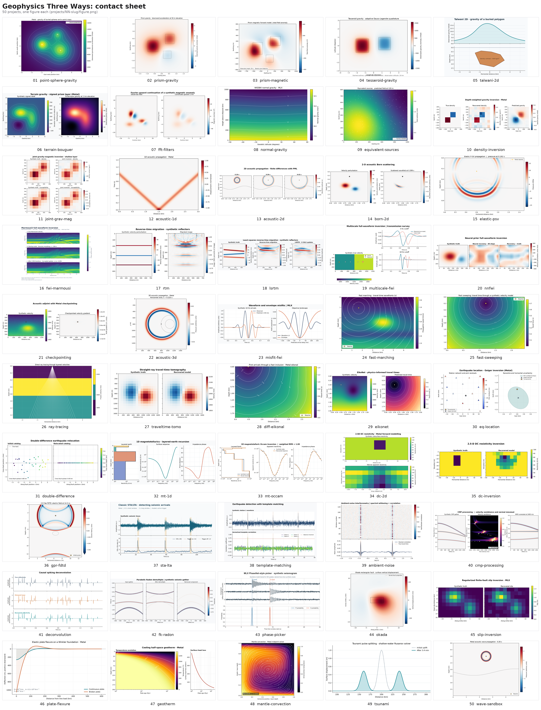

# Outcrop

**50 classic geophysics methods on Apple silicon GPUs, each written in MLX, in Rust + Metal, or both, and tested against established reference codes.**



Outcrop covers gravity and magnetics, seismic modelling and imaging, travel times and earthquake location, electrical and electromagnetic methods, seismic processing, and geodynamics. Every project is a small, self-contained folder with the same layout, so you can read one in an afternoon and compare how the same method looks in two GPU programming models:

- **MLX** (`mlx/impl.py`): array code in Python; gradients by automatic differentiation.
- **Rust + Metal** (`metal/`, crate `outcrop-NN`): hand-written compute shaders; gradients by hand-written adjoints.

Both paths implement the same API (`tests/api.py`) and must pass the same locked tests.

## What "tested" means

Each project has a **judge**: goldens computed in float64 by an established library or a published result, such as Harmonica, Boule, Deepwave, SimPEG, ObsPy, scikit-fmm, Okada's (1985) check table or the Blankenbach et al. convection benchmark. The tests compare each GPU path against those goldens with tolerances that are written down and justified in `tests/tolerances.py`. Where a project has both paths, MLX and Metal are also checked against each other.

The GPU work runs in **float32**. Where float32 is shown to lose accuracy, a small, documented float64 step runs on the CPU instead. Each project's `RESULTS.md` records the oracle, the tolerances, the test results, the benchmark and any approved deviations.

## Gallery

Click a method for its folder, figure and `RESULTS.md`. **Speedup** is reference wall time ÷ the fastest Outcrop path at the large benchmark size, measured on an Apple M5 Max. **†** means the reference was too slow to run at the large size, so the comparison is at the medium size.

### Potential fields

| # | Method | MLX | Metal | Checked against | Speedup vs reference |
|---|---|:-:|:-:|---|---|
| 01 | [Point-mass and sphere gravity](projects/01-point-sphere-gravity) | ✓ | ✓ | Analytic formulas | 61.5× (Metal) |
| 02 | [Prism gravity](projects/02-prism-gravity) | ✓ | ✓ | Harmonica | 11.1× (MLX, medium†) |
| 03 | [Prism magnetic anomaly](projects/03-prism-magnetic) | ✓ | ✓ | Harmonica | 13.3× (MLX, medium†) |
| 04 | [Tesseroid gravity](projects/04-tesseroid-gravity) | ✓ | ✓ | Harmonica | 0.025× (Metal) |
| 05 | [Talwani 2D polygon gravity](projects/05-talwani-2d) | ✓ | ✓ | Analytic shapes, Harmonica | 1,448× (MLX, medium†) |
| 06 | [Terrain and Bouguer correction](projects/06-terrain-bouguer) | ✓ | ✓ | Harmonica | 3.35× (MLX) |
| 07 | [FFT potential-field filters](projects/07-fft-filters) | ✓ |  | Harmonica | 44.3× (MLX) |
| 08 | [Normal gravity on the reference ellipsoid](projects/08-normal-gravity) | ✓ |  | Boule | 28.8× (MLX) |
| 09 | [Equivalent sources](projects/09-equivalent-sources) | ✓ | ✓ | Harmonica | 0.26× (MLX) |
| 10 | [3D density inversion](projects/10-density-inversion) | ✓ | ✓ | SimPEG | 0.77× (MLX) |
| 11 | [Joint gravity and magnetic inversion](projects/11-joint-grav-mag) | ✓ |  | NumPy/SciPy reference | 2.72× (MLX) |

### Seismic wave propagation and imaging

| # | Method | MLX | Metal | Checked against | Speedup vs reference |
|---|---|:-:|:-:|---|---|
| 12 | [1D acoustic finite difference](projects/12-acoustic-1d) | ✓ | ✓ | NumPy reference, d'Alembert | 1.72× (MLX) |
| 13 | [2D acoustic finite difference (orders 2–8, PML)](projects/13-acoustic-2d) | ✓ | ✓ | Deepwave, analytic | 1.33× (Metal) |
| 14 | [2D Born modeling](projects/14-born-2d) | ✓ | ✓ | Deepwave (Born) | 12.5× (Metal) |
| 15 | [2D elastic P-SV (C-PML, free surface)](projects/15-elastic-psv) | ✓ | ✓ | Deepwave (elastic) | 0.34× (Metal, medium†) |
| 16 | [Acoustic FWI on Marmousi2 (headline)](projects/16-fwi-marmousi) | ✓ | ✓ | Deepwave, finite differences | 7.20× (Metal) |
| 17 | [Reverse-time migration](projects/17-rtm) | ✓ | ✓ | Deepwave | 4.55× (Metal) |
| 18 | [Least-squares RTM](projects/18-lsrtm) | ✓ | ✓ | Deepwave-equivalent CGLS | 5.47× (Metal) |
| 19 | [Multiscale FWI (frequency continuation)](projects/19-multiscale-fwi) | ✓ |  | Deepwave | 0.13× (MLX) |
| 20 | [Neural-reparameterized FWI (NNFWI style)](projects/20-nnfwi) | ✓ |  | Deepwave | 0.35× (MLX) |
| 21 | [Gradient checkpointing](projects/21-checkpointing) | ✓ | ✓ | Deepwave full-storage gradient | 0.9× (Metal) |
| 22 | [3D acoustic propagation](projects/22-acoustic-3d) |  | ✓ | Deepwave, analytic | 2.99× (Metal, medium†) |
| 23 | [Envelope-misfit FWI](projects/23-misfit-fwi) | ✓ |  | Analytic objective and adjoint | 6.64× (MLX) |

### Travel times, rays and earthquakes

| # | Method | MLX | Metal | Checked against | Speedup vs reference |
|---|---|:-:|:-:|---|---|
| 24 | [Fast marching eikonal solver](projects/24-fast-marching) | ✓ | ✓ | scikit-fmm | 0.015× (Metal) |
| 25 | [Fast sweeping eikonal solver](projects/25-fast-sweeping) |  | ✓ | scikit-fmm, analytic media | 3.96× (Metal) |
| 26 | [Ray tracing (shooting and bending)](projects/26-ray-tracing) | ✓ | ✓ | Analytic rays (Snell, constant gradient) | 720× (MLX, medium†) |
| 27 | [Travel-time tomography](projects/27-traveltime-tomo) | ✓ | ✓ | NumPy least squares | 1.70× (MLX, medium†) |
| 28 | [Differentiable eikonal tomography](projects/28-diff-eikonal) | ✓ | ✓ | Float64 marching + adjoint | 2.38× (Metal, medium†) |
| 29 | [EikoNet physics-informed travel times](projects/29-eikonet) | ✓ |  | scikit-fmm | 4.37× (MLX) |
| 30 | [Earthquake location](projects/30-eq-location) | ✓ | ✓ | SciPy least squares | 9.40× (Metal) |
| 31 | [Double-difference relocation](projects/31-double-difference) | ✓ |  | SciPy least squares | 1.85× (MLX, medium†) |

### Electrical and electromagnetic methods

| # | Method | MLX | Metal | Checked against | Speedup vs reference |
|---|---|:-:|:-:|---|---|
| 32 | [1D magnetotelluric forward model](projects/32-mt-1d) | ✓ | ✓ | SimPEG, analytic half-space | 17.9× (MLX) |
| 33 | [1D MT Occam inversion](projects/33-mt-occam) | ✓ |  | Float64 recursion, SciPy | 144× (MLX, medium†) |
| 34 | [2D DC resistivity forward model](projects/34-dc-2d) | ✓ | ✓ | SimPEG | 0.6× (Metal, medium†) |
| 35 | [2D DC resistivity inversion](projects/35-dc-inversion) | ✓ |  | SimPEG | 3.51× (MLX) |
| 36 | [GPR FDTD (2D TE Yee)](projects/36-gpr-fdtd) | ✓ | ✓ | SciPy Yee operators, analytic | 12.3× (Metal, medium†) |

### Seismic data and signal processing

| # | Method | MLX | Metal | Checked against | Speedup vs reference |
|---|---|:-:|:-:|---|---|
| 37 | [STA/LTA event detector](projects/37-sta-lta) |  | ✓ | ObsPy | 0.14× (Metal) |
| 38 | [Template matching](projects/38-template-matching) |  | ✓ | ObsPy | 0.33× (Metal, medium†) |
| 39 | [Ambient-noise interferometry](projects/39-ambient-noise) | ✓ | ✓ | Known Green's function | 16.5× (MLX) |
| 40 | [CMP processing (NMO, semblance, stack)](projects/40-cmp-processing) | ✓ | ✓ | Analytic events, NumPy | 177× (Metal) |
| 41 | [Spiking and predictive deconvolution](projects/41-deconvolution) | ✓ | ✓ | SciPy solve_toeplitz | 4.04× (MLX) |
| 42 | [f-k filtering and Radon demultiple](projects/42-fk-radon) | ✓ | ✓ | NumPy FFT, analytic | 23.6× (MLX) |
| 43 | [PhaseNet-style phase picker](projects/43-phase-picker) | ✓ |  | STEAD labels | 17.2× (MLX) |

### Geodynamics and deformation

| # | Method | MLX | Metal | Checked against | Speedup vs reference |
|---|---|:-:|:-:|---|---|
| 44 | [Okada dislocation](projects/44-okada) | ✓ | ✓ | Okada (1985) Table 2, DC3D manual | 663× (Metal) |
| 45 | [Fault slip inversion (InSAR + GPS)](projects/45-slip-inversion) | ✓ |  | Okada + SciPy lstsq | 2.15× (MLX, medium†) |
| 46 | [Elastic plate flexure](projects/46-plate-flexure) | ✓ | ✓ | Turcotte & Schubert closed forms | 13.0× (MLX) |
| 47 | [Conductive geotherm and heat-flow age inversion](projects/47-geotherm) | ✓ | ✓ | Analytic erf solution | 5.82× (MLX) |
| 48 | [2-D mantle convection (Blankenbach case 1a)](projects/48-mantle-convection) | ✓ | ✓ | Float64 reference, Blankenbach benchmark | 11.2× (Metal) |
| 49 | [Tsunami propagation (shallow water)](projects/49-tsunami) | ✓ | ✓ | Float64 reference, analytic dam break | 112× (Metal) |

### Interactive

| # | Method | MLX | Metal | Checked against | Speedup vs reference |
|---|---|:-:|:-:|---|---|
| 50 | [Wave sandbox (headless Metal core)](projects/50-wave-sandbox) |  | ✓ | Deepwave, analytic | 0.48× (Metal, medium†) |

### Reading the speedups

- **The references are correctness oracles, not tuned competitors.** Many run in float64 on one CPU thread. A speedup means "faster than the oracle", not "faster than the state of the art". The largest numbers mostly reflect a slow reference: in 05 it is a 96-point area quadrature, and in 33 a finite-difference Jacobian.
- **Values below 1× are slower than the reference.** That happens for problems too small to fill a GPU (04, 10, 21), small dense solves (09), and inherently serial algorithms: fast marching (24), STA/LTA's running sum (37).
- **Metal timings include process launch, shader compilation and file I/O on every call,** a floor of about 40–60 ms, so Metal loses most small-size comparisons by construction.
- **Wall time is the median of three calls after one warm-up.** Full tables for all three sizes, with memory figures and how each was measured, are in each project's `RESULTS.md`.

## Running it

Requirements: a Mac with Apple silicon, Python 3.12, [uv](https://docs.astral.sh/uv/) and Rust 1.88 or later. The reference libraries (Harmonica, Deepwave, SimPEG, ObsPy…) are needed only to regenerate goldens.

```bash
git clone https://github.com/DanielMercado60660/outcrop
cd outcrop
uv sync                        # Python environment (MLX, NumPy, pytest, reference libraries)
cargo build --release          # all Metal binaries (outcrop-01 … outcrop-50)
.venv/bin/python -m pytest projects/44-okada/tests -k mlx      # one project, one path
.venv/bin/python -m pytest projects/44-okada/tests -k metal
```

Project 43 also needs its STEAD dataset, which is too large for the repository; without it, 12 of its tests are skipped (see [data/phasepicker/README.md](data/phasepicker/README.md)). Run tests one project at a time; collecting all 50 in one pytest run fails because test module names repeat. Benchmarks and figures: `projects/NN-slug/bench/`.

The goldens (`projects/NN-slug/judge/golden/*.npz`, about 70 MB in all) are included, so the tests run without regenerating them. To regenerate one project's goldens, run `projects/NN-slug/judge/make_goldens.py`.

## Project layout

```
projects/NN-slug/
  tests/api.py        the API: every function, argument, shape, dtype and unit
  tests/test_*.py     locked tests;  tests/tolerances.py: every tolerance and why
  judge/              make_goldens.py (the float64 oracle) and golden/
  mlx/impl.py         MLX implementation
  metal/              Rust + Metal implementation (crate outcrop-NN)
  bench/              benchmark and figure scripts, results.json
  RESULTS.md          what was built, judge, parity, benchmark, deviations
```

Shared code lives in `common/py/outcrop_harness.py` (calls either path and loads goldens) and `common/rust` (crate `outcrop-common`: .npy I/O and Metal helpers). The full test contract is in [CONTRACT.md](CONTRACT.md), and the cross-project findings are in [REPORT.md](REPORT.md).

## Data and credits

- **Marmousi2** (project 16): This work uses the Marmousi2 (AGL Elastic Marmousi) model, created by Gary S. Martin, Robert Wiley and Kurt J. Marfurt at the Allied Geophysical Laboratories, University of Houston. Copyright 2004 Allied Geophysical Laboratory, University of Houston, TX, USA. Licensed under [CC BY 4.0](https://creativecommons.org/licenses/by/4.0/). Obtained from https://www.agl.uh.edu/downloads/downloads.htm (licence per the [SEG Open Data release](https://wiki.seg.org/wiki/AGL_Elastic_Marmousi)). Changes: converted from SEG-Y to NumPy arrays and block-averaged to coarser grids. Martin, G. S., Wiley, R., and Marfurt, K. J., 2006, Marmousi2: An elastic upgrade for Marmousi: *The Leading Edge*, 25(2), 156–166, doi:10.1190/1.2172306.
- **STEAD** (project 43): Mousavi, S. M., Sheng, Y., Zhu, W., and Beroza, G. C., 2019, STanford EArthquake Dataset (STEAD): *IEEE Access*, 7, 179464–179476, doi:10.1109/ACCESS.2019.2947848. CC BY 4.0. A windowed, event-split subset is used.
- **Reference codes** used as test oracles: Harmonica and Boule (Fatiando a Terra), Deepwave, SimPEG and discretize, ObsPy, scikit-fmm, SciPy and NumPy. Published results: Okada (1985, 1992), Blankenbach et al. (1989), Turcotte and Schubert. Full citations are in each project's `judge/golden/meta.json` and `RESULTS.md`.

## Licence

Code: MIT OR Apache-2.0, at your option ([LICENSE-MIT](LICENSE-MIT), [LICENSE-APACHE](LICENSE-APACHE)). Datasets keep their own licences (above).
