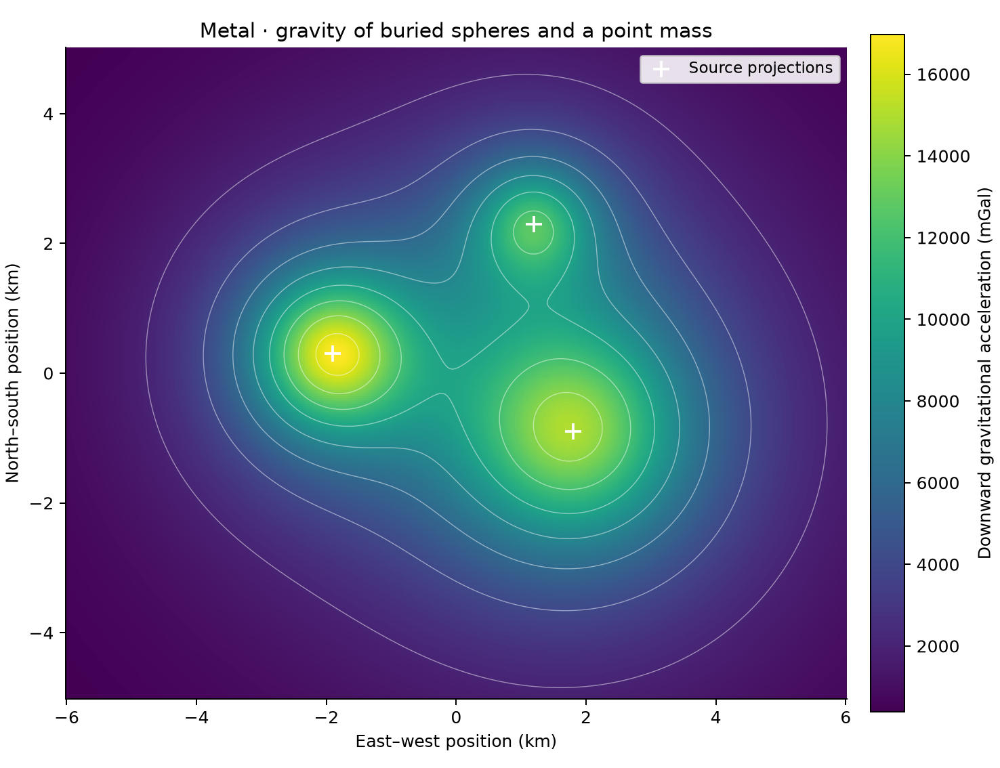

# 01 · Point-mass and sphere gravity

**Paths:** MLX and Metal · **Tests:** 11 (all pass on both paths) · **Benchmarked:** yes

Downward gravitational acceleration (mGal) at the surface over buried spheres and a point mass, computed on the Metal path; crosses mark source projections.

## What was built
Gravitational potential and acceleration of point masses and homogeneous solid spheres (shell theorem: exterior point-mass formula, interior `-GM(3R²-r²)/(2R³)` and `-GM r/R³`) on arbitrary observation grids, with G = 6.67430e-11. The MLX path (`mlx/impl.py`) evaluates the superposition in bounded observation and source chunks using a scaled distance and direction-vector form so the inverse-cube factor neither overflows nor underflows. The Metal path (`metal/kernels/gravity.metal`, Rust driver `metal/src/main.rs`) uses one thread per observation, 64-bit buffer offsets, a scaled norm that separates float32 mantissas from exponents (final `ldexp`), bounded `delta/R` sphere classification, and compensated source summation with fast-math reassociation disabled. Both paths are float32 on the GPU throughout; no CPU float64 step.

## Judge and tolerances
- Oracle: float64 analytic point-mass and shell-theorem sphere formulas, inputs rounded to float32 first, seed 20261028. The judge self-checks surface and centre anchors (-GM/R, -1.5 GM/R) and FD vs analytic to 1e-7.
- `RELATIVE_ERROR = 1e-4` elementwise for nonzero reference values (project-wide float32 rule); `ZERO_SCALE_ERROR = 1e-6` × field scale for exactly-zero components.
- `CROSS_RELATIVE_ERROR = 2e-4`, `CROSS_ZERO_SCALE_ERROR = 2e-6` for MLX vs Metal (two independently rounded outputs).
- `GRADIENT_RELATIVE_ERROR = 1e-3` for the centered-potential-gradient check.
- Review noted that the gradient test finite-differences the *analytic* potential, so it checks the sign convention (g = −∇U) rather than the implementation's own potential; there is no parameter-gradient API, so the project-wide gradient rule does not really apply. It also noted that 1e-4 cannot distinguish CODATA G values (3.3e-5 apart).

## Parity
- Tests: 4/4 MLX passed (`test_analytic[point_grid|sphere|mixed]`, `test_centered_potential_gradient`); 4/4 Metal passed (same set). The 3 MLX-vs-Metal cross-checks are in the 11 locked tests. MLX-vs-Metal cross-checks: 3/3 passed in a separate cross-check run (`CROSS_CHECKS.md`).
- Independent float32 build written during review: max elementwise relative error 3.3e-7 on every case (limit 1e-4); points 0.125 m either side of the sphere surface differ by 3.75e-4, so a misclassified branch fails.
- Bench medium (131,072 observations, 64 sources), max abs error / max reference: MLX 2.36e-07, Metal 1.58e-07.

## Benchmark
Wall time is the median of three calls after one warm-up (`bench/results.json`). Speedup = judge wall time ÷ path wall time at the same size; the judge is a correctness oracle, not a tuned competitor. Metal times include process launch, shader compilation and file I/O on every call, so a floor of roughly 40–60 ms dominates small sizes.

| Size | Problem | Judge | MLX | Metal | MLX vs judge | Metal vs judge |
|---|---|---|---|---|---|---|
| small | observations=16384, sources=64 | 33.0 ms | 7.29 ms | 54.3 ms | 4.53× | 0.607× |
| medium | observations=131072, sources=64 | 257 ms | 15.8 ms | 55.7 ms | 16.3× | 4.63× |
| large | observations=1048576, sources=128 | 4.30 s | 241 ms | 69.9 ms | 17.8× | 61.5× |

| Size | Judge peak mem | MLX peak mem | Metal peak mem |
|---|---|---|---|
| small | 22.0 | 107 | 0.164 |
| medium | 25.7 | 395 | 0.672 |
| large | 76.3 | 5,050 | 0 (child-RSS delta; see note) |

- Peak memory is in MB as recorded by the harness (decimal MB or MiB per the project notes). Memory methods differ by path and are not comparable across columns. Judge: tracemalloc peak during call (includes traced NumPy allocations). MLX: MLX reset_peak_memory/get_peak_memory; process RSS high-water mark separately. Metal: macOS RUSAGE_CHILDREN ru_maxrss high-water delta; bytes converted to MB.
- Medium-size max relative difference vs judge: MLX 2.36e-07, Metal 1.58e-07.

At 134 million interactions (large), Metal is 3.4× faster than MLX even with process startup included, and MLX's chunked broadcast peaks at about 5 GB of allocator memory.

## Known limitations
- MLX materializes observation × source blocks; its large-size allocator peak (5,050 MB) is far above the problem's input/output size.
- Float32 limits remain for extreme inputs (coordinate differences near float32 max, very small intermediates); the scaled-norm formulation pushes these far outside geophysical ranges.
- Source summation order changes with chunking (MLX) and is compensated (Metal), so exactly-zero components agree only to the 1e-6 field-scale allowance.
- Metal peak memory is a child-RSS delta and does not capture GPU allocations.

## Papers
- Newtonian potential of a point mass and the shell theorem (standard analytic results); no additional papers.
