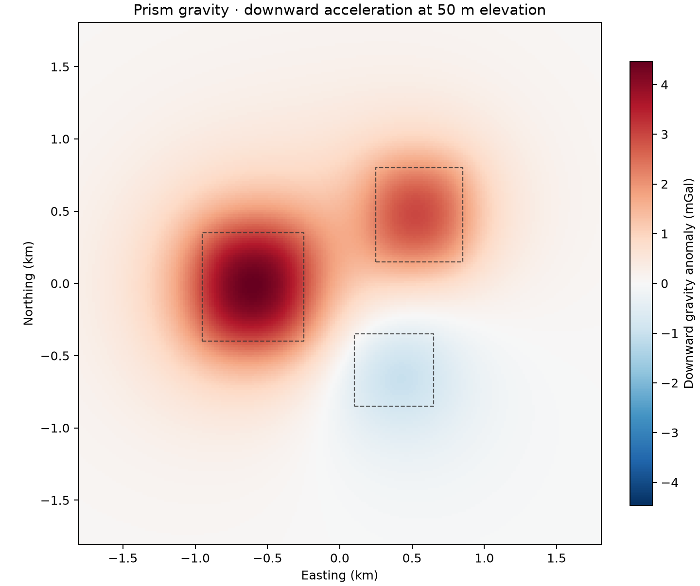

# 02 · Prism gravity

**Paths:** MLX and Metal · **Tests:** 62 (all pass on both paths) · **Benchmarked:** yes

Downward gravity anomaly (mGal) at 50 m elevation over three right rectangular prisms (two positive, one negative density contrast), computed with Metal; dashed boxes are prism outlines.

## What was built
Closed-form gravitational potential and the three acceleration components (east, north, downward g_z) of right rectangular prisms (Nagy et al. 2000 corner-sum formulas with safe log/atan limiting branches at faces, edges and vertices), evaluated in source-local coordinates (corner minus observation) to limit float32 cancellation. The MLX path (`mlx/impl.py`) is built from ordinary MLX ops in `prism_gravity_mlx`, which keeps autodiff through coordinates, prism bounds and density (exercised by the standalone `mlx/check_autodiff.py`, not by the locked tests); the public adapter returns float32 NumPy fields. The Metal path (`metal/kernels/prism.metal`, Rust driver with a local checked NPY reader) runs one thread per observation with 64-bit buffer offsets and fast math disabled through `Gpu::compile`, as required in review. Both paths are float32 on the GPU; no CPU float64 step.

## Judge and tolerances
- Oracle: Harmonica `prism_gravity` v0.7.0 (choclo v0.3.2), float64 outputs from float32-rounded inputs; seed 20261028. Cases: single prism with special points, mixed signed/zero densities, a distance ladder at 2/4/8/16 prism widths, a translation by (16384, −8192, 4096) m, and a gradient case.
- `NEAR_REL = 1e-4` and `TRANSLATION_REL = 1e-4` (group-max-normalized); `CROSS_REL = 2e-4` for MLX vs Metal.
- `DISTANCE_REL = (1e-4, 7e-4, 5e-3, 4e-2)` at 2/4/8/16 widths, with `DISTANCE_CROSS_REL` twice that: the documented far-field loosening for closed-form potential fields (corner-term cancellation grows with distance), set with ≥1.9× margin over the float32 error measured by independent float32 ports.
- `GRADIENT_REL = 1e-3`: implementation g_e, g_n, g_z vs float64 centered differences (2 m step) of the float64 Harmonica potential.
- Judge defects caught in review before lock: (1) the original distance limits (1e-4, 3e-4, 2e-3, 1e-2) rejected a correct float32 closed form at 4/8/16 widths, so they were re-derived from measurement and recorded in `golden/meta.json`; (2) the gradient test finite-differenced the float32 potential and was rounding-dominated (measured 1.0e-3 and 8.5e-4 against a 1e-3 limit), so it was changed to use the float64 FD of the reference potential.

## Parity
- Tests: 19/19 MLX passed and 19/19 Metal passed (`test_reference` single/mixed × 4 fields, `test_translation` × 4, `test_error_vs_distance` × 4, `test_potential_gradient` × 3). The remaining locked tests are MLX-vs-Metal cross-checks and golden checks. MLX-vs-Metal cross-checks: 24/24 passed in a separate cross-check run (`CROSS_CHECKS.md`).
- Independent float32 ports written during review, worst error at 2/4/8/16 widths: numpy 2.6e-5 / 2.3e-4 / 2.2e-3 / 1.6e-2; MLX GPU 2.1e-5 / 3.6e-4 / 2.4e-3 / 1.7e-2. Near field ≤ 2.3e-5 against 1e-4; gradient 7.3e-5 to 7.8e-5 against 1e-3. The per-distance errors of the delivered MLX and Metal paths were not recorded (the test runs record pass/fail only).
- Bench medium (2,048 observations × 512 prisms): MLX 7.45e-05, Metal 5.30e-05.

## Benchmark
Wall time is the median of three calls after one warm-up (`bench/results.json`). Speedup = judge wall time ÷ path wall time at the same size; the judge is a correctness oracle, not a tuned competitor. Metal times include process launch, shader compilation and file I/O on every call, so a floor of roughly 40–60 ms dominates small sizes.

| Size | Problem | Judge | MLX | Metal | MLX vs judge | Metal vs judge |
|---|---|---|---|---|---|---|
| small | observations=256, prisms=256 | 7.53 ms | 3.78 ms | 193 ms | 1.99× | 0.0391× |
| medium | observations=2048, prisms=512 | 114 ms | 10.3 ms | 211 ms | 11.1× | 0.541× |
| large | observations=8192, prisms=800 | n/a (skipped) | 69.8 ms | 235 ms | n/a | n/a |

| Size | Judge peak mem | MLX peak mem | Metal peak mem |
|---|---|---|---|
| small | 0.0552 | 43.8 | 19.1 |
| medium | 0.179 | 743 | 19.5 |
| large | n/a | 1,800 | 19.4 |

- Judge large skipped by the benchmark harness: "Large serial float64 reference may exceed 120 s".
- Peak memory is in MB as recorded by the harness (decimal MB or MiB per the project notes). Memory methods differ by path and are not comparable across columns. Judge: tracemalloc peak during call (Python-tracked allocations). MLX: MLX reset_peak_memory/get_peak_memory, bytes to MiB. Metal: fresh worker RUSAGE_CHILDREN ru_maxrss delta, macOS bytes to MiB.
- Medium-size max relative difference vs judge: MLX 7.45e-05, Metal 5.30e-05.

MLX is the fastest path at every size here; the Metal binary's per-call floor on this project is about 190 ms (startup, shader compile, I/O), so Metal never beats it at these sizes.

## Known limitations
- Far-field accuracy is bounded by float32 cancellation in the corner sums: relative error grows to the 1e-2 level at 16 prism widths. At 8–16 widths the bounds are loose enough that a point-mass shortcut would also pass; the 1e-4 near-field tests pin the physics.
- `test_translation` uses exactly representable coordinates, so it checks invariance, not source-local evaluation of arbitrary coordinates.
- MLX cannot control fast-math flags inside its built-in GPU kernels; the error budget assumes near correctly rounded log/atan.
- The MLX autodiff entry point is checked only by the standalone `check_autodiff.py`, not by the locked tests.
- Judge large size was not run (serial float64 reference), so there is no large-size speedup.

## Papers
- Nagy, Papp, Benedek (2000), The gravitational potential and its derivatives for the prism, J. Geodesy. https://doi.org/10.1007/s001900000116
- Fukushima (2020), Precise and fast computation of the gravitational field of a general finite body, GJI. https://doi.org/10.1093/gji/ggz567
