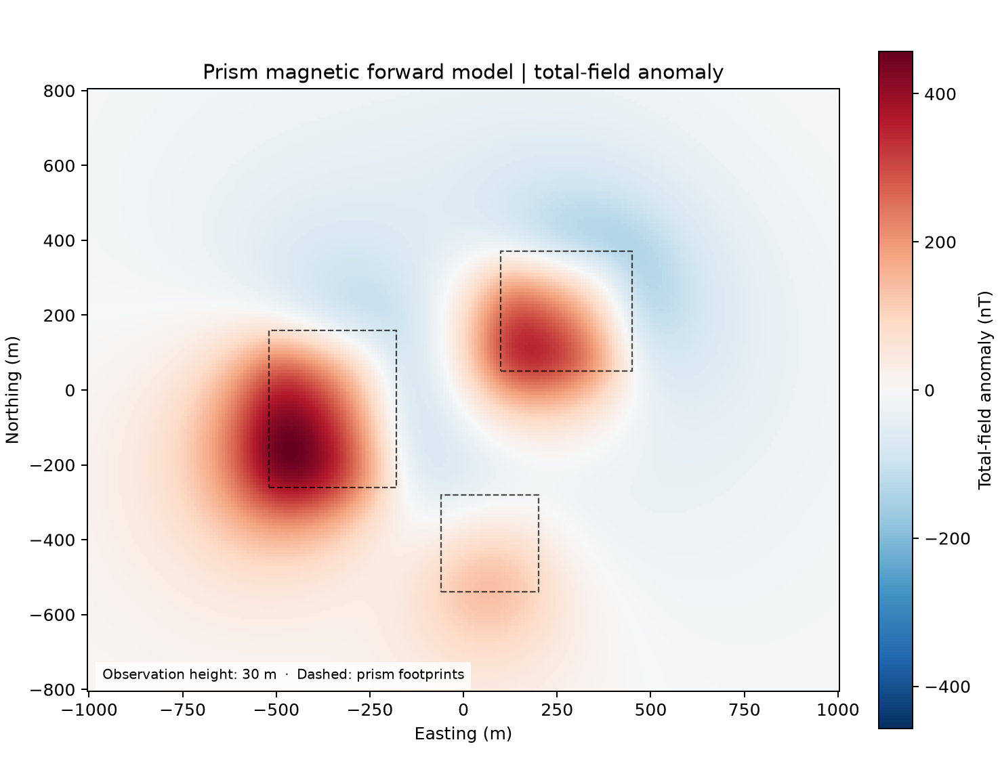

# 03 · Prism magnetic anomaly

**Paths:** MLX and Metal · **Tests:** 30 (all pass on both paths) · **Benchmarked:** yes

Total-field anomaly (nT) at 30 m observation height over three magnetized prisms, computed with Metal; dashed boxes are prism footprints.

## What was built
Closed-form magnetic induction (b_e, b_n, b_u in nT) of uniformly magnetized right rectangular prisms from the analytic second-derivative corner tensor (ee/nn/uu/en/eu/nu kernels with principal-branch arctangents and stable logarithms), evaluated in source-local coordinates, plus the total-field anomaly as the linear projection of the field onto the inducing direction. The MLX path (`mlx/impl.py`) is plain MLX ops with explicit limiting-derivative handling at aligned boundary planes; the Metal path (`metal/kernels/prism.metal` plus Rust driver with checked, fallible buffer allocation) runs one thread per observation with 64-bit offsets and exact mixed-tensor zeros on symmetry midplanes. Both are float32 on the GPU; no CPU float64 step.

## Judge and tolerances
- Oracle: Harmonica 0.7.0 `prism_magnetic(field="b")`, float64, inputs rounded to float32. An independent float64 port matched the goldens to 5e-10; hand check on the axis at 500 m: dipole 20.48 nT vs golden 20.68 nT (finite-size correction).
- `NEAR_REL = 1e-4` (project-wide float32 bound, source-local near/intermediate points); `CROSS_NEAR_REL = 2e-4`.
- `FAR_REL = 2e-2` at 8–12 prism widths (documented far-field allowance for closed-form potential fields: alternating corner terms cancel strongly in float32); `CROSS_FAR_REL = 4e-2`.
- `PROJECTION_REL = 2e-6` for the total-field projection; `ZERO_ABS_NT = 2e-5` nT absolute floor for symmetry zeros.
- Review noted that `FAR_REL` is about 15× above the measured float32 error (≤ 1.3e-3) and loose enough to accept a dipole shortcut (dipole within 0.14% there); the near-field tests carry the physics. It suggested ~5e-3 if tightened later; the bound was not changed.

## Parity
- Tests: 12/12 MLX passed and 12/12 Metal passed (`test_reference_near` single/translated/multiple/axis/zero, `test_reference_far_by_distance` 8/10/12 widths, `test_total_field_projection` × 4). The other 6 locked tests are MLX-vs-Metal cross-checks. MLX-vs-Metal cross-checks: 6/6 passed in a separate cross-check run (`CROSS_CHECKS.md`).
- Independent float32 closed form written during review: near field ≤ 1.2e-5 (MLX GPU) and 9e-6 (numpy) against 1e-4; far field ≤ 1.3e-3 at 8–12 widths. Per-distance far-field errors of the delivered paths were requested in review; the tests do not print them and the test runs record pass/fail only, so those numbers are not available here.
- Bench medium (4,096 observations × 256 prisms): MLX 5.40e-05, Metal 5.79e-05.

## Benchmark
Wall time is the median of three calls after one warm-up (`bench/results.json`). Speedup = judge wall time ÷ path wall time at the same size; the judge is a correctness oracle, not a tuned competitor. Metal times include process launch, shader compilation and file I/O on every call, so a floor of roughly 40–60 ms dominates small sizes.

| Size | Problem | Judge | MLX | Metal | MLX vs judge | Metal vs judge |
|---|---|---|---|---|---|---|
| small | observations=1024, prisms=128 | 27.9 ms | 8.70 ms | 70.7 ms | 3.21× | 0.394× |
| medium | observations=4096, prisms=256 | 222 ms | 16.7 ms | 76.7 ms | 13.3× | 2.89× |
| large | observations=16384, prisms=1024 | n/a (skipped) | 305 ms | 80.2 ms | n/a | n/a |

| Size | Judge peak mem | MLX peak mem | Metal peak mem |
|---|---|---|---|
| small | 0.0994 | 97.0 | 15.8 |
| medium | 0.328 | 768 | 16.0 |
| large | n/a | 5,710 | 16.4 |

- Judge large skipped by the benchmark harness: "16.8 million CPU prism-observation pairs may exceed 120 seconds".
- Peak memory is in MB as recorded by the harness (decimal MB or MiB per the project notes). Memory methods differ by path and are not comparable across columns. Judge: tracemalloc peak during call; maximum of repeats. MLX: MLX reset_peak_memory/get_peak_memory; maximum of repeats. Metal: fresh worker RUSAGE_CHILDREN ru_maxrss delta; macOS bytes; maximum of repeats.
- Medium-size max relative difference vs judge: MLX 5.40e-05, Metal 5.79e-05.

At the large size (16.8 million prism–observation pairs) Metal finishes in 80.2 ms against MLX's 305 ms, and MLX's broadcast intermediates peak at about 5.7 GB.

## Known limitations
- Far-field (8–12 widths) accuracy is only enforced at 2%, well above the measured float32 error; per-distance errors of the delivered paths were not recorded.
- The total field is the linear projection onto the inducing unit vector, not |F+B| − |F|.
- At corners where an arctangent's numerator and denominator both vanish, the geometry derivative is undefined (noted for the MLX path); no gradient API is tested here.
- MLX materializes observation × prism intermediates (5,712 MB allocator peak at large).
- Judge large size skipped, so no large-size speedup vs the reference.

## Papers
- Nagy, Papp, Benedek (2000), prism potential and derivatives. https://doi.org/10.1007/s001900000116
- Fukushima (2020), accuracy of prism field formulas. https://doi.org/10.1093/gji/ggz567
