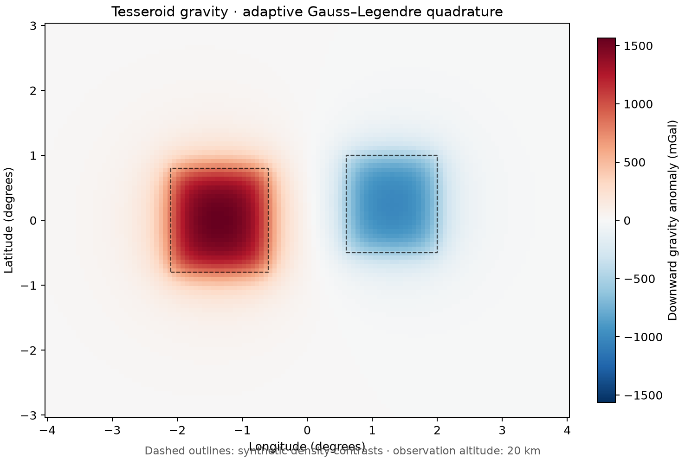

# 04 · Tesseroid gravity

**Paths:** MLX and Metal · **Tests:** 60 (all pass on both paths) · **Benchmarked:** yes

Downward gravity anomaly (mGal) at 20 km altitude over a positive and a negative tesseroid (dashed outlines), computed with adaptive Gauss–Legendre quadrature on Metal.

## What was built
Gravitational potential and downward g_z of spherical-shell elements (tesseroids) by 2-point Gauss–Legendre quadrature with Harmonica-style adaptive discretization: a cell is split (all dimensions halved at once) while distance/size < q, with q = 1 for potential and 2.5 for g_z, optionally with radial adaptation. Both paths use the numerically stable forms the API recommends: haversine for 1 − cos ψ, cell sizes as 2 asin(cos φ_c sin(Δλ/2)), and radial differences relative to the cell mean radius. The MLX path (`mlx/impl.py`) does the subdivision on host snapshots and keeps the quadrature in MLX arrays; it now raises an explicit error when a required split cannot make numerical progress (observation on a source boundary). The Metal path (`metal/kernels/tesseroid.metal`) runs an explicit-stack subdivision per observation–source pair, with compensated summation, and reports stack or float32-midpoint exhaustion instead of returning NaN. Both are float32 on the GPU; no CPU float64 step.

## Judge and tolerances
- Oracle: Harmonica 0.7.0 `tesseroid_gravity` in float64 at matched discretization settings, plus a pre-refined float64 Harmonica reference to check the adaptive scheme itself. Cases: near, mixed signed sources, a 10 km to 10,000 km distance ladder, each with and without radial adaptation, for potential and g_z.
- `MATCHED_REL = 1e-4` against the matched-settings judge (project-wide float32 bound); `CROSS_REL = 1e-4` MLX vs Metal.
- `FINE_REL = 3e-3` against the refined reference: adaptive GLQ is itself approximate; measured float64 matched-vs-refined error is at most 2.0e-3 (`mixed` potential), so 1.5× margin.
- Judge defects caught in review before lock: (1) the goldens were not float64: float32 inputs made Harmonica's numba kernel compute in float32, shifting values by up to 4.4e-3 (`near` g_z), so a correct float64-faithful implementation would have failed; fixed by promoting inputs to float64. (2) One split decision sat on the threshold (relative gap 2.3e-11), making the case ill-posed in float32; the `mixed` observation was moved to longitude 20.13° (margin now 3.3e-2 for that case, 4.3e-4 globally) and the generator asserts margin > 1e-4. (3) Harmonica internals an implementation needs were made explicit in the API docstring.

## Parity
- Tests: 24/24 MLX passed and 24/24 Metal passed (`test_matched` and `test_refined_reference`, each over radial/horizontal × potential/g_z × near/mixed/distance). The other 12 locked tests are MLX-vs-Metal cross-checks and golden checks. MLX-vs-Metal cross-checks: 12/12 passed in a separate cross-check run (`CROSS_CHECKS.md`).
- Independent stable float32 port written during review: ≤ 1.8e-6 per point vs matched (limit 1e-4), ≤ 2.0e-3 vs refined (limit 3e-3), across 10 km to 10,000 km. A literal-formula float32 port misses by 2.8e-4 to 5.9e-3 and correctly fails. The per-point distance errors printed under `pytest -s` were not recorded.
- Bench medium: MLX 3.73e-07, Metal 3.02e-07.

## Benchmark
Wall time is the median of three calls after one warm-up (`bench/results.json`). Speedup = judge wall time ÷ path wall time at the same size; the judge is a correctness oracle, not a tuned competitor. Metal times include process launch, shader compilation and file I/O on every call, so a floor of roughly 40–60 ms dominates small sizes.

| Size | Problem | Judge | MLX | Metal | MLX vs judge | Metal vs judge |
|---|---|---|---|---|---|---|
| small | observations=8, sources=1 | 0.523 ms | 3.80 ms | 69.6 ms | 0.137× | 0.00751× |
| medium | observations=64, sources=2 | 0.707 ms | 45.1 ms | 68.8 ms | 0.0157× | 0.0103× |
| large | observations=256, sources=4 | 1.91 ms | 373 ms | 76.4 ms | 0.00514× | 0.0251× |

| Size | Judge peak mem | MLX peak mem | Metal peak mem |
|---|---|---|---|
| small | 4.82 | 0.0238 | 0.180 |
| medium | 4.82 | 0.161 | 0 (child-RSS delta; see note) |
| large | 4.84 | 1.36 | 0 (child-RSS delta; see note) |

- Peak memory is in MB as recorded by the harness (decimal MB or MiB per the project notes). Memory methods differ by path and are not comparable across columns. Judge: tracemalloc peak Python allocations during call. MLX: MLX reset_peak_memory/get_peak_memory; process peak RSS also reported. Metal: RUSAGE_CHILDREN ru_maxrss high-water delta (macOS bytes).
- Medium-size max relative difference vs judge: MLX 3.73e-07, Metal 3.02e-07.

The benchmark sizes are tiny (8, 128 and 1,024 observation–source pairs), so these rows mostly measure per-call overhead: Harmonica's compiled numba kernel is fastest at every size, and neither GPU path wins.

## Known limitations
- Observations on a source boundary can require unbounded subdivision; both paths now fail with an explicit error instead of a value.
- MLX derivatives (if used) apply to the selected mesh and jump at split decisions; MLX autodiff through the host-side subdivision is unverified, and no gradient is tested.
- Benchmark sizes are too small to show GPU throughput; no size exercised a large tesseroid model.
- Figure: the footer caption slightly overlaps the x-axis label.

## Papers
- Uieda, Barbosa, Braitenberg (2016), Tesseroids: forward-modeling gravitational fields in spherical coordinates, Geophysics (adaptive discretization used by Harmonica).
- Harmonica documentation for `tesseroid_gravity` (oracle only).
