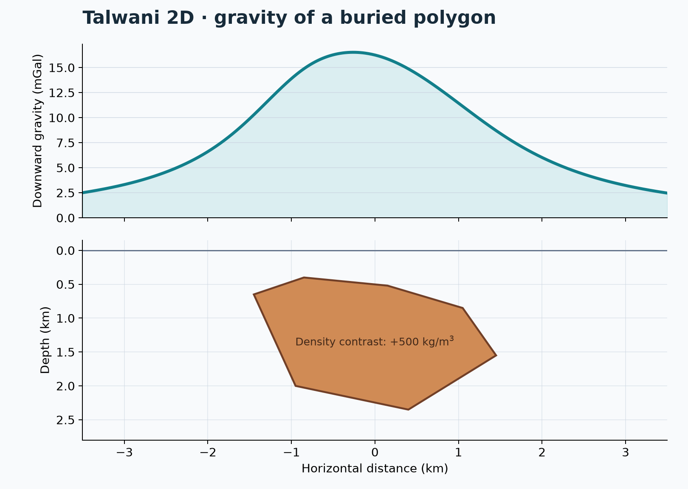

# 05 · Talwani 2D polygon gravity

**Paths:** MLX and Metal · **Tests:** 23 (all pass on both paths) · **Benchmarked:** yes

Downward gravity (mGal, top) along a profile over a buried 2D polygon with +500 kg/m³ density contrast (bottom), computed with Metal.

## What was built
Gravity g_z (mGal, positive down) of infinitely long 2D polygonal bodies by the Talwani line-integral method in the Won and Bevis edge form, `cross/|e|² · (2·dx·angle − dz·log(r_end²/r_start²))` per edge, with a per-edge signed `atan2(cross, dot)` angle and the overall sign fixed by the polygon's signed area, so either winding and concave bodies (observation below the source) work. The MLX path (`mlx/impl.py`) evaluates bounded observation × edge tiles (≤ 65,536 pairs) under `mx.checkpoint` so autodiff through density and geometry is memory-bounded, handles vertex-coincident edges, and returns exact zeros for zero density. The Metal path (`metal/kernels/gravity.metal`) uses one thread per observation, compensated accumulation, short-edge quadrature, and a finite edge-average limit when an observation coincides with a vertex. Both are float32 on the GPU; no CPU float64 step.

## Judge and tolerances
- Oracles: analytic infinite horizontal cylinder (inscribed 1024-gon), exact finite-width slab, a finite-strike Harmonica rectangular prism cross-checked against area quadrature to 1e-7, and independent 96-point triangle quadrature for general convex/concave polygons (Harmonica 0.7.0 has no polygonal prism). Also reversed winding, translation and zero density.
- `RELATIVE_ERROR = 1e-4` (max-normalized per case; project-wide float32 bound); `CROSS_PATH_RELATIVE_ERROR = 2e-4`; `ZERO_ABSOLUTE_ERROR_MGAL = 0.0` (zero density must give exact zero).
- Judge defect caught in review before lock: the `slab` golden was the *infinite*-slab value for a polygon of half-width 1e7 m. Truncation alone used 7.32e-5 of the budget, and float32 cannot resolve the end-edge radius ratio at that scale, so a correct float32 Talwani measured −1.47e-4 and failed. Fixed by testing a 100 km half-width rectangle against its exact finite-width value (6.244329 mGal); the infinite-slab limit 2πGρt stays as a judge-side assertion (within 7.3e-5 at 10,000 km).

## Parity
- Tests: 8/8 MLX passed and 8/8 Metal passed (`test_reference` on rectangle, slab, cylinder, polygon, polygon_reversed, polygon_translated, concave; `test_zero_density`). The 7 MLX-vs-Metal cross-checks are among the 23 locked tests. MLX-vs-Metal cross-checks: 7/7 passed in a separate cross-check run (`CROSS_CHECKS.md`).
- Independent float32 Talwani written during review, after the fix: slab −8.9e-6 (numpy) and −9.2e-6 (MLX GPU); ≤ 2.1e-7 on rectangle, polygon, reversed, translated and concave; 6.8e-6 on the cylinder (mostly the 1024-gon vs circle area deficit, 6.3e-6); exactly 0 for zero density.
- Bench medium: MLX 5.54e-07, Metal 2.20e-07.

## Benchmark
Wall time is the median of three calls after one warm-up (`bench/results.json`). Speedup = judge wall time ÷ path wall time at the same size; the judge is a correctness oracle, not a tuned competitor. Metal times include process launch, shader compilation and file I/O on every call, so a floor of roughly 40–60 ms dominates small sizes.

| Size | Problem | Judge | MLX | Metal | MLX vs judge | Metal vs judge |
|---|---|---|---|---|---|---|
| small | vertices=16, observations=512, quadrature_order=96 | 925 ms | 1.87 ms | 52.0 ms | 496× | 17.8× |
| medium | vertices=32, observations=512, quadrature_order=96 | 1.88 s | 1.30 ms | 51.5 ms | 1,450× | 36.5× |
| large | vertices=128, observations=65536, quadrature_order=96 | n/a (skipped) | 80.4 ms | 50.7 ms | n/a | n/a |

| Size | Judge peak mem | MLX peak mem | Metal peak mem |
|---|---|---|---|
| small | 0.981 | 0.626 | 0 (child-RSS delta; see note) |
| medium | 0.981 | 1.24 | 0.469 |
| large | n/a | 10.6 | 0.0312 |

- Judge large skipped by the benchmark harness: "96-point per-triangle area quadrature is expected to exceed 120 seconds".
- Peak memory is in MB as recorded by the harness (decimal MB or MiB per the project notes). Memory methods differ by path and are not comparable across columns. Judge: tracemalloc peak during call (MiB). MLX: MLX mx.get_peak_memory after reset (MiB); process RSS high-water separately. Metal: RUSAGE_CHILDREN ru_maxrss high-water delta per call (MiB, macOS).
- Medium-size max relative difference vs judge: MLX 5.54e-07, Metal 2.20e-07.

The benchmark judge is the independent 96-point-per-triangle area quadrature, not a closed-form Talwani, so the very large speedups (MLX 1,450× at medium) mostly reflect how expensive that reference is.

## Known limitations
- At a sharp vertex the forward value is a finite limit, but spatial derivatives need not be finite; locked tests use exterior points away from edges.
- Float32 still cannot resolve very distant or nearly degenerate edges (the original 20,000 km slab is the example).
- MLX reverse-mode memory still grows with problem size; checkpointing trades recomputation for storage. No gradient is tested by the locked suite.
- No large-size judge timing (quadrature reference skipped), so no large-size speedup.

## Papers
- Talwani, Worzel, Landisman (1959), rapid gravity computations for two-dimensional bodies, JGR.
- Won and Bevis (1987), computing the gravitational and magnetic anomalies due to a polygon, Geophysics (edge form used).
