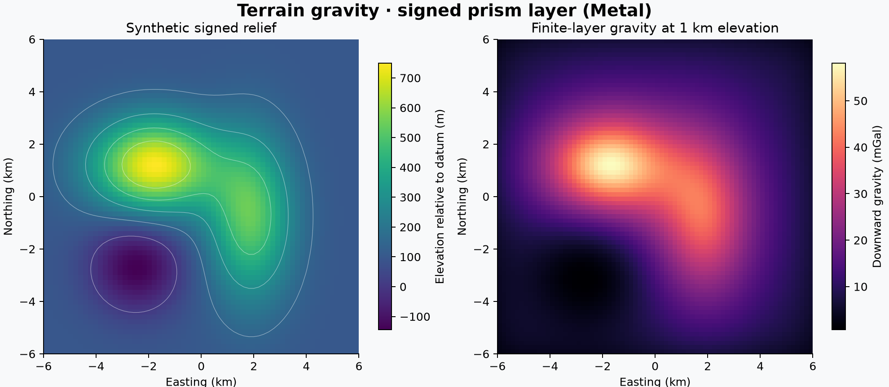

# 06 · Terrain and Bouguer correction

**Paths:** MLX and Metal (Metal for the heavy prism sum, MLX for the pipeline; both paths implement the full function) · **Tests:** 21 (all pass on both paths) · **Benchmarked:** yes

The figure has two panels: the synthetic signed relief relative to the datum (left), and the downward gravity of the matching signed finite prism layer at 1 km elevation, computed with Metal (right).

## What was built
Terrain and Bouguer corrections from a gridded DEM.
- **Layer.** Each cell becomes a prism between the reference surface and the topography: bottom = min, top = max, and density signed by sign(surface − reference). Zero-thickness cells are dropped. The layer's g_z is summed at each observation.
- **Slab.** The simple Bouguer slab 2πGρh is taken at the observation's nearest cell centre.
- **Terrain.** `terrain_gz = layer_gz − slab_gz` is a single float32 subtraction. The correction added to observed gravity is −layer.

Both paths evaluate prisms the same way:
- **Close prisms** use the closed-form prism kernel in source-local corners.
- **Distant prisms** are those whose Euclidean gap is at least 2 cell widths. They use a 6×6 horizontal Gauss–Legendre rule with the vertical integral done analytically in rationalised form, `1/ra − 1/rb = h(a+b)/(ra·rb·(ra+rb))`, which avoids corner cancellation.

The paths differ in a few details:
- **MLX** (`mlx/impl.py`) evaluates this for all observation–cell pairs and keeps the inputs differentiable.
- **Metal** (`metal/kernels/terrain.metal`) used to switch to quadrature only beyond 64 widths. It now switches at 2 widths, which covers every prism at all four benchmark altitudes. Its thin-prism branch (h < 0.001·w) uses the same analytic vertical integral, with up to 32 horizontal tiles per axis. It sums the layer in a compensated, stable order.

Both paths compute in float32 on the GPU, with no CPU float64 step.

## Judge and tolerances
- **Oracle:** Harmonica 0.7.0 `prism_layer(...).gravity(field="g_z")` in float64, with signed density. The cases are terrain, depression and flat, plus a benchmark-regime fixture. That fixture reproduces `bench/run_bench.py` medium inputs exactly (64×64 cells of 200 m, 256 seeded points) and evaluates them at 700, 1400, 3000 and 8000 m. An independent float64 layer written during review agrees to 4e-8.
- **Tolerances** (unchanged when the benchmark-regime fixture was added):
  - `NEAR_RTOL = 1e-4`: 500–900 m and the 700 m benchmark group.
  - `FAR_RTOL = 1e-3`: 1400 m and above; float32 corner cancellation grows with distance (documented far-field allowance for closed-form potential fields).
  - `ABS_MGAL = 2e-5` mGal floor, on the pointwise cases only.
  - `SLAB_RTOL = 2e-6`.
  - `ALGEBRA_ATOL = 2e-6` mGal.
- **Original fixtures:** an independent float32 layer measured thin margins, about 2× near and 2.7× far.
- **Benchmark-regime fixture.** The first benchmark showed Metal at 1.37e-3, so a benchmark-regime fixture was added to the locked tests. In that regime each observation sums 4096 prisms, mostly 10–90 widths away. A plain float32 closed form fails it at:

  | Backend | 700 m | 1400 m | 3000 m | 8000 m |
  |---|---|---|---|---|
  | NumPy float32 | 1.1e-3 | 1.2e-3 | 3.7e-3 | 4.7e-3 |
  | MLX GPU closed form | 1.1e-3 | 1.4e-3 | 2.2e-3 | 5.6e-3 |

  The stable quadrature scheme reaches at most 2.6e-7 on every output at every altitude, a margin of at least 380×. Review noted that the 1e-3 limit above 700 m is loose for a stable scheme, so the 700 m group at 1e-4 and the original pointwise tests carry the load.

## Parity
- **Tests:** 7/7 MLX and 7/7 Metal passed: `test_reference` on terrain, depression and flat, and `test_benchmark_reference` at 700, 1400, 3000 and 8000 m. MLX was re-tested against the updated judge.
- **Cross-checks:** 7/7 MLX-vs-Metal cross-checks passed in a follow-up cross-check run after the fixture was added (`CROSS_CHECKS.md`). This replaces the 3/3 from the first run.
- **Independent check during review:** the stable float32 scheme scores at most 2.6e-7 on `layer_gz`, `terrain_gz`, `correction_gz` and `slab_gz` (slab 9.5e-8) on the benchmark-regime fixture.
- **Bench medium, max over the four outputs:** MLX 2.62e-07, Metal 2.40e-07. Metal was 1.37e-03 before the quadrature switch moved to 2 widths.
- **Large size (128×128, 512 observations):** parity is not recorded. The benchmark reports medium only, and the large grid is not a locked fixture. The argument that the stable branch covers every large-size prism is geometric, not measured.

## Benchmark
Wall time is the median of three calls after one warm-up (`bench/results.json`). Speedup = judge wall time ÷ path wall time at the same size; the judge is a correctness oracle, not a tuned competitor. Metal times include process launch, shader compilation and file I/O on every call, so a floor of roughly 40–60 ms dominates small sizes.

| Size | Problem | Judge | MLX | Metal | MLX vs judge | Metal vs judge |
|---|---|---|---|---|---|---|
| small | nx=32, ny=32, observations=80 | 7.97 ms | 5.26 ms | 52.7 ms | 1.52× | 0.151× |
| medium | nx=64, ny=64, observations=256 | 68.8 ms | 17.1 ms | 87.4 ms | 4.02× | 0.787× |
| large | nx=128, ny=128, observations=512 | 536 ms | 160 ms | 235 ms | 3.35× | 2.28× |

| Size | Judge peak mem | MLX peak mem | Metal peak mem |
|---|---|---|---|
| small | 0.230 | 99.1 | 0.0781 (abs. child RSS 16.1) |
| medium | 0.792 | 1,270 | 0 (abs. child RSS 16.1) |
| large | 3.01 | 3,840 | 0 (abs. child RSS 16.4) |

- Peak memory is in MB as recorded by the harness (decimal MB or MiB per the project notes). Memory methods differ by path and are not comparable across columns. Judge: tracemalloc peak during timed repeats; excludes native allocations. MLX: MLX peak allocator after reset; process_peak_rss_mb is lifetime RSS high-water. Metal: RUSAGE_CHILDREN ru_maxrss high-water delta after warmup; child_peak_rss_mb is cumulative.
- Medium-size max relative difference vs judge: MLX 2.62e-07, Metal 2.40e-07.

At large, MLX is the fastest path (160 ms, 3.35× the judge). Metal is 235 ms (2.28×). Metal was 164 ms with the old closed-form branch, so the stable quadrature costs Metal time at this size.

## Known limitations
- Large-size parity is unmeasured. Errors of a closed-form-based scheme grow with distance, and the large grid reaches about 36 km.
- Metal's thin-prism quadrature is capped at 32 tiles per axis, so accuracy may degrade extremely close above a thin prism. Extreme float32 coordinate scales can over- or underflow intermediates. Neither regime is in the locked cases.
- MLX evaluates every observation–cell pair, so work and memory grow with all pairs.
- Above 700 m, the 1e-3 limit would not catch a 1e-4-level quadrature defect (noted in review; accepted under the documented far-field allowance for closed-form potential fields).
- In the figure, the x-axis labels sit at the bottom edge of the image.

## Papers
- Nagy, Papp, Benedek (2000), prism gravity closed form. https://doi.org/10.1007/s001900000116
- Fukushima (2020), prism field accuracy. https://doi.org/10.1093/gji/ggz567
