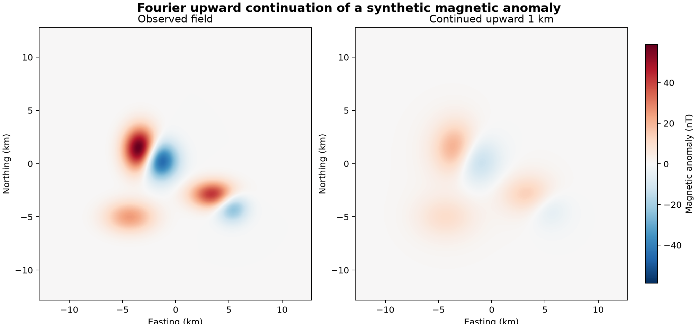

# 07 · FFT potential-field filters

**Paths:** MLX only · **Tests:** 12 (all pass) · **Benchmarked:** yes (upward continuation)

A synthetic magnetic anomaly (left) and the same field continued upward by 1 km with the MLX FFT filter (right).

## What was built
Wavenumber-domain filters for gridded potential-field data: upward continuation `exp(−|k|h)`, vertical derivative `|k|`-type filter, reduction to the pole (the full dipole factor `|k|² / ((f_z|k| + i f·k_h)(m_z|k| + i m·k_h))` with F(0) = 0), and the tilt angle `arctan2(dz, hypot(dE, dN))` with centered horizontal differences. The MLX path (`mlx/impl.py`) builds wavenumbers and parameter-dependent filters in MLX (a safe zero-frequency branch; zero horizontal derivative on a singleton axis), applies them with the MLX GPU FFT as `Re(ifft(F·G))`, and keeps parameters differentiable. Periodic grid, no padding or taper, matching Harmonica's `apply_filter`. Float32 on the GPU; no CPU float64 step.

## Judge and tolerances
- Oracle: Harmonica 0.7.0 filters (`upward_continuation`, derivative upward, `reduction_to_pole`, tilt via `xarray.differentiate`), float64, no padding. In review, the Harmonica source was read and the RTP kernel re-derived from the dipole field, confirming it is the physically correct RTP.
- `REFERENCE_RELATIVE = 1e-4`: max absolute error normalized by the interior reference peak (project-wide float32 limit).
- `EDGE_BAND = 2` cells excluded at the original grid boundary for all transformations (this also excludes tilt's one-sided edge differences, which are documented but untested).
- Cases: localized (non-periodic ramp, so parity with periodic wraparound rather than physical accuracy), periodic, rough; dx ≠ dy everywhere so transposed axes fail.

## Parity
- Tests: 12/12 MLX passed (`test_harmonica` for upward, vertical, rtp, tilt × localized, periodic, rough).
- Independent float32 implementation written during review (scipy complex64 FFT): interior error upward ≤ 1.7e-7, rtp ≤ 2.8e-7, vertical ≤ 1.1e-6, tilt ≤ 2.3e-5 (tilt is the thin case: minimum total gradient 6.6e-5 against a peak of 8.2e-3 in `localized`). The test run records pass/fail only, not the MLX path's per-case errors.
- Bench medium (2048×2048 upward continuation, full grid, normalized by reference max): MLX 9.33e-07.

## Benchmark
Wall time is the median of three calls after one warm-up (`bench/results.json`). Speedup = judge wall time ÷ path wall time at the same size; the judge is a correctness oracle, not a tuned competitor. Metal times include process launch, shader compilation and file I/O on every call, so a floor of roughly 40–60 ms dominates small sizes.

| Size | Problem | Judge | MLX | MLX vs judge |
|---|---|---|---|---|
| small | ny=768, nx=768 | 22.9 ms | 2.05 ms | 11.2× |
| medium | ny=2048, nx=2048 | 156 ms | 4.97 ms | 31.4× |
| large | ny=8192, nx=8192 | 3.03 s | 68.4 ms | 44.3× |

| Size | Judge peak mem | MLX peak mem |
|---|---|---|
| small | 63.1 | 50.1 |
| medium | 448 | 356 |
| large | 7,170 | 9,280 |

- Metal: n/a, no Metal path was benchmarked for this project (MLX-only project).
- Peak memory is in MB as recorded by the harness (decimal MB or MiB per the project notes). Memory methods differ by path and are not comparable across columns. Judge: tracemalloc peak during a separate call, including NumPy allocations. MLX: MLX peak active memory during a separate call.
- Medium-size max relative difference vs judge: MLX 9.33e-07.

The benchmark times upward continuation only. At 8192×8192, MLX takes 68.4 ms against Harmonica's 3.03 s (44×), including conversion of the output to NumPy.

## Known limitations
- No padding or taper: results inherit periodic wraparound, so non-periodic data need the edge band or user padding.
- Tilt is ill-conditioned where the total gradient is near zero; a zero total gradient is outside the API contract.
- Only upward continuation is benchmarked; RTP, derivative and tilt costs are not measured.
- Gradients through the MLX FFT and complex RTP are available but untested.
- Figure: the x-axis labels are clipped at the bottom edge of the image.

## Papers
- Blakely (1995), Potential Theory in Gravity and Magnetic Applications (Fourier-domain continuation, derivatives and RTP).
- Harmonica 0.7.0 filter documentation (oracle only).
