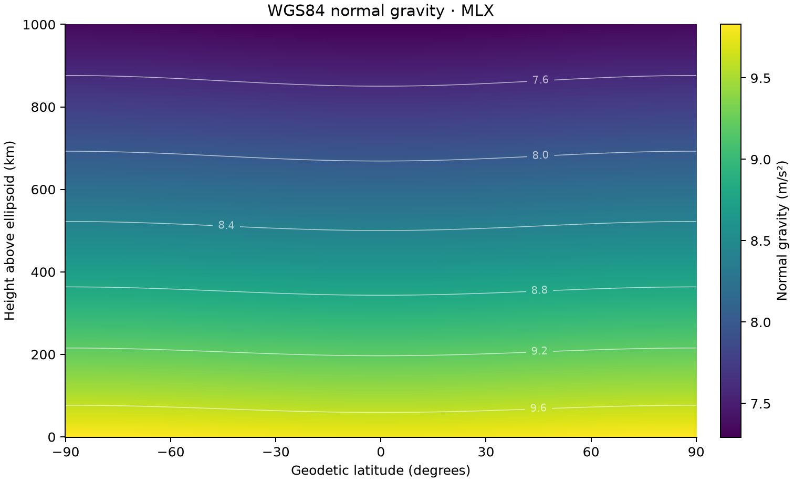

# 08 · Normal gravity on the reference ellipsoid

**Paths:** MLX only · **Tests:** 3 (all pass) · **Benchmarked:** yes

WGS84 normal gravity (m/s²) as a function of geodetic latitude and height from 0 to 1000 km, evaluated with MLX.

## What was built
Closed-form WGS84 normal gravity at any exterior height (h ≥ 0), following Hofmann-Wellenhof & Moritz (2006) eq. 2-126 (equivalently Li & Götze 2001): geodetic (lat, h) → Cartesian → ellipsoidal-harmonic (u, β), returning the signed u component γ_u with the centrifugal term included. The MLX path (`mlx/impl.py`) normalizes coordinates before squaring (so very large heights do not overflow), evaluates q′(u) with a series in 1/x² instead of the cancelling `3(1+x²)(1 − x·atan(1/x)) − 1`, and handles the equatorial sign change of γ_u near 35,786 km with a local first-order expansion around a precomputed root. Precision: per-point bulk compute is float32 on the GPU. Model constants (q0, the series coefficients, and the equatorial root and slope, found by bisection) are computed once on the host in Python float64 and cast to float32 constants; the root is split into hi/lo float32 parts. This is the isolated constant precomputation that review showed is necessary (direct float32 q0 and q′ fail the orbital case at 3.8e-4).

## Judge and tolerances
- Oracle: Boule 0.6.0 WGS84 `normal_gravity` in float64, inputs float32-quantized first; cases surface, near-Earth and orbital. An independent float64 re-implementation matched all goldens to ≤ 1.5e-12; surface equator/pole values 9.7803253359 and 9.8321849379 m/s² are the standard WGS84 numbers.
- `GRAVITY_RELATIVE = 1e-4`: pointwise relative error vs Boule (project-wide float32 rule; references bounded away from zero, minimum 0.43 m/s²).
- `SURFACE_SANITY_ABSOLUTE = 1e-9` m/s² for the published WGS84 surface values.
- Documented physics note (raised in review): Boule returns γ_u, the ellipsoidal-harmonic **u component**, not |∇U|. They agree to 2e-6 for h ≤ 1e7 m but differ by 9.7e-3 (about 1%) at 45°, 20,000 km. The API states the u component explicitly, so an implementation returning the magnitude would fail `orbital`; if "normal gravity at any height" was meant as the magnitude, the orbital fixture and contract would need to change. The contract also narrows "any height" to exterior points.
- Gravity-disturbance precision is not certified by the 1e-4 total-gravity tolerance: float32 spacing near the surface is about 1e-6 m/s² (0.1 mGal), as the Pass line allows ("precision documented").

## Parity
- Tests: 3/3 MLX passed (`test_boule_parity` surface, near_earth, orbital).
- Independent float32 simulations run during review: direct evaluation fails orbital at 3.8e-4; with float64-precomputed q0 plus a stable q′ series, ≤ 3e-7 everywhere. Wrong implementations (geocentric latitude 6.7e-3, no q′ term 3.5e-3, |∇U| at orbit 9.7e-3) fail by > 10×. The test run records pass/fail only.
- Bench medium (16 × 1,048,576 points, heights 0–2000 km): MLX 8.64e-07.

## Benchmark
Wall time is the median of three calls after one warm-up (`bench/results.json`). Speedup = judge wall time ÷ path wall time at the same size; the judge is a correctness oracle, not a tuned competitor. Metal times include process launch, shader compilation and file I/O on every call, so a floor of roughly 40–60 ms dominates small sizes.

| Size | Problem | Judge | MLX | MLX vs judge |
|---|---|---|---|---|
| small | points_per_batch=1048576, batches=1 | 60.7 ms | 3.99 ms | 15.2× |
| medium | points_per_batch=1048576, batches=16 | 1.03 s | 44.2 ms | 23.3× |
| large | points_per_batch=1048576, batches=128 | 8.35 s | 289 ms | 28.8× |

| Size | Judge peak mem | MLX peak mem |
|---|---|---|
| small | 120 | 142 |
| medium | 128 | 142 |
| large | 128 | 142 |

- Metal: n/a, no Metal path was benchmarked for this project (MLX-only project).
- Peak memory is in MB as recorded by the harness (decimal MB or MiB per the project notes). Memory methods differ by path and are not comparable across columns. Judge: tracemalloc peak allocated bytes during a separate run. MLX: MLX peak allocated bytes during a separate run; process RSS is lifetime high-water mark.
- Medium-size max relative difference vs judge: MLX 8.64e-07.

Memory is flat across sizes because each size repeats the same 1,048,576-point batch (memory measured in a separate run). At 128 batches MLX is 29× faster than Boule (289 ms vs 8.35 s).

## Known limitations
- Near signed-gravity zeros at nonzero latitude (outside the 64 m equatorial expansion interval) float32 subtraction loses relative accuracy; the locked fixtures do not exercise these.
- Interior points (h < 0) are outside the contract.
- Gravity disturbances formed by subtracting float32 totals lose precision (≈0.1 mGal spacing).
- Returns γ_u, not |∇U| (≈1% different at 20,000 km).

## Papers
- Hofmann-Wellenhof and Moritz (2006), Physical Geodesy, eq. 2-113 and 2-126.
- Li and Götze (2001), ellipsoid, geoid, gravity, geodesy and geophysics, Geophysics.
- Boule 0.6.0 (oracle only).
