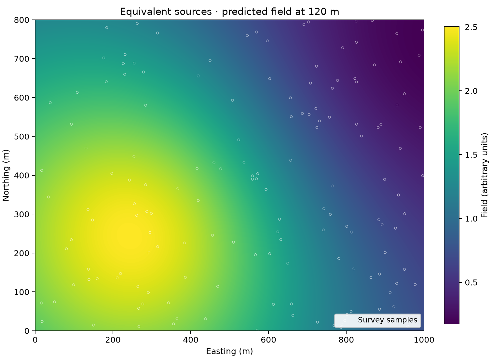

# 09 · Equivalent sources

**Paths:** MLX and Metal · **Tests:** 12 (all pass on both paths) · **Benchmarked:** yes (standard damped fit)

Field predicted at 120 m on a regular grid by an equivalent-source fit (100 sources) to 1,200 scattered synthetic survey samples (circles), computed with Metal.

## What was built
Equivalent-source gridding with point sources and a 1/r kernel, in both the standard fit and the gradient-boosted variant. The fit is the weighted ridge objective in scaled coordinates (Jacobian columns divided by their unweighted ddof=0 standard deviation about the column mean, c = S⁻¹β, no intercept); the boosted variant processes the supplied windows in order, rescaling and damping per window and updating the full residual after each. The MLX path (`mlx/impl.py`) solves damped fits by a Householder QR graph on the GPU and, for undamped or rank-deficient fits, an MLX SVD pseudoinverse on the CPU stream (float32) with a registered Moore–Penrose VJP so `mx.grad` works through the solve. The Metal path (`metal/kernels/equivalent.metal`) builds the Jacobian and right-hand side in parallel kernels but solves with an augmented QR (damped) or one-sided Jacobi SVD (undamped) in a single GPU thread, then predicts in parallel. All float32; no float64 step. (The MLX SVD runs on the CPU stream because that MLX primitive is CPU-only; it is float32 and is not used by any locked case or the benchmark, all of which are damped.)

## Judge and tolerances
- Oracle: Harmonica `EquivalentSources` and `EquivalentSourcesGB`, float64, same source layout, damping and seed; window membership and processing order are explicit input arrays taken from the fitted Harmonica model and replayed by the judge to 1e-10.
- `GRID_REL_ERR = 1e-3` (the project's specified allowance for this regularized inverse problem: float32 least squares and sequential boosted updates accumulate error); `CROSS_PATH_REL_ERR = 1e-3`.
- Judge defects caught in review before lock: (1) the boosted cases depended on verde's `rolling_window` and sklearn's legacy MT19937 shuffle, which neither path could reproduce (order changed predictions by 1.5e-2 to 3.9e-2), so membership and order became inputs; (2) the column-scaling statistic was ambiguous, and the natural "RMS" reading failed at 1.4e-2; (3) the fitted objective was not written down. All three were fixed before lock.

## Parity
- Tests: 4/4 MLX passed and 4/4 Metal passed (`test_prediction_matches_harmonica` on standard_weak, standard_damped, boosted_seed7, boosted_seed19); 4 cross-path tests among the 12 locked. MLX-vs-Metal cross-checks: 4/4 passed in a separate cross-check run (`CROSS_CHECKS.md`).
- Independent float32 replay run during review: 1.2e-5 to 3.0e-5 (boosted) and 1.3e-7 (float32 least squares) against 1e-3; float32 normal equations + Cholesky would reach 1.6e-4 to 1.9e-4; processing windows in reverse fails at 4.6e-2 to 7.1e-2. The test run records pass/fail only.
- Bench medium (2,048 observations, 160 sources, 4,096 predictions): MLX 1.59e-07, Metal 1.56e-06.

## Benchmark
Wall time is the median of three calls after one warm-up (`bench/results.json`). Speedup = judge wall time ÷ path wall time at the same size; the judge is a correctness oracle, not a tuned competitor. Metal times include process launch, shader compilation and file I/O on every call, so a floor of roughly 40–60 ms dominates small sizes.

| Size | Problem | Judge | MLX | Metal | MLX vs judge | Metal vs judge |
|---|---|---|---|---|---|---|
| small | observations=768, sources=64, evaluation=1024 | 2.86 ms | 11.2 ms | 243 ms | 0.255× | 0.0118× |
| medium | observations=2048, sources=160, evaluation=4096 | 3.69 ms | 18.3 ms | 6.64 s | 0.202× | 0.000555× |
| large | observations=4096, sources=320, evaluation=16384 | 14.1 ms | 55.2 ms | 47.4 s | 0.255× | 0.000298× |

| Size | Judge peak mem | MLX peak mem | Metal peak mem |
|---|---|---|---|
| small | 1.24 | 14.9 | 0 (child-RSS delta; see note) |
| medium | 7.87 | 94.1 | 0.156 |
| large | 31.2 | 365 | 0 (child-RSS delta; see note) |

- Peak memory is in MB as recorded by the harness (decimal MB or MiB per the project notes). Memory methods differ by path and are not comparable across columns. Judge: tracemalloc peak during call; excludes untracked native allocations. MLX: MLX reset_peak_memory/get_peak_memory; process RSS high-water also reported. Metal: RUSAGE_CHILDREN ru_maxrss high-water delta, macOS bytes; may be zero after earlier larger children.
- Medium-size max relative difference vs judge: MLX 1.59e-07, Metal 1.56e-06.

The Metal QR solve runs in one GPU thread (`if (tid != 0) return;`), so Metal time grows from 243 ms to 47.4 s while Harmonica takes 14.1 ms at the large size: Metal is about 3,400× slower than the judge and 860× slower than MLX (55.2 ms). The serial solve, not the parallel Jacobian and prediction kernels, dominates.

## Known limitations
- The Metal dense solve is single-threaded on the GPU; it is correct but the slowest path among the potential-field projects by orders of magnitude.
- Only the standard damped fit is benchmarked; the boosted variant and undamped SVD paths are not timed.
- Undamped rank decisions use a float32 cutoff (`max(n, m)·ε·σ_max`) and may differ from a float64 reference for very ill-conditioned systems; the MLX Moore–Penrose VJP assumes fixed rank.
- Coincident observation and source positions make the 1/r kernel singular (no softening).
- Standard cases alone cannot detect ignored sample weights (4e-4 change); the boosted cases do.

## Papers
- Dampney (1969), the equivalent source technique, Geophysics.
- Soler and Uieda (2021), gradient-boosted equivalent sources, GJI.
- Harmonica and Verde documentation (oracle only).
