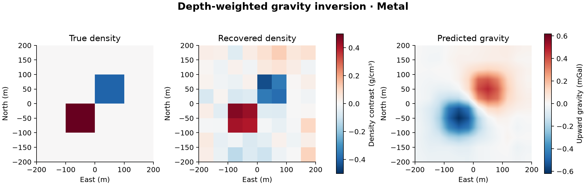

# 10 · 3D density inversion

**Paths:** MLX and Metal (MLX autodiff; hand-written adjoint on Metal) · **Tests:** 62 (all pass on both paths) · **Benchmarked:** yes (fixed-beta inversion)

Map view of a two-block synthetic (true density contrast, left), the depth-weighted Tikhonov recovery from the Metal inversion (centre), and the predicted upward gravity (right).

## What was built
Li–Oldenburg-style 3D gravity inversion on a tensor mesh: data misfit ‖G m − d‖² plus β times a depth-weighted smallness + first-difference smoothness penalty (SimPEG `depth_weighting(exponent=2)`, w² in the penalty, Neumann boundaries, reference model subtracted in both terms), solved at a fixed β. The sensitivity G is a frozen float64 SimPEG matrix supplied by the judge, so the project tests applying the operator, the adjoint, the regularization and the solver, not building the prism kernel (project 02 does that). The MLX path (`mlx/impl.py`) gets the gradient from autodiff and inverts by augmented QR on the departure from the reference, followed by four residual corrections with the autodiff gradient; MLX's QR and triangular solves run on its CPU stream in float32 (those ops are CPU-only in MLX), while the operator, objective and autodiff use the GPU. The Metal path (`metal/kernels/density.metal`) is entirely hand-written float32 kernels: depth weights, forward G·m, an explicit hand-coded adjoint Gᵀ·r, normal-matrix assembly and a dense Cholesky solve. No float64 step on either path; depth/offset lengths are rescaled by their maximum on the host so extreme units stay finite.

## Judge and tolerances
- Oracle: synthetic blocks on a 256-cell mesh (plus a 24-cell `small` case) with SimPEG's float64 sensitivity, regularization and Hessian; the reference model is the exact Cholesky minimizer of SimPEG's Hessian at a β chosen by the judge's discrepancy search (not SimPEG `BaseInversion` with directives).
- `parity = 1e-4` (operators, objective, gradient, model; relative L2 plus max-scaled); `stationarity = 1e-4` (normal-equation residual relative to RHS).
- `adjoint = 1e-5` normalized dot-product residual (specified pass criterion); `gradient = 1e-3` centered FD with `fd_step = 0.01` g/cc along a saved unit direction (objective is quadratic, so no truncation error).
- Specified pass criteria: `chi_fraction = 0.10` (χ² within 10% of N), `correlation = 0.70`, `model_error_fraction = 0.20` (L2 error ≤ 1.2× SimPEG's).
- Oracle self-checks: `oracle_check 1e-10`, `oracle_regularization 1e-12`, `oracle_gradient 1e-7` (step 1e-5), `beta_root_xtol 1e-12`.
- Review notes: χ² and the 20% model-error criteria hold automatically for any implementation passing stationarity at the supplied β (no β search is tested or required); the Cauchy-normalized dot-product test is weaker than forward/transpose parity, which is what catches a wrong Gᵀ; `reg_only` is the case that isolates the regularization term.

## Parity
- Tests: 28/28 MLX passed and 28/28 Metal passed: operator parity (forward and adjoint × 3 cases), adjoint dot product × 3, objective/gradient parity (4 settings × 3 cases), centered FD gradient × 4, block inversion pass criteria × 2, nonzero-reference inversion. 3 MLX-vs-Metal cross-parity tests are among the 62 locked. MLX-vs-Metal cross-checks: 3/3 passed in a separate cross-check run (`CROSS_CHECKS.md`).
- Independent checks during review: G entries checked against a 40³-point Gauss–Legendre volume integral to 1e-14; float32 Cholesky gives stationarity 1.7e-7 and model difference 1.1e-5 (L2), float32 CG 1.4e-7 and 2.1e-5; golden recovery correlations 0.754 / 0.802 against 0.70. The test run records pass/fail only.
- Autodiff vs hand adjoint: both paths pass the same 1e-5 dot-product test, 1e-3 FD checks and 1e-4 gradient parity against SimPEG; no measured error magnitudes beyond pass/fail are recorded.
- Bench medium (256 cells, 144 data; model and prediction vs the judge's Cholesky solution): MLX 1.12e-06, Metal 4.10e-08.

## Benchmark
Wall time is the median of three calls after one warm-up (`bench/results.json`). Speedup = judge wall time ÷ path wall time at the same size; the judge is a correctness oracle, not a tuned competitor. Metal times include process launch, shader compilation and file I/O on every call, so a floor of roughly 40–60 ms dominates small sizes.

| Size | Problem | Judge | MLX | Metal | MLX vs judge | Metal vs judge |
|---|---|---|---|---|---|---|
| small | shape=4×4×2, n_data=36 | 0.693 ms | 2.61 ms | 55.6 ms | 0.266× | 0.0125× |
| medium | shape=8×8×4, n_data=144 | 6.45 ms | 5.94 ms | 63.6 ms | 1.09× | 0.102× |
| large | shape=12×12×6, n_data=324 | 41.8 ms | 54.0 ms | 180 ms | 0.774× | 0.232× |

| Size | Judge peak mem | MLX peak mem | Metal peak mem |
|---|---|---|---|
| small | 0.0508 | 0.187 | 0 (child-RSS delta; see note) |
| medium | 2.07 | 8.06 | 0.0156 |
| large | 21.4 | 97.0 | 0.719 |

- Peak memory is in MB as recorded by the harness (decimal MB or MiB per the project notes). Memory methods differ by path and are not comparable across columns. Judge: tracemalloc peak during call. MLX: MLX reset_peak_memory/get_peak_memory. Metal: RUSAGE_CHILDREN ru_maxrss high-water delta (macOS bytes).
- Medium-size max relative difference vs judge: MLX 1.12e-06, Metal 4.10e-08.

The benchmark times the fixed-β inversion on synthetic point-cell sensitivities (32, 256 and 864 cells), not the gradient alone. At 864 cells the dense float64 NumPy judge (41.8 ms) beats MLX (54.0 ms) and Metal (180 ms); the problems are too small for GPU throughput, and Metal's dense Cholesky uses sequential dispatches.

## Known limitations
- Dense solvers on both paths (QR on MLX's CPU stream, Cholesky on Metal with quadratic memory, cubic work and a uint32 normal-matrix index limit): suited to the locked 24/256-cell problems, not large meshes.
- β is supplied, not searched; χ² and model-error criteria are therefore automatic given stationarity.
- G is a frozen SimPEG matrix (tests) or a point-cell approximation (bench); the prism kernel itself is tested in project 02.
- No bounds on density; the Metal solver adds no diagonal shift and needs the SPD normal system.

## Papers
- Li and Oldenburg (1996), 3-D inversion of magnetic data, Geophysics; Li and Oldenburg (1998), 3-D inversion of gravity data, Geophysics (depth weighting).
- SimPEG (Cockett et al. 2015), oracle only.
