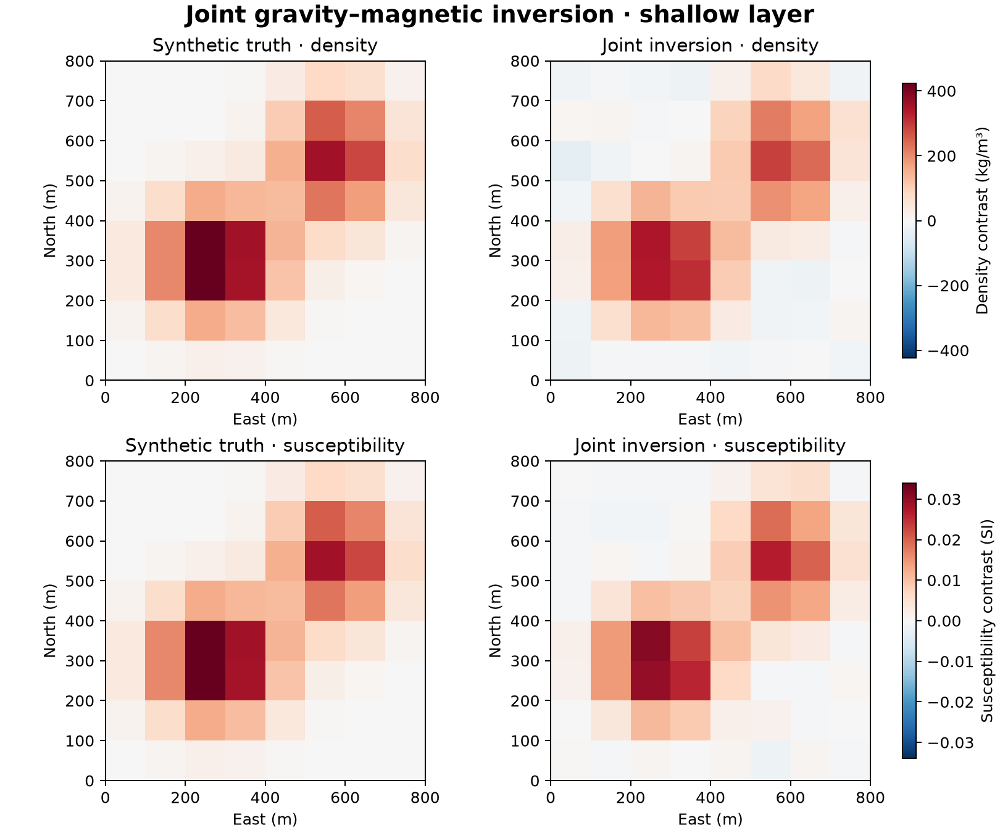

# 11 · Joint gravity and magnetic inversion

**Paths:** MLX only · **Tests:** 13 (all pass) · **Benchmarked:** yes

Synthetic truth vs joint inversion for density and susceptibility on the shallow layer of an 8×8×2 mesh (MLX, 20 sweeps; smooth synthetic sensitivity kernels, not exact prism physics).

## What was built
Joint gravity and magnetic inversion with a cross-gradient coupling term (Gallardo and Meju style). The objective is data misfit + damping + smoothness for each property + coupling × |∇ρ × ∇κ|², with its gradient from MLX autodiff. The inversion is an exact density-first alternating block scheme: each sweep solves the quadratic normal equations for one property with the other fixed (Cholesky + two triangular solves). Sensitivity matrices are supplied by the judge, so projects 03 and 10 are bypassed. Precision: everything is float32. The whole `invert` routine runs on MLX's CPU stream (MLX's Cholesky/triangular solves are CPU-only, and the Gram-matrix assembly is kept on the same stream so its roundoff matches the factorization). No float64 anywhere in the path.

## Judge and tolerances
- Oracle: float64 NumPy/SciPy implementation of the same objective and sweep schedule; separate vs joint recovery on one synthetic.
- `PARITY_RTOL = 1e-4` (forward, objective, gradient, and predicted data from every returned model); `SOLVER_MODEL_RTOL = 3e-3` for solver model parity only (cond(Hg) = 1.18e4, cond(Hm) = 7.80e3 amplify float32 roundoff); `ZERO_ATOL = 1e-6` for analytically zero components; `GRAD_RTOL = 1e-3`, `FD_STEP = 2e-3`; `MAX_ERROR_RATIO = 0.90` (joint must beat separate by ≥10% for each property).
- Judge defect caught in review: solver parity at 1e-4 was impossible for any correct float32 solver. The judge's own float32 SciPy solve failed it (2.0e-4 on the separate cases). Model parity was therefore moved to 3e-3 with the conditioning argument, and a data-space check at 1e-4 was added that is not amplified by poorly resolved modes. The review also found explicit inverses fail the data check (`mx.linalg.inv`: model 1.1e-2, data 2.0e-4), so a backward-stable solve is required.

## Parity
- Tests: 13/13 MLX passed (forward; coupled, uncoupled and affine objective/gradient; two centered-FD checks; five solver-parity cases at sweeps 0, 1, 3, 7, 150; 10% improvement for density and susceptibility).
- Independent review measurements (float32, worst over the five solver cases): MLX Cholesky + triangular solves model 5.2e-4, data 4.1e-6; MLX `linalg.solve` model 1.6e-3, data 1.6e-5. CPU float32 FD audit 2.9e-4 vs 1e-3. Recovery ratios on the goldens: 0.761 (density) and 0.869 (susceptibility) vs 0.90.
- Bench medium max relative difference: MLX 1.53e-6.

## Benchmark
Wall time is the median of three calls after one warm-up (`bench/results.json`). Speedup = judge wall time ÷ path wall time at the same size; the judge is a correctness oracle, not a tuned competitor. Metal times include process launch, shader compilation and file I/O on every call, so a floor of roughly 40–60 ms dominates small sizes.

| Size | Problem | Judge | MLX | MLX vs judge |
|---|---|---|---|---|
| small | shape=4×4×3, observations_per_survey=72, sweeps=1 | 0.455 ms | 1.12 ms | 0.408× |
| medium | shape=6×6×4, observations_per_survey=180, sweeps=8 | 6.46 ms | 4.75 ms | 1.36× |
| large | shape=8×8×5, observations_per_survey=320, sweeps=60 | 180 ms | 66.2 ms | 2.72× |

| Size | Judge peak mem | MLX peak mem |
|---|---|---|
| small | 0.216 | 0.254 |
| medium | 1.91 | 2.66 |
| large | 9.39 | 11.7 |

- Metal: n/a, no Metal path was benchmarked for this project (MLX-only project).
- Peak memory is in MB as recorded by the harness (decimal MB or MiB per the project notes). Memory methods differ by path and are not comparable across columns. Judge: tracemalloc peak during call. MLX: MLX reset_peak_memory/get_peak_memory; process RSS high-water mark separately.
- Medium-size max relative difference vs judge: MLX 1.53e-06.

MLX overtakes the float64 judge only once the problem has many sweeps: 2.72× at the large size (60 sweeps), slower at the 1-sweep small size.

## Known limitations
- The inversion runs on the MLX CPU stream (float32), not the GPU; timings reflect CPU performance.
- Synthetic is favourable: susceptibility is exactly 0.8 × normalized density, so the cross-gradient coupling is ideal.
- Sensitivities are supplied matrices (and smooth synthetic kernels in the figure), not computed from 03/10 prism physics.
- `mx.linalg.solve` has under 2× margin against the 3e-3 model limit; the Cholesky path used has more room.
- A one-sweep difference near convergence (149 vs 150) is about 3e-6 and is undetectable; the early-sweep cases (1 and 7) lock the sweep count and order.

## Papers
- No papers were specified for this project, and none are cited in its judge.
- The cross-gradient coupling is the standard Gallardo and Meju (2003) formulation; regularization follows the Li and Oldenburg style of project 10.
