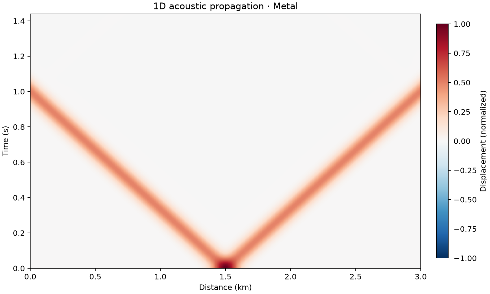

# 12 · 1D acoustic finite difference

**Paths:** MLX and Metal · **Tests:** 21 (all pass on both paths) · **Benchmarked:** yes

Time–distance plot of a Gaussian pulse splitting into left- and right-going waves that leave a 3 km domain through the Mur boundaries without visible reflection (Metal path, 601 points, 800 steps).

## What was built
A 1D constant-speed acoustic solver: second-order centered leapfrog in space and time with first-order Mur absorbing boundaries at both ends, q = (c·dt − dx)/(c·dt + dx). The caller passes `u0` and `u_prev` and the solver returns the full (steps+1)×n wavefield. The MLX path is a vectorized float32 recurrence; the Metal path is a Rust host driving one MSL update kernel per step, with a fallible buffer allocator (overflow and `maxBufferLength` checks). Both paths are float32 throughout with no CPU float64 step.

## Judge and tolerances
- Two judges per the FD amendment: (a) same-grid parity against a separately written float64 NumPy/SciPy leapfrog + Mur recurrence; (b) d'Alembert analytic solution for a convergence test at refinements 101/201/401 points, plus a reflection test.
- `PARITY = 1e-4` (peak-normalized, includes accumulated time-step rounding); `CROSS_PATH = 1e-4` (MLX vs Metal); `ORDER_DEVIATION = 0.2` (order within 2 ± 0.2); `REFLECTION = 0.01` (reflected amplitude below 1% of incident peak).
- Review noted that the convergence test measures interior second order only (the pulses never reach the first-order Mur boundary at t = 0.25 s); boundary accuracy is pinned by parity and reflection tests.

## Parity
- Tests: 8/8 MLX passed and 8/8 Metal passed (5 matched-stencil cases, second-order convergence, left/right absorbing boundary); the remaining 5 of 21 locked tests are MLX-vs-Metal cross-path comparisons. MLX-vs-Metal cross-checks: 5/5 passed in a separate cross-check run (`CROSS_CHECKS.md`).
- Independent review measurements on the goldens: an independent float32 implementation reaches 3.7e-7 to 3.9e-6 peak-normalized error; float32 L2 errors vs analytic 0.01433, 0.003540, 0.000879 give orders 2.02 and 2.01; boundary residual 1.63e-4 of the incident peak (limit 1e-2).
- Bench medium max relative difference: MLX 3.76e-6, Metal 3.76e-6 (identical to the printed digits; both paths evaluate the same float32 recurrence in the same order).

## Benchmark
Wall time is the median of three calls after one warm-up (`bench/results.json`). Speedup = judge wall time ÷ path wall time at the same size; the judge is a correctness oracle, not a tuned competitor. Metal times include process launch, shader compilation and file I/O on every call, so a floor of roughly 40–60 ms dominates small sizes.

| Size | Problem | Judge | MLX | Metal | MLX vs judge | Metal vs judge |
|---|---|---|---|---|---|---|
| small | n=4096, steps=400 | 11.7 ms | 48.3 ms | 57.3 ms | 0.242× | 0.204× |
| medium | n=8192, steps=1200 | 60.5 ms | 91.0 ms | 78.4 ms | 0.665× | 0.772× |
| large | n=32768, steps=4096 | 491 ms | 285 ms | 301 ms | 1.72× | 1.63× |

| Size | Judge peak mem | MLX peak mem | Metal peak mem |
|---|---|---|---|
| small | 25.3 | 12.9 | 41.6 |
| medium | 151 | 75.5 | 136 |
| large | 2,050 | 1,020 | 1,560 |

- Peak memory is in MB as recorded by the harness (decimal MB or MiB per the project notes). Memory methods differ by path and are not comparable across columns. Judge: tracemalloc peak in fresh worker. MLX: MLX reset_peak_memory/get_peak_memory; process RSS high-water also reported. Metal: fresh worker RUSAGE_CHILDREN ru_maxrss delta (Metal child high-water RSS).
- Medium-size max relative difference vs judge: MLX 3.76e-06, Metal 3.76e-06.

At the large size (32,768 points × 4,096 steps) MLX (1.72×) and Metal (1.63×) are nearly tied against the float64 NumPy judge. One kernel launch per step on a short 1D array leaves the GPU mostly idle.

## Known limitations
- Constant wave speed only; first-order Mur boundary (adequate at normal incidence; reflection tested only for one smooth pulse at Courant 0.5).
- The same-grid reference is an in-house float64 recurrence, not a third-party solver (accepted in review for a 1D d'Alembert problem).
- The full wavefield is stored (steps+1 rows), so memory grows with steps × n (2 GB judge peak at the large size).

## Papers
- d'Alembert solution of the 1D wave equation.
- Mur (1981), absorbing boundary conditions for finite-difference time-domain equations.
