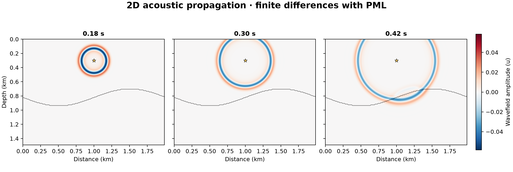

# 13 · 2D acoustic finite difference (orders 2–8, PML)

**Paths:** MLX and Metal · **Tests:** 20 (all pass on both paths) · **Benchmarked:** yes

Wavefield snapshots at 0.18, 0.30 and 0.42 s for a Ricker source over a sinusoidal interface and a fast Gaussian lens (Metal path, order 4, 12-cell PML; every grid node recorded as a receiver).

## What was built
A 2D constant-density acoustic propagator matching Deepwave's `scalar` scheme exactly as written in the locked `tests/SCHEME.md`: 2nd/4th/6th/8th-order centered space stencils, second-order leapfrog in time, C-PML (σ, α, a, b, db profiles with ψ/ζ memory variables), recording before injection, no substepping. Both paths evaluate the second derivative in difference form, Σ d_j·((f[i+j] − f[i]) + (f[i−j] − f[i]))/h², which review measurements showed is necessary in float32. The MLX path synchronizes (`mx.eval`) every step to bound graph growth. The Metal path runs one propagation kernel per step plus a separate source-injection kernel with one writer per distinct source cell (no atomics). Both are float32 on the GPU with no CPU float64 step. This propagator, including its PML law, is the base for projects 14, 16–21, 23 and 50.

## Judge and tolerances
- Two judges per the FD amendment: (a) Deepwave `scalar` at the same grid, stencil, dt and PML for orders 2, 4, 6 and 8; (b) the analytic homogeneous 2D Green's function, convolved with a Gaussian source (σ 0.025 s), for a grid-refinement test with dt refined with h at a fixed CFL of 0.4.
- `PARITY = 1e-4` (peak-normalized); `CROSS_PATH = 2e-4` (independent float32 rounding in two implementations); convergence order bounds `CONVERGENCE_COARSE_MIN = 1.25`, `CONVERGENCE_FINE_MIN = 1.65`, `CONVERGENCE_MAX = 2.75` around the combined space-time order 2. The coarse interval is wider because spatial and temporal error partly cancel at order 4 (float64 coarse rate 1.334).
- Ruling (2026-10-28): with dt refined at fixed CFL, the expected order is the combined space-time order (2), not the stencil order; spatial accuracy is pinned by the Deepwave parity tests.
- Judge defects caught in review: the convergence test was missing, and the scheme was known only from Deepwave's source. The fix added the Green's-function refinement test and wrote `tests/SCHEME.md` (coefficients, halo, C-PML profiles, update and injection order). An independent reimplementation from SCHEME.md alone reproduced every golden (float64 ≤1.4e-15 on parity, ≤4.5e-13 on convergence fixtures).
- Related erratum (found while testing project 18, recorded in 14): Deepwave applies the full PML expression, including the db·D1 and D1(a·ψ) terms, in the accuracy/2 nodes next to each PML. Project 13's SCHEME.md already documents it; project 14's did not.

## Parity
- Tests: 8/8 MLX passed and 8/8 Metal passed (Deepwave parity and Green-function refinement for orders 2, 4, 6, 8); the other 4 of 20 locked tests are MLX-vs-Metal cross-checks. MLX-vs-Metal cross-checks: 4/4 passed in a separate cross-check run (`CROSS_CHECKS.md`).
- Independent float32 measurements: difference-form D2 gives 3.4e-7 to 7.7e-7 on the parity fixtures and ≤1.4e-6 on the convergence fixtures. The naive d_0 form fails conv parity (up to 4.0e-4) and convergence (fine rate 1.36–1.51). Float64 rates for orders 2/4/6/8 are (2.14, 2.03), (1.33, 1.80), (1.87, 1.99), (1.97, 2.00).
- Bench medium max relative difference: MLX 3.31e-7, Metal 3.73e-7.

## Benchmark
Wall time is the median of three calls after one warm-up (`bench/results.json`). Speedup = judge wall time ÷ path wall time at the same size; the judge is a correctness oracle, not a tuned competitor. Metal times include process launch, shader compilation and file I/O on every call, so a floor of roughly 40–60 ms dominates small sizes.

| Size | Problem | Judge | MLX | Metal | MLX vs judge | Metal vs judge |
|---|---|---|---|---|---|---|
| small | nz=64, nx=64, nt=24, shots=1, receivers=32 | 2.03 ms | 8.53 ms | 40.0 ms | 0.238× | 0.0507× |
| medium | nz=128, nx=128, nt=240, shots=1, receivers=64 | 8.72 ms | 118 ms | 46.6 ms | 0.0740× | 0.187× |
| large | nz=256, nx=256, nt=1000, shots=1, receivers=128 | 79.9 ms | 488 ms | 60.0 ms | 0.164× | 1.33× |

| Size | Judge peak mem | MLX peak mem | Metal peak mem |
|---|---|---|---|
| small | 0.0374 | 2.17 | 0 (child-RSS delta; see note) |
| medium | 0.137 | 4.89 | 0.0328 |
| large | 0.537 | 16.3 | 0 (child-RSS delta; see note) |

- Peak memory is in MB as recorded by the harness (decimal MB or MiB per the project notes). Memory methods differ by path and are not comparable across columns. Judge: tracemalloc peak (Python allocations; excludes native Torch allocations). MLX: MLX reset_peak_memory/get_peak_memory (bytes; includes live MLX allocations). Metal: RUSAGE_CHILDREN ru_maxrss high-water delta, macOS bytes; may be zero after warm-up.
- Medium-size max relative difference vs judge: MLX 3.31e-07, Metal 3.73e-07.

The judge here is Deepwave's compiled C/OpenMP CPU kernel, a strong baseline. Only Metal beats it at the large size (1.33×, 60 ms including process launch); MLX's per-step synchronization makes it 0.164× the judge.

## Known limitations
- Constant density, single-precision only; PML reflection is bounded only through parity, with no separate reflection-coefficient test.
- The MLX path evaluates every step eagerly to keep the lazy graph bounded, which costs throughput at small grids.
- The convergence test checks combined order 2, so high-order spatial accuracy is verified only by same-grid parity against Deepwave.

## Papers
- Komatitsch and Martin (2007), C-PML; Deepwave (Richardson) `scalar` scheme as the reference.
- Analytic 2D homogeneous acoustic Green's function (cosh-substitution quadrature in the judge).
