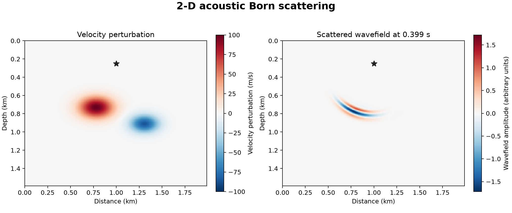

# 14 · 2D Born modeling

**Paths:** MLX and Metal · **Tests:** 25 (all pass on both paths) · **Benchmarked:** yes

Velocity perturbation (left) and the scattered wavefield it generates at the final time step (Metal path).

## What was built
Linearized (Born) 2D acoustic modeling, matching Deepwave `scalar_born`: a background wavefield and a scattered wavefield are stepped together. The scattered field is driven by 2·v·dv·H(u), plus −k²·2·v·dv·f at the source, with the C-PML of project 13 on both. The API also exposes `misfit_and_grad`: half the squared scattered-data residual and its gradient with respect to dv. The MLX path gets that gradient from `mx.value_and_grad` (autodiff through the time loop). The Metal path has a hand-written adjoint (`adjprep`/`adjstep` kernels) that replays a stored background-force history, which is allocated only when a gradient is requested. Both evaluate D2 in difference form and are float32 on the GPU with no CPU float64 step.

## Judge and tolerances
- Two judges per the FD amendment: (a) Deepwave `scalar_born` in float64 at the same grid, stencil, dt and PML (`mode24/48/96`, `pml2`, `pml4` fixtures); (b) an analytic single-mode convergence test (accuracy 2) under h-halving.
- `PARITY = 1e-4`, `CROSS = 1e-4` (MLX vs Metal); `GRADIENT = 1e-3` vs centered directional finite differences; `ORACLE_FD = 2e-6` for the float64 oracle's own FD; convergence error ratio per halving between `CONVERGENCE_RATIO = 3.2` and `CONVERGENCE_RATIO_MAX = 5.0`; fine-grid modal error `CONVERGENCE_FINE = 1e-4` (tightened from an earlier 3e-3).
- **SCHEME erratum** (found while testing project 18): `tests/SCHEME.md` says non-PML nodes use plain D2 and ignore db. Deepwave applies the full PML expression everywhere, so the db·D1 and D1(a·ψ) terms survive in the accuracy/2 nodes next to each PML. Implementations use the full expression (as in project 13's SCHEME.md). It matches 14's goldens either way: float64 gap 1.8e-6 (background), 7e-9 (scattered), 1.6e-7 (gradient) for the literal SCHEME; ≤2e-14 for the full form.
- Judge defect caught in review: the PML/padding discretization was unspecified. The fix wrote SCHEME.md (edge extension, profiles, ψ/ζ updates, Born source terms, recording order, PML-copy gradient fold-back, CFL ratio 1) and made the convergence bounds two-sided.

## Parity
- Tests: 9/9 MLX and 9/9 Metal passed (5 Deepwave reference fixtures, zero/linearity, analytic convergence, gradient + centered difference on `pml2` and `pml4`); the remaining 7 of 25 locked tests are MLX-vs-Metal cross-checks (5 forward, 2 gradient). MLX-vs-Metal cross-checks: 7/7 passed in a separate cross-check run (`CROSS_CHECKS.md`).
- Float32 measurements from an independent implementation: background ≤2.7e-6, scattered ≤2.9e-5 (`mode96`, the tightest margin), gradient ≤6.6e-6, objective ≤2.2e-6; convergence errors 6.84e-4, 1.693e-4, 4.24e-5 (ratios 4.04, 3.99); float32 centered-difference error ≤6.7e-5 vs 1e-3.
- Bench medium max relative difference (forward Born): MLX 9.05e-6, Metal 7.09e-6.

## Benchmark
Wall time is the median of three calls after one warm-up (`bench/results.json`). Speedup = judge wall time ÷ path wall time at the same size; the judge is a correctness oracle, not a tuned competitor. Metal times include process launch, shader compilation and file I/O on every call, so a floor of roughly 40–60 ms dominates small sizes.

| Size | Problem | Judge | MLX | Metal | MLX vs judge | Metal vs judge |
|---|---|---|---|---|---|---|
| small | ny=48, nx=48, shots=1, receivers=24, nt=100 | 5.89 ms | 59.3 ms | 45.7 ms | 0.0994× | 0.129× |
| medium | ny=128, nx=128, shots=2, receivers=96, nt=240 | 54.3 ms | 227 ms | 54.5 ms | 0.239× | 0.996× |
| large | ny=256, nx=256, shots=4, receivers=192, nt=400 | 1.18 s | 538 ms | 94.8 ms | 2.20× | 12.5× |

| Size | Judge peak mem | MLX peak mem | Metal peak mem |
|---|---|---|---|
| small | 304 | 2.87 | 16.5 |
| medium | 328 | 17.0 | 21.0 |
| large | 394 | 110 | 49.9 |

- Peak memory is in MB as recorded by the harness (decimal MB or MiB per the project notes). Memory methods differ by path and are not comparable across columns. Judge: process peak RSS (ru_maxrss, macOS bytes; includes native Torch allocations). MLX: MLX reset_peak_memory/get_peak_memory; process peak RSS separately. Metal: Metal child ru_maxrss delta in a fresh helper process (macOS bytes).
- Medium-size max relative difference vs judge: MLX 9.05e-06, Metal 7.09e-06.

Only forward Born is benchmarked; the gradient path (MLX autodiff vs Metal hand adjoint) has no timing in `bench/results.json`. At the large size Metal is 12.5× faster than float64 Deepwave and 5.7× faster than MLX (94.8 ms vs 538 ms).

## Known limitations
- Analytic convergence covers accuracy 2 only; accuracy 4 relies on Deepwave parity (expected combined order 2 for both).
- CFL ratio 1 only (no Deepwave substepping).
- The gradient is with respect to the scattering perturbation dv only, not the background v.
- The Metal adjoint stores the full background-force history (memory ∝ nt × grid).

## Papers
- Deepwave `scalar_born` (Richardson) as the reference; Komatitsch and Martin (2007), C-PML.
- Born approximation for acoustic scattering (standard linearized-modeling literature).
