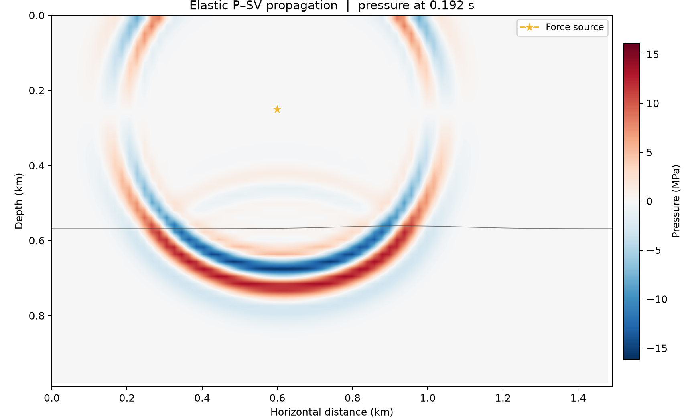

# 15 · 2D elastic P-SV (C-PML, free surface)

**Paths:** MLX and Metal · **Tests:** 91 (all pass on both paths) · **Benchmarked:** yes

Pressure snapshot at the final time step of an elastic P-SV simulation (Metal path).

## What was built
A 2D staggered-grid velocity–stress elastic P-SV solver matching Deepwave `elastic` exactly as written in the locked `tests/SCHEME.md`: 4th-order staggered derivatives, harmonic-mean shear and interface buoyancy, C-PML with eight memory variables, an image-method (IVM) free surface, and force-density sources. `misfit_and_grad` returns a velocity least-squares objective with exact discrete gradients with respect to vp, vs, rho and both source force components. The MLX path gets them from `mx.value_and_grad` through the time loop. The Metal path uses a hand-written elastic adjoint: 13 kernels, including `reverse_stress`, `reverse_velocity`, `receiver_adjoint` and `material_adjoint`. Both are float32 on the GPU; exact zeros (vacuum rows, zero case) use masked reciprocals rather than epsilon guards. There is no CPU float64 step.

## Judge and tolerances
- Two judges per the FD amendment: (a) Deepwave `elastic` in float64 at the same grid, stencil, dt and PML, on cases including heterogeneous, free_surface, zero, reflective, pml and lamb; (b) analytic P and S plane-wave convergence (y-direction, combined space-time order 2). Also an analytic Lamb's-problem Rayleigh arrival (cR = 1398.78886 m/s) and a C-PML absorption test with a reflective negative control.
- `PARITY = 1e-4` per component (peak-normalized); `CROSS = 2e-4`; `GRAD_FD = 1e-3` with `FD_STEP = 1e-3` relative multiplicative perturbations; oracle FD `ORACLE_GRAD_FD = 2e-5` at h = 1e-4; `RAYLEIGH_TIME = 0.01`; order within [`ORDER_MIN` 1.8, `ORDER_MAX` 2.3]; `PLANE_FINE_ERROR = 3.5e-3`; `PML_REFLECTION = 0.01`, `REFLECTIVE_MIN = 0.10`, `PML_IMPROVEMENT = 20`; `ZERO = 0` exactly.
- Judge defects caught in review: the edge termination was unspecified, so SCHEME.md was written with padding, staggering, PML sampling, the eight memories, step order and IVM surface. `PLANE_FINE_ERROR` of 0.003 sat only 0.8% above S's reference error and was raised to 3.5e-3 with a triangle-inequality bound (P bound 3.122e-3, S bound 3.287e-3).
- Remaining caveat noted at lock: an adversarial parity-passing implementation could, in principle, push the P order below 1.8 (it would need about 88% of the parity budget, correlated with the discretization error). Realistic float32 deviations are about 1e-6.

## Parity
- Tests: 38/38 MLX and 38/38 Metal passed (12 Deepwave parity, 2 plane-wave convergence, Lamb Rayleigh arrival, C-PML absorption, 2 discrete-adjoint reference/objective, 20 centered-FD gradient checks over 5 fields × 2 cases × 2 directions). The rest of the 91 locked tests are MLX-vs-Metal cross-path and integrity tests. MLX-vs-Metal cross-checks: 14/14 passed in a separate cross-check run (`CROSS_CHECKS.md`).
- Independent review values: plane-wave orders 2.04/2.01 (P) and 2.08/2.02 (S); Lamb arrival errors 0.61–0.63%; C-PML residuals 8.6e-5 and 2.0e-4; independent float32 audit ≤4.7e-6 on parity, centered differences ≤3.0e-4 (about 3.3× margin on 1e-3).
- Bench medium max relative difference (forward): MLX 5.40e-8, Metal 4.64e-7.

## Benchmark
Wall time is the median of three calls after one warm-up (`bench/results.json`). Speedup = judge wall time ÷ path wall time at the same size; the judge is a correctness oracle, not a tuned competitor. Metal times include process launch, shader compilation and file I/O on every call, so a floor of roughly 40–60 ms dominates small sizes.

| Size | Problem | Judge | MLX | Metal | MLX vs judge | Metal vs judge |
|---|---|---|---|---|---|---|
| small | ny=48, nx=64, nt=60, nreceiver=24 | 6.26 ms | 76.1 ms | 64.5 ms | 0.0823× | 0.0972× |
| medium | ny=96, nx=144, nt=300, nreceiver=72 | 24.3 ms | 321 ms | 71.3 ms | 0.0759× | 0.341× |
| large | ny=160, nx=240, nt=600, nreceiver=120 | n/a (skipped) | 697 ms | 79.7 ms | n/a | n/a |

| Size | Judge peak mem | MLX peak mem | Metal peak mem |
|---|---|---|---|
| small | 0.0475 | 13.7 | 18.6 |
| medium | 0.531 | 39.2 | 21.0 |
| large | n/a | 96.1 | 27.1 |

- Judge large skipped by the benchmark harness: "Conservative CPU runtime limit for the large case".
- Peak memory is in MB as recorded by the harness (decimal MB or MiB per the project notes). Memory methods differ by path and are not comparable across columns. Judge: tracemalloc peak Python allocations (excludes native Torch allocations). MLX: MLX reset_peak_memory/get_peak_memory; process RSS is lifetime high-water mark. Metal: fresh worker RUSAGE_CHILDREN ru_maxrss delta (macOS bytes); Metal child RSS.
- Medium-size max relative difference vs judge: MLX 5.40e-08, Metal 4.64e-07.

Only the forward `elastic` call is benchmarked; the gradient paths have no timing. At the large size Metal (79.7 ms, process launch included) is 8.7× faster than MLX (697 ms). The judge was not timed at that size.

## Known limitations
- The analytic convergence check is y-direction plane waves only; x-direction accuracy relies on Deepwave parity.
- The finest plane-wave cases (1767 sources × 3200 steps) are heavy for the Metal subprocess I/O.
- Centered-FD gradient margin is about 3.3×, so forward replays must stay deterministic.
- Variable names `a`/`b` (PML) and `by`/`bx` (buoyancy) clash in SCHEME.md notation.

## Papers
- Komatitsch and Martin (2007), C-PML.
- Deepwave `elastic` (Richardson) as the reference; Lamb's problem (Rayleigh-wave speed from the Rayleigh polynomial root).
