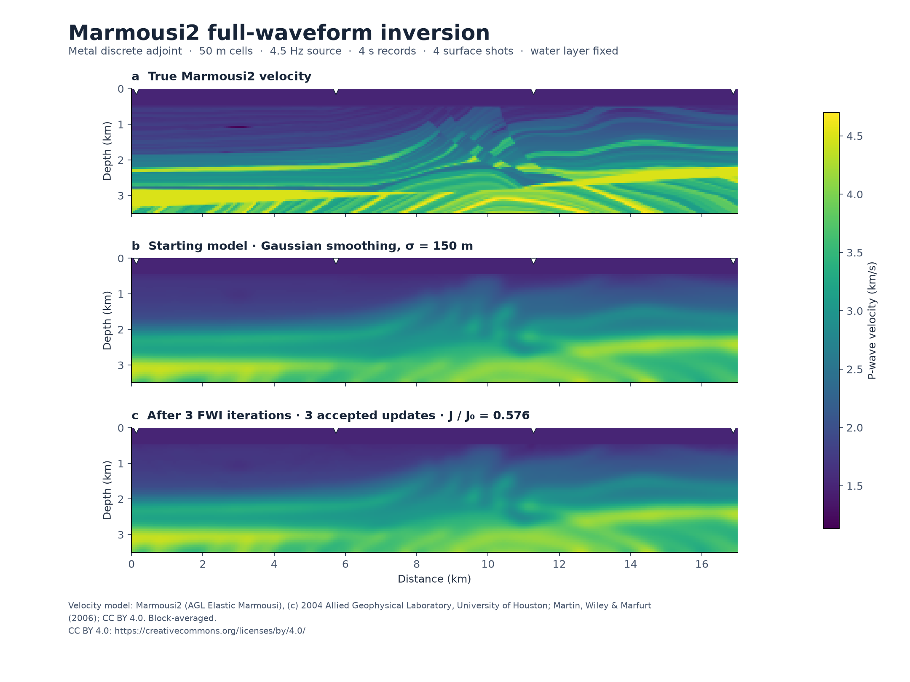

# 16 · Acoustic FWI on Marmousi2 (headline)

**Paths:** MLX and Metal (MLX autodiff, Metal hand-written adjoint) · **Tests:** 21 (all pass on both paths; synthetic stand-in fixture) · **Benchmarked:** yes. The small size uses the synthetic stand-in; medium and large use Marmousi2 at 70×340 / 50 m and 140×680 / 25 m.

Three panels on the 70×340, 50 m Marmousi2 grid:
- (a) True Marmousi2 P velocity.
- (b) Starting model, Gaussian-smoothed with σ = 150 m.
- (c) The model after 3 Metal discrete-adjoint FWI iterations. Settings: 4.5 Hz source, 4 s records, 4 surface shots, water layer fixed, at most two trial steps per iteration, an update kept only if the misfit decreases.

The figure states "3 accepted updates · J/J₀ = 0.576". That is a data-misfit drop of 42%. It is not convergence: the recovered model is still visibly close to the smoothed start.

## What was built
Acoustic full-waveform inversion on the project-13 propagator. It uses a 4th-order stencil and a Deepwave-equivalent C-PML, both written out in the locked `tests/DISCRETE_OPERATOR.md`. `misfit_and_grad` returns 0.5 × the mean squared trace residual and its gradient with respect to velocity (m/s).
- **MLX** gets the gradient from reverse-mode autodiff through the full time loop, which keeps the whole time history.
- **Metal** implements the discrete adjoint by hand. It stores the full forcing history, back-propagates with adjoint kernels, and folds the replicated-edge PML contributions back into boundary cells.

A test-owned optimizer drives the recovery test: 40 iterations, step cap 20 m/s, up to 10 backtracks, bounds 1400–2600 m/s. Both paths are float32 on the GPU with no CPU float64 step. Metal uses a fallible allocator that checks `maxBufferLength`.

The benchmark (`bench/run_bench.py`) runs every path one shot at a time over an 8-shot surface survey, then averages objectives and gradients. This bounds memory. The setup:
- receivers at every surface cell;
- 4 s records, with peak frequency 4.5 Hz (medium) or 8 Hz (large);
- max_vel·dt/dx = 0.376;
- noiseless targets generated with Metal on the true model, outside the timers.

## Judge and tolerances
- **Oracle:** Deepwave 0.1.0 `scalar` gradients in float64 on a matched discrete operator, plus centered finite differences and fixed-iteration model-error recovery.
- **Locked constants:**
  - `PARITY = 1e-4` for traces, objective and gradient magnitude, as a global max norm.
  - `GRADIENT_COSINE = 0.999` against Deepwave.
  - `FD_REL = 1e-3`, with `FD_STEP = 1` m/s along RMS-one directions.
  - `MODEL_ERROR_RATIO = 0.70` after `ITERATIONS = 40`, i.e. at least a 30% reduction in model L2 error.
  - `EQUATION_AUDIT_REL = 1e-10`, a judge-only float64 audit.
- **Data deviation, now partly resolved.** The locked tests still use the synthetic stand-in, because `data/` held only Okada data when the judge was written. A Marmousi fixture would need a new, reviewed set of locked tests, including re-checking the 0.70 ratio with surface-only acquisition.
  - The benchmark (medium, large) and the figure now use Marmousi2, which is CC BY 4.0.
  - Classic IFP Marmousi (`data/marmousi`, no redistribution terms) is not used anywhere.
- **Judge defect caught in review.** The C-PML was originally specified only as "match Deepwave", which would have forced implementations to copy Deepwave's code. `tests/DISCRETE_OPERATOR.md` now writes it out in equations. Review showed that dropping the c·Dq u term (gradient error 6.7e-2) or using R = 0.01 (3.2e-4) both fail.

## Parity
- **Tests:** 9/9 MLX and 9/9 Metal passed. These are 2 Deepwave parity tests, 6 centered-FD checks (global, lens and random directions at the initial and perturbed models), and the 40-iteration recovery test.
- **Cross-checks** (`CROSS_CHECKS.md`, separate cross-check run): 2/2 MLX-vs-Metal passed.
- **Independent build:** a float32 build written from the spec alone gave:
  - traces 3.7e-7 and 4.2e-7, objective 2.6e-6 and 3.4e-6, gradient 5.7e-6 and 5.8e-6;
  - cosine 1.0000000;
  - FD errors ≤ 7.7e-5;
  - recovery ratio 0.6199 (float64) and 0.6200 (Deepwave float32), against the 0.70 gate.
- **Bench medium**, Marmousi2 70×340, 8 shots, 1001 steps, against Deepwave CPU float64: MLX 1.22e-5, Metal 5.27e-5 (max over predictions, objective and gradient). Both are within the locked `PARITY = 1e-4`, though this is a benchmark sanity metric, not a locked test.

## Benchmark
Wall time is the median of three calls after one warm-up (`bench/results.json`). Speedup = judge wall time ÷ path wall time at the same size; the judge is a correctness oracle, not a tuned competitor. Metal times include process launch, shader compilation and file I/O on every call, so a floor of roughly 40–60 ms dominates small sizes.

| Size | Problem | Judge | MLX | Metal | MLX vs judge | Metal vs judge |
|---|---|---|---|---|---|---|
| small | model=synthetic tilted layers, fault and lens (stand-in), nz=48, nx=64, nt=800, shots=4, receivers=64, grid_spacing=10.0, dt=0.001 | 172 ms | 3.25 s | 352 ms | 0.0530× | 0.489× |
| medium | model=vp_70x340_d50m.npy, nz=70, nx=340, nt=1001, shots=8, receivers=340, grid_spacing=50.0, dt=0.004 | 1.91 s | 8.40 s | 941 ms | 0.228× | 2.03× |
| large | model=vp_140x680_d25m.npy, nz=140, nx=680, nt=2001, shots=8, receivers=680, grid_spacing=25.0, dt=0.002 | 14.0 s | 18.7 s | 1.95 s | 0.752× | 7.20× |

| Size | Judge peak mem | MLX peak mem | Metal peak mem |
|---|---|---|---|
| small | 1.73 | 61.3 | 39.5 (abs. child RSS 39.5) |
| medium | 22.3 | 335 | 174 (abs. child RSS 174) |
| large | 89.2 | 2,480 | 1,180 (abs. child RSS 1,180) |

- Peak memory is in MB as recorded by the harness (decimal MB or MiB per the project notes). Memory methods differ by path and are not comparable across columns. Judge: tracemalloc peak; native PyTorch memory excluded; process lifetime max RSS also reported. MLX: mx.reset_peak_memory/get_peak_memory; process lifetime max RSS also reported. Metal: fresh worker RUSAGE_CHILDREN ru_maxrss delta; maximum of one-shot child peaks; macOS bytes.
- Medium-size max relative difference vs judge: MLX 1.22e-05, Metal 5.27e-05.

This benchmark times the full-survey `misfit_and_grad` (forward plus gradient), so it compares MLX autodiff with the Metal hand-written adjoint directly.

| Size | Survey | Metal | MLX | Metal vs MLX | Metal vs judge | MLX vs judge |
|---|---|---|---|---|---|---|
| Large | Marmousi2 140×680, 2001 steps, 8 shots | 1.95 s | 18.7 s | 9.6× faster | 7.20× | 0.752× |
| Medium | Marmousi2 70×340 | 941 ms | 8.40 s | 8.9× faster | 2.03× | 0.228× |

The judge is Deepwave float64 on one CPU thread; at large it takes 14.0 s.

MLX's allocator peaks at 2,480 MB at large. The Metal child RSS peak is 1,180 MB, and the notes estimate about 1.12 GB of history per large shot. The two memory figures use different methods, so they are not directly comparable.

## Known limitations
- The locked tests and the recovery criterion still run on the synthetic stand-in. Marmousi2 is exercised only by the benchmark, through a parity sanity metric, and by the 3-iteration figure.
- The figure shows initial FWI updates (J/J₀ = 0.576 after 3 iterations, 4 shots), not convergence or structural recovery. No Marmousi2 model-error number is recorded.
- Neither path checkpoints:
  - The Metal adjoint stores the full forcing history, about 1.12 GB per large shot according to the bench notes.
  - MLX reverse mode keeps the whole trajectory, peaking at 2,480 MB at large.
  - Shots run one at a time to bound memory. For a checkpointed version, see project 21.
- The benchmark uses absorbing boundaries on all sides with no free surface, noiseless targets, and a fourth-order stencil that may disperse at these peak frequencies.

## Attribution
This work uses the Marmousi2 (AGL Elastic Marmousi) model, created by Gary S. Martin, Robert Wiley and Kurt J. Marfurt at the Allied Geophysical Laboratories, University of Houston. Copyright 2004 Allied Geophysical Laboratory, University of Houston, TX, USA. Licensed under the Creative Commons Attribution 4.0 International License (https://creativecommons.org/licenses/by/4.0/). Obtained from https://www.agl.uh.edu/downloads/downloads.htm (licence per the SEG Open Data release, https://wiki.seg.org/wiki/AGL_Elastic_Marmousi). Changes: converted from SEG-Y to NumPy arrays and block-averaged to coarser grids (50 m and 25 m).

## Papers
- Tarantola (1984); Richardson (2018), Deepwave; Zhu et al. (2020), AD-based seismic inversion.
- Komatitsch and Martin (2007), C-PML.
- Martin, G. S., Wiley, R., and Marfurt, K. J., 2006, Marmousi2: An elastic upgrade for Marmousi. The Leading Edge, 25(2), 156–166, doi:10.1190/1.2172306.
