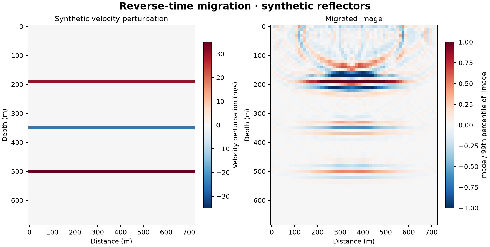

# 17 · Reverse-time migration

**Paths:** MLX and Metal · **Tests:** 44 (all pass on both paths) · **Benchmarked:** yes

Synthetic layered velocity perturbation (left) and the migrated RTM image (right).

## What was built
Reverse-time migration as the adjoint of the project-14 Born operator: the image is the adjoint of linearized modeling applied to the reflection data (full nonlinear layered data minus the direct wave). It uses the shared 13/14 operator (accuracy 4, Deepwave-equivalent CFS-PML, edge-replicated scatter folded back in the adjoint). A second entry point, `born_misfit_and_grad`, returns the Born-prediction loss and its gradient. The MLX path obtains the image as `mx.grad` of a data pairing at zero scatter, and the gradient from `mx.value_and_grad`. Both are autodiff through the time loop. The Metal path has hand-written adjoint kernels (`adjoint_local`, `adjoint_gather`, `fold_gradient`) driven by a stored background-forcing history. Both paths are float32 on the GPU with no CPU float64 step.

## Judge and tolerances
- Oracle: Deepwave `scalar` (nonlinear layered data minus direct wave) and `scalar_born` in float64 on float32-rounded inputs; accuracy 4, `step_ratio == 1`, max_vel = max(velocity). Known reflector depths for the imaging criterion.
- `REFERENCE_RTOL = 1e-4`; `CROSS_RTOL = 2e-4` (two independent 1e-4 budgets); `DEPTH_CELLS = 2` (every reflector within 2 vertical cells, the project's pass criterion); `GRADIENT_RTOL = 1e-3` with `FD_STEP = 0.5` m/s (binary-exact step; a quadratic Born objective has no FD truncation error); `ORACLE_RTOL = 1e-8`; `ZERO_ATOL = 0`; `MIN_LAYER_FRACTION = 1e-3` (anti-degeneracy floor).
- Review notes: in `layers_uniform` the images peak at rows 20 and 40 against true rows 22 and 42, exactly at the 2-cell limit. A velocity step migrated with the Born adjoint images as a doublet whose strongest lobe is about λ/4 shallower, so this is physics, not error. The runner-up rows are 0.72× and 0.76× of the peak. `layers_variable` recovers rows 19/35/50 exactly. The dot-product test runs at 1e-4 because no project-specific adjoint threshold exists.

## Parity
- Tests: 20/20 MLX and 20/20 Metal passed (5 reflector-depth checks; layer and small-image parity; Born prediction/loss/gradient parity; 3 centered-FD directions; discrete-adjoint dot product; RTM = −gradient at zero; RTM equals residual gradient; zero data, linearity, source and signed-data scaling; shot-sum and permutation invariance). The other 4 of 44 are cross-backend checks at 2e-4. MLX-vs-Metal cross-checks: 4/4 `cross_backend` tests passed in a follow-up cross-check run (`CROSS_CHECKS.md`). Their IDs name neither path, so they were selected with `-k cross_backend` rather than `mlx and metal`.
- Independent review: float32 Deepwave audit ≤3.2e-6 on all outputs; float32 FD error ≤6.6e-6; reflector offsets 2, 2, 0, 0, 0 cells.
- Bench medium max relative difference (RTM image): MLX 5.05e-6, Metal 1.99e-6.

## Benchmark
Wall time is the median of three calls after one warm-up (`bench/results.json`). Speedup = judge wall time ÷ path wall time at the same size; the judge is a correctness oracle, not a tuned competitor. Metal times include process launch, shader compilation and file I/O on every call, so a floor of roughly 40–60 ms dominates small sizes.

| Size | Problem | Judge | MLX | Metal | MLX vs judge | Metal vs judge |
|---|---|---|---|---|---|---|
| small | nz=24, nx=24, nt=100, nshot=1, nrec=8 | 6.31 ms | 66.9 ms | 68.8 ms | 0.0943× | 0.0916× |
| medium | nz=48, nx=48, nt=300, nshot=2, nrec=20 | 55.6 ms | 286 ms | 79.6 ms | 0.194× | 0.699× |
| large | nz=96, nx=96, nt=700, nshot=4, nrec=44 | 509 ms | 553 ms | 112 ms | 0.921× | 4.55× |

| Size | Judge peak mem | MLX peak mem | Metal peak mem |
|---|---|---|---|
| small | 0.0297 | 2.99 | 17.6 |
| medium | 0.0356 | 32.9 | 31.7 |
| large | 0.0734 | 358 | 193 |

- Peak memory is in MB as recorded by the harness (decimal MB or MiB per the project notes). Memory methods differ by path and are not comparable across columns. Judge: tracemalloc peak (Python allocations; excludes native Torch allocations). MLX: MLX peak allocated bytes after reset; process RSS high-water also reported. Metal: fresh worker RUSAGE_CHILDREN ru_maxrss delta (macOS bytes), Metal child process RSS.
- Medium-size max relative difference vs judge: MLX 5.05e-06, Metal 1.99e-06.

`rtm` is an adjoint computation, so this compares MLX autodiff with the hand-written Metal adjoint. At the large size (96×96, 700 steps, 4 shots) Metal takes 112 ms against 553 ms for MLX (4.9×). MLX roughly ties the float64 Deepwave judge (0.921×).

## Known limitations
- The Metal path retains the full background-forcing history (memory ∝ shots × padded cells × samples); there is no checkpointing.
- Step-interface reflectors image as doublets offset by up to 2 cells (inherent to Born-adjoint RTM without imaging-condition corrections).
- Goldens depend on a local Deepwave 0.1.0 build whose file hashes are recorded in meta.json.

## Papers
- Deepwave `scalar`/`scalar_born` (Richardson) as the reference; Komatitsch and Martin (2007), C-PML.
- Tarantola (1984) and Zhu et al. (2020) for the adjoint/autodiff view of migration.
