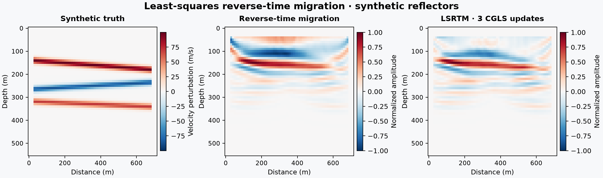

# 18 · Least-squares RTM

**Paths:** MLX and Metal · **Tests:** 55 (all pass on both paths) · **Benchmarked:** yes

Synthetic dipping reflectors (truth), plain RTM, and LSRTM after 3 CGLS updates (Metal path; normalized amplitude).

## What was built
Least-squares RTM: CGLS on the masked Born operator from projects 13/14, with reorthogonalization as specified in `tests/api.py`, plus `born_model`, `misfit_and_grad` and a `lsrtm` solver that also returns plain RTM. The propagator follows the project's own locked `tests/SCHEME.md`: full PML expression at every updated node, per-axis spacing, edge-clamped v/dv with transpose fold-back. The MLX path gets the Born adjoint from autodiff applied one step at a time. A compiled `mx.grad` of a one-step pairing (all six states) is run backward over the stored drives, and a separate `mx.grad` folds the edge extension, so the graph stays bounded over 680 steps. The Metal path has hand-written `reverse_prepare`/`reverse_step`/`fold` kernels plus GPU BLAS-1 kernels (`axpy`, `dot`, `scale`) for CGLS. Both paths are float32 on the GPU with no CPU float64 step.

## Judge and tolerances
- Oracle: a float64 Deepwave-equivalent CGLS reference on the project-17 layered synthetic, validated against an independently written scheme replay (`judge/scheme_reference.py`) at `ORACLE_RTOL = 1e-7`; plain RTM as the comparison.
- `PARITY_RTOL = 1e-4`; `CROSS_RTOL = 2e-4`; `GRADIENT_RTOL = 1e-3` with `FD_STEP = 2` m/s (quadratic objective, no truncation error); `BORN_LINEARIZATION_STEP = 1e-3`; `MAX_RESIDUAL_RATIO = 0.5` (residual L2 down ≥50%); `MAX_WIDTH_RATIO = 0.8` (envelope FWHM narrower by ≥20%); `MAX_DEPTH_ERROR_CELLS = 2`; `HISTORY_SLACK = 1e-6`.
- **Adopted rule (2026-10-28), envelope width:** raw-amplitude width cannot shrink by 20% on project 17's near-Nyquist synthetic, so the official measure is the vertical FWHM of the analytic-signal envelope along depth, locked in `tests/metrics.py` (69-point FFT, no padding, window after transform).
- Judge defects caught in review. First, the raw-width criterion was infeasible (the float64 reference's own width ratios were 0.83–1.05, and a perfect spike could not pass in 6 of 9 cases). Second, the scheme was defined only as "Deepwave's CFS-PML", and project 14's written SCHEME missed the goldens by 1.56e-3 and 3.03e-3. This was traced to db·D1 and D1(a·ψ) surviving in the accuracy/2 nodes next to the PML, which became the **project-14 SCHEME erratum** recorded for 13, 14, 16, 17, 19, 21, 23 and 50. The corrected scheme is the locked one, and an independent float64 transcription matched the goldens to ≤9.6e-15.

## Parity
- Tests: 26/26 MLX and 26/26 Metal passed (Born and objective/gradient references, 3 centered-FD directions, adjoint dot product, mask, zero-model = −RTM, CGLS reference, residual ≥50%, 9 reflector-width checks, solver start vs best-scaled RTM, polarity/scale, zero data, golden integrity). The other 3 of 55 are cross-path operator/solver tests. MLX-vs-Metal cross-checks: 3/3 passed in a separate cross-check run (`CROSS_CHECKS.md`).
- Independent review: envelope width ratios 0.492–0.727 (worst 0.727 vs 0.8); final residual ratio 0.0545; independent Hilbert envelope reproduces golden widths to 1.8e-15. Earlier float32 CPU feasibility diagnostics were at least 25× inside 1e-4.
- Bench medium max relative difference (one CGLS update): MLX 2.13e-6, Metal 1.93e-6.

## Benchmark
Wall time is the median of three calls after one warm-up (`bench/results.json`). Speedup = judge wall time ÷ path wall time at the same size; the judge is a correctness oracle, not a tuned competitor. Metal times include process launch, shader compilation and file I/O on every call, so a floor of roughly 40–60 ms dominates small sizes.

| Size | Problem | Judge | MLX | Metal | MLX vs judge | Metal vs judge |
|---|---|---|---|---|---|---|
| small | nz=20, nx=24, nt=128, nshot=1, nrec=8, iterations=1 | 24.9 ms | 99.5 ms | 57.2 ms | 0.250× | 0.436× |
| medium | nz=40, nx=48, nt=320, nshot=2, nrec=20, iterations=1 | 175 ms | 164 ms | 75.1 ms | 1.07× | 2.33× |
| large | nz=64, nx=80, nt=640, nshot=3, nrec=36, iterations=1 | 729 ms | 355 ms | 133 ms | 2.05× | 5.47× |

| Size | Judge peak mem | MLX peak mem | Metal peak mem |
|---|---|---|---|
| small | 0.0349 | 7.01 | 0 (child-RSS delta; see note) |
| medium | 0.0311 | 32.2 | 0 (child-RSS delta; see note) |
| large | 0.0310 | 157 | 0.469 |

- Peak memory is in MB as recorded by the harness (decimal MB or MiB per the project notes). Memory methods differ by path and are not comparable across columns. Judge: tracemalloc peak Python allocations; excludes native Torch allocations. MLX: MLX reset_peak_memory/get_peak_memory in MiB. Metal: RUSAGE_CHILDREN ru_maxrss high-water mark delta; bytes on macOS.
- Medium-size max relative difference vs judge: MLX 2.13e-06, Metal 1.93e-06.

One CGLS update (a Born forward plus an adjoint) is timed, so this compares per-step MLX autodiff with the hand-written Metal adjoint. At the large size Metal (133 ms) is 2.7× faster than MLX (355 ms) and 5.47× faster than the float64 judge.

## Known limitations
- Inverse crime: the observed data are generated with the same Born operator, so this is a best-case linear test.
- Several 40-iteration CGLS solves per path can take minutes in eager MLX.
- The width gate uses the envelope metric; raw-lobe width barely changes on this near-Nyquist synthetic (the ruling above).
- The integrity test hashes SCHEME.md and the scheme reference, but not `api.py` or `metrics.py`; those are not hash-checked by the tests.

## Papers
- No papers were specified for this project; the method is standard CGLS least-squares migration (e.g. Nemeth, Wu and Schuster 1999), with Tarantola (1984) for the adjoint view.
- Deepwave `scalar_born` (Richardson) behaviour as documented in the locked SCHEME; Komatitsch and Martin (2007), C-PML.
