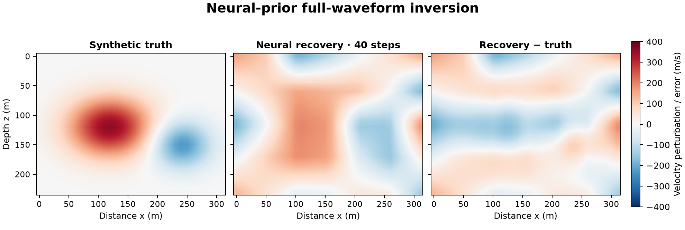

# 20 · Neural-reparameterized FWI (NNFWI style)

**Paths:** MLX only · **Tests:** 32 (all pass) · **Benchmarked:** yes

Synthetic true perturbation, neural-prior recovery after 40 Adam steps (both relative to the initial model), and recovery − truth (MLX).

## What was built
FWI where velocity is generated by a small decoder network instead of being inverted cell by cell, compared with plain grid FWI on the same noisy (6 dB) data. The "generative prior" is a 355-parameter dense decoder: a fixed 4-latent through a tanh layer of width 8 to a 5×7 image, then bilinear upsampling to the grid. The propagator is the project-13 scheme (accuracy 4, 12-cell PML, pml_freq 18, max_vel 2600). `misfit_and_grad` returns the data objective and its gradient with respect to either grid velocities or network parameters, via `mx.value_and_grad` through the decoder and the time loop. `invert` runs a fixed explicit Adam (ε outside the square root, bias correction) for 160 steps in either parameterization. Float32 MLX on the GPU; NumPy float64 appears only in setup (PML profiles, interpolation weights). No step runs in CPU float64.

## Judge and tolerances
- Oracle: Deepwave `scalar` float64 with autograd on float32-quantized inputs (`step_ratio == 1` asserted), an explicit float64 Adam, and plain FWI on the same data. Truth and clean data are withheld from the implementation by an input allowlist.
- `PARITY_RTOL = 1e-4`; `FD_RTOL = 1e-3` with `FD_STEP = 1e-2` (dimensionless); `MAX_ERROR_RATIO = 0.90` (neural ≥10% better than plain FWI); `MAX_INITIAL_ERROR_RATIO = 1.0` (must also beat the start); `ORACLE_FD_RTOL = 1e-4`; `MIN_DIRECTIONAL_DERIVATIVE = 1e-4`; `MAX_GOLDEN_BYTES = 20 MB`.
- Review flagged scope rather than defects. The prior is a compact smooth decoder, not a Zhu et al. (2022) CNN generator, and the baseline is unregularized Adam grid FWI that overfits the noise. The literal pass criterion is met, but the result is specific to this prior and budget. `test_repeated_one_step_is_deterministic` demands bitwise-identical repeats, which is stricter than the project-wide rules require.

## Parity
- Tests: 32/32 MLX passed (4 objective/gradient parity, 12 centered-parameter-gradient directions, 8 fixed-Adam trajectory, 4 determinism, 2 identical-start physics, 2 neural-beats-plain).
- Golden error ratios (neural/plain): 0.857 and 0.736 against 0.90. Oracle calibration: 160-step float32 parameters 1.8e-5 (grid) and 8e-7 (neural), velocity perturbation 1.7e-5, loss history 3e-7. Oracle FD error 1.6e-5 and float32 FD error 3.1e-4 against 1e-3. No float32/float64 sign flips in the first-step gradient (768 cells, 355 parameters).
- Bench medium max relative difference: MLX 1.02e-5.

## Benchmark
Wall time is the median of three calls after one warm-up (`bench/results.json`). Speedup = judge wall time ÷ path wall time at the same size; the judge is a correctness oracle, not a tuned competitor. Metal times include process launch, shader compilation and file I/O on every call, so a floor of roughly 40–60 ms dominates small sizes.

| Size | Problem | Judge | MLX | MLX vs judge |
|---|---|---|---|---|
| small | nz=12, nx=16, shots=1, receivers=6, nt=32 | 3.05 ms | 23.5 ms | 0.130× |
| medium | nz=24, nx=32, shots=3, receivers=15, nt=280 | 22.7 ms | 280 ms | 0.0810× |
| large | nz=64, nx=96, shots=4, receivers=32, nt=1200 | 419 ms | 1.21 s | 0.345× |

| Size | Judge peak mem | MLX peak mem |
|---|---|---|
| small | 0.0343 | 1.44 |
| medium | 0.0326 | 33.9 |
| large | 0.0297 | 496 |

- Metal: n/a, no Metal path was benchmarked for this project (MLX-only project).
- Peak memory is in MB as recorded by the harness (decimal MB or MiB per the project notes). Memory methods differ by path and are not comparable across columns. Judge: tracemalloc peak, Python allocations only; excludes native Torch allocations. MLX: MLX peak device allocation since reset; process RSS is lifetime high-water mark.
- Medium-size max relative difference vs judge: MLX 1.02e-05.

This times one neural `misfit_and_grad` (forward + autodiff gradient). MLX stays slower than the float64 Deepwave judge at every size (0.345× at the large size, 1.21 s vs 419 ms). The judge uses Deepwave's compiled CPU kernels with torch autograd.

## Known limitations
- The prior is a 355-parameter dense decoder acting mostly as a smoothness/low-dimensional constraint, not a deep CNN generator.
- The baseline is unregularized plain FWI; a regularized baseline might close the gap.
- The model-error metric is relative to |truth| (about 2000 m/s background), so absolute errors are small (initial 0.0506).
- Neural one-step parameter parity is normalized by the W1 magnitude (max |p| ≈ 3.3), so the small W2/b2 first updates are checked only to about 1.6% there; they are covered by the velocity and 160-step checks.

## Papers
- Zhu et al. (2022), integrating deep neural networks with FWI (reparametrization, regularization, UQ), Geophysics 87(1).
- Zhu et al. (2020), AD-based seismic inversion; Richardson (2018), Deepwave.
