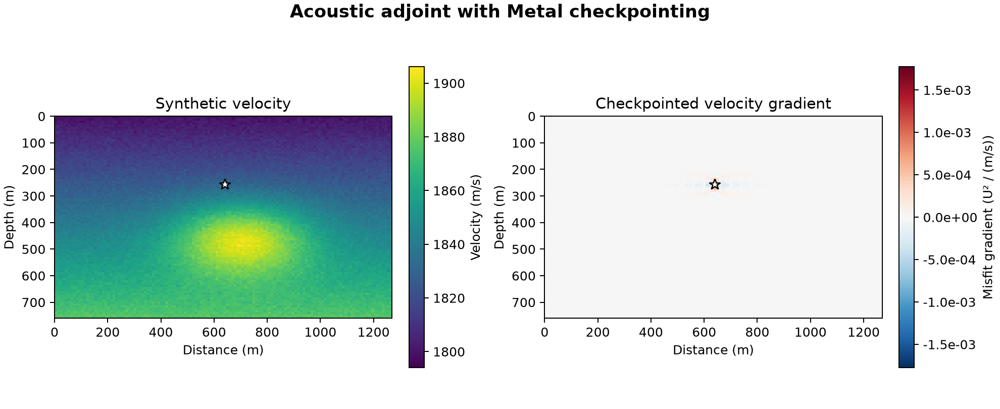

# 21 · Gradient checkpointing

**Paths:** MLX and Metal · **Tests:** 82 (all pass on both paths) · **Benchmarked:** yes

Synthetic velocity model (left) and the Metal velocity gradient computed with 7 checkpoint slots on the large case (96 × 128 grid, 192 steps, source marked).

## What was built
Revolve-style checkpointing for the 2D acoustic C-PML adjoint used by projects 13 and 16: `misfit_and_grad` takes a checkpoint budget, plans an optimal binomial replay schedule (exact minimum forward work F(nt, c, e) defined in `tests/api.py`), and returns the objective, receiver data, velocity gradient, forward-step count, peak checkpoint count, logical bytes and an audited event log. The **MLX** path traces only one time step with autodiff (per-step VJP), forcing `mx.eval` each step so the lazy graph never retains a trajectory; full-storage and bounded-storage runs share the same reverse kernel. The **Metal** path has a hand-written adjoint in `kernels/checkpoint.metal` (D2ᵀ/D1ᵀ gather kernels, replicated-PML gradient folding with one thread per physical cell and compensated float32 sums, no float atomics); Rust plans the schedule (`planner.rs`, smallest optimal split via saturated binomials) and manages GPU restart buffers. Both paths are float32 on the GPU; only PML profile construction is done in float64 NumPy/Rust at setup. The propagator keeps the full PML expression in the guard nodes next to each PML, as Deepwave does (the project-14 SCHEME erratum).

## Judge and tolerances
- Oracle: float64 Deepwave/eager-autodiff full-storage gradient on the same grid, stencil, PML and sampling; exact integer work limits from the recursive-split recurrence.
- `checkpoint_gradient` / `checkpoint_forward` = 1e-6: checkpointed result must equal the same path's full-storage result (max-norm relative).
- `reference` = `cross_path` = 1e-4: float32 vs float64 at the same discrete operator, and MLX vs Metal.
- `finite_difference` = 1e-3 (steps 0.625, 1.25, 2.0 m/s); judge-only `oracle_finite_difference` 2e-5 and `oracle_adjoint` 1e-10; `loss_from_receivers` 2e-6; zero-source outputs exactly 0.
- Work limits are exact, no slack (optimality required). MLX allocator gate: checkpointed peak ≤ (0.4 + 6 × payload ratio) of the full-storage peak, 0.509375 on the memory fixture.
- Defects found in review before lock: `api.py` claimed "global optimality is not required" while the saved limits were the exact optimum (a correct textbook Revolve with the other tie-break exceeded them by one step every time); and no test could fail an implementation that never checkpointed (whole-loop `mx.grad` plus a fabricated log passed everything). Fixed by defining the recurrence in `api.py` and adding the MLX allocator gate. A brute-force search confirmed (nt ≤ 12, c ≤ 4) that the limits are the true optimum.

## Parity
- Tests: 29/29 MLX and 28/28 Metal passed: checkpoint = full storage on 4 fixtures × 5 budgets, full storage vs float64, centered FD at full/0/3 slots, allocator gate (MLX), memory/recompute curve plotted. MLX-vs-Metal cross-checks: 24/24 passed in a separate run (`CROSS_CHECKS.md`).
- Work counts verified independently (long fixture, budgets 0/1/3/7/126): 8128 / 1240 / 516 / 329 / 127 forward steps; memory fixture 1324 (7 slots) vs 385 (full storage).
- An independent MLX prototype on the memory fixture: whole-loop `mx.grad` 511 MB, per-step VJP storing every state 502 MB, ~7 checkpoints 31 MB (prototype, not the shipped code).
- Bench medium max relative difference vs judge: MLX 6.99e-7, Metal 5.01e-7.

## Benchmark
Wall time is the median of three calls after one warm-up (`bench/results.json`). Speedup = judge wall time ÷ path wall time at the same size; the judge is a correctness oracle, not a tuned competitor. Metal times include process launch, shader compilation and file I/O on every call, so a floor of roughly 40–60 ms dominates small sizes.

| Size | Problem | Judge | MLX | Metal | MLX vs judge | Metal vs judge |
|---|---|---|---|---|---|---|
| small | nz=16, nx=24, nt=16, nshot=1, nreceiver=8, checkpoint_budget=7 | 7.23 ms | 15.7 ms | 58.5 ms | 0.461× | 0.124× |
| medium | nz=48, nx=64, nt=64, nshot=1, nreceiver=16, checkpoint_budget=7 | 31.5 ms | 67.2 ms | 84.1 ms | 0.469× | 0.374× |
| large | nz=96, nx=128, nt=192, nshot=1, nreceiver=32, checkpoint_budget=7 | 144 ms | 256 ms | 161 ms | 0.564× | 0.897× |

| Size | Judge peak mem | MLX peak mem | Metal peak mem |
|---|---|---|---|
| small | 0.0296 | 0.446 | 0 (abs. child RSS 17.3) |
| medium | 0.0546 | 3.00 | 0.0469 (abs. child RSS 18.3) |
| large | 0.125 | 6.29 | 0.0312 (abs. child RSS 22.2) |

- Peak memory is in MB as recorded by the harness (decimal MB or MiB per the project notes). Memory methods differ by path and are not comparable across columns. Judge: tracemalloc peak Python allocations; excludes native PyTorch storage. MLX: MLX allocator peak after reset; process RSS high-water mark also reported. Metal: RUSAGE_CHILDREN ru_maxrss high-water delta in macOS bytes; cumulative and may be zero.
- Medium-size max relative difference vs judge: MLX 6.99e-07, Metal 5.01e-07.

The judge here runs full storage (no recomputation), while both GPU paths replay under a 7-slot budget, so neither path beats the CPU judge at these sizes; the hand-adjoint Metal path is 1.6× faster than MLX autodiff at large (161 ms vs 256 ms).

## Known limitations
- The benchmark sizes are small (largest 96 × 128 × 192 steps); the regime where checkpointing pays off (trajectory far larger than memory) is only exercised by the allocator test fixture, not the benchmark.
- The memory-vs-recompute curve is produced by the locked test into pytest's temporary directory; it is not the project figure and no allocator numbers for the shipped code were archived.
- Metal memory reduction is checked by code review and child RSS only, not by a parity test (scope agreed at lock). The MLX allocator gate catches the easy shortcut, not deliberate gaming.
- PML defined by the pinned Deepwave build, as in project 13.

## Papers
- Griewank (1992) and Griewank & Walther (2000), Revolve binomial checkpointing.
- Komatitsch & Martin (2007), C-PML; Deepwave (Richardson) as the reference propagator.
