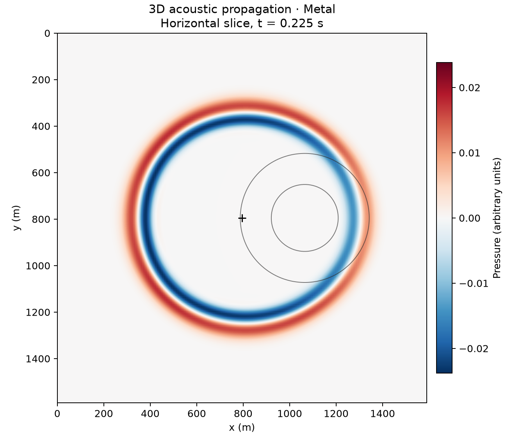

# 22 · 3D acoustic propagation

**Paths:** Metal only (MLX was planned as a reference only; `mlx/` is empty, no MLX reference was built) · **Tests:** 6 Metal tests, all pass (the MLX cross-path check is skipped) · **Benchmarked:** yes

Horizontal slice through a 160³ Metal wavefield at t = 0.225 s: a Gaussian pulse spreading from the centre past a fast Gaussian velocity inclusion (contours at 2100 and 2300 m/s).

## What was built
A 3D second-order (in time and space) acoustic leapfrog propagator, `u' = 2u − p + (v·dt/h)²·∇²u`, on a periodic grid with no source and no PML, as a pure GPU throughput benchmark. The Metal path is a single float32 compute kernel (`propagate.metal`, compiled with fast math disabled) driven from Rust; the host prepares the float32 Courant factor in float64 only when `dt/spacing` is not a normal finite float32 or a velocity is subnormal (edge-case input handling, not bulk compute). Rust carries local hardened NPY parsing and fallible Metal buffer allocation. No MLX reference implementation exists (`mlx/` is empty); MLX is n/a throughout.

## Judge and tolerances
- Oracles: (a) float64 Deepwave `scalar` at the same grid, stencil and dt (heterogeneous model and plane waves); (b) analytic homogeneous plane wave for the convergence test; (c) a model invariant along one axis compared with Deepwave 2D.
- `PARITY_RTOL` = `CROSS_PATH_RTOL` = 1e-4; plane-wave comparisons are normalised by at least the initial amplitude (1).
- `ORDER_MIN`/`ORDER_MAX` = 1.8 / 2.2 (combined space-time order 2, per the project-wide convergence rule adopted 2026-10-28); `ANALYTIC_ERROR_MAX` = 0.08 on the coarsest grid.
- Judge defect found in review before lock: the plane-wave fixtures end near a zero crossing of cos(ωt) (reference maxima 0.011–0.092), so normalising by them made the effective tolerance 1e-6–6e-6 of the true field scale; a straightforward float32 leapfrog failed at 1.07e-4. Fixed by flooring the normaliser at max|initial|; independent float32 orderings then reached ≤2.85e-6 (≥35× margin).
- Documented deviation: the invariant-axis check uses Deepwave 2D as a proxy for project 13 (exact with periodic faces); a direct comparison with project 13's implementation was not added.

## Parity
- Tests: 6/6 Metal passed (Deepwave parity on heterogeneous, plane_12, plane_24, plane_48; analytic convergence; invariant-axis vs 2D). The MLX cross-path check is skipped (no MLX path).
- Independent measurements on the goldens: analytic max errors 0.01879, 0.004519, 0.001107 under refinement, observed orders 2.06 and 2.03; float64 periodic leapfrog matches every golden to ≤3e-13.
- Bench medium max relative difference vs judge: Metal 8.81e-6.

## Benchmark
Wall time is the median of three calls after one warm-up (`bench/results.json`). Speedup = judge wall time ÷ path wall time at the same size; the judge is a correctness oracle, not a tuned competitor. Metal times include process launch, shader compilation and file I/O on every call, so a floor of roughly 40–60 ms dominates small sizes.

| Size | Problem | Judge | Metal | Metal vs judge |
|---|---|---|---|---|
| small | shape=48×48×48, steps=320, spacing=10.0, dt=0.0015 | 38.2 ms | 52.4 ms | 0.730× |
| medium | shape=96×96×96, steps=200, spacing=10.0, dt=0.0015 | 195 ms | 65.2 ms | 2.99× |
| large | shape=192×192×192, steps=500, spacing=10.0, dt=0.0015 | n/a (skipped) | 232 ms | n/a |

| Size | Judge peak mem | Metal peak mem |
|---|---|---|
| small | 2.56 | 26.1 |
| medium | 20.3 | 53.0 |
| large | n/a | 266 |

- Judge large skipped by the benchmark harness: "Single-threaded Deepwave reference may exceed 120 s at this size".
- MLX: n/a, no MLX path was benchmarked for this project (Metal-only; MLX was planned as a reference).
- Peak memory is in MB as recorded by the harness (decimal MB or MiB per the project notes). Memory methods differ by path and are not comparable across columns. Judge: tracemalloc peak; excludes most native PyTorch/Deepwave allocations. Metal: fresh worker RUSAGE_CHILDREN ru_maxrss delta, macOS bytes; child RSS, not GPU allocation.
- Medium-size max relative difference vs judge: Metal 8.81e-06.

At medium (96³, 200 steps) Metal is 3.0× faster than single-threaded float64 Deepwave; the large 192³ × 500-step run takes 232 ms on Metal, but has no judge timing to compare against.

## Known limitations
- The contract is minimal (order 2, periodic, no source, no PML), so the benchmark understates the cost of a realistic 3D run.
- No MLX reference path; no direct comparison with project 13's implementation.
- Judge large size skipped, so there is no large-size speedup.

## Papers
- Deepwave (Richardson) as the reference propagator; standard second-order leapfrog finite differences.
