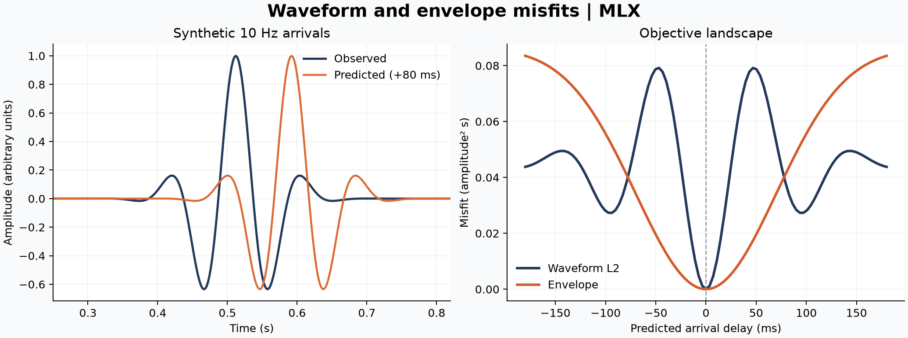

# 23 · Envelope-misfit FWI

**Paths:** MLX only · **Tests:** 24 (all pass) · **Benchmarked:** yes

Synthetic 10 Hz arrivals and their envelopes, with the L2 and envelope objective landscapes versus time shift computed by MLX.

## What was built
Trace-level L2 and envelope misfits with their predicted-data gradients for cycle-skipping-resistant FWI. The envelope is the smoothed modulus of the analytic signal, √(p² + H(p)² + ε²), where the Hilbert transform is an FFT mask (keep DC and Nyquist, double positive frequencies). The objective is the rectangular-time integral `dt/(2·ntrace)·Σ r²`. The MLX path gets the gradient by autodiff through `mx.fft`; intermediate norms are scaled to protect float32 range. Everything runs in float32 on the GPU; no CPU float64 step.

## Judge and tolerances
- Oracle: float64 analytic objective and adjoint (verified against float64 FD to `ORACLE_GRAD_RTOL` = 2e-6), plus a cycle-skipping experiment on time-shifted 10 Hz arrivals with a fixed local optimizer (`_local_search.py`).
- `PARITY_RTOL` = 1e-4 (global infinity norm); `GRAD_RTOL` = 1e-3 centered FD with steps 1e-2 (L2), 5e-3 (unit envelope), 1e-2 (sub-ε envelope); feasibility audit must show 3× margin (`FD_AUDIT_RTOL`).
- Pass criterion: `MIN_BASIN_RATIO` = 1.5 (envelope attraction basin at least 1.5× L2's), `RECOVERY_SECONDS` = 5e-4 s (¼ sample), `MIN_L2_BASIN_SECONDS` = 0.01; `ENVELOPE_EPSILON` = 1e-3.
- Judge defect found in review before lock: the small-envelope FD check was infeasible for a correct float32 implementation (an independent literal float32 build failed at 1.7e-3) and the feasibility audit computed the envelope in float64. Fixed with per-regime FD steps and a literal float32 audit; the independent build then passed 24/24.
- Scope note: the judge certifies the misfit, its adjoint and a one-parameter time-shift inversion; it never runs a wave equation or a velocity model, so the "FWI" part of the build is untested.

## Parity
- Tests: 24/24 MLX passed: float64 reference parity (6), centered gradients (6), physical waveform parity (2), cycle-skipping basin ratio (±delay), dt/receiver normalisation, exact fit and polarity, silence and smoothing.
- Independent measurements: cycle test L2 separatrix at ±0.0475 s, envelope basin ≥ 0.12 s, ratio 3.0 (gate 1.5). Independent float32 FD errors at the locked steps: L2 6.2e-5 / 1.4e-4 / 5.8e-5, envelope 2.4e-4 / 1.4e-4 / 1.3e-4 (odd/even/small).
- Bench medium max relative difference vs judge: MLX 9.81e-6.

## Benchmark
Wall time is the median of three calls after one warm-up (`bench/results.json`). Speedup = judge wall time ÷ path wall time at the same size; the judge is a correctness oracle, not a tuned competitor. Metal times include process launch, shader compilation and file I/O on every call, so a floor of roughly 40–60 ms dominates small sizes.

| Size | Problem | Judge | MLX | MLX vs judge |
|---|---|---|---|---|
| small | ntrace=128, ntime=1024, dt=0.002, kind=envelope, epsilon=0.01 | 2.30 ms | 1.41 ms | 1.63× |
| medium | ntrace=512, ntime=4096, dt=0.002, kind=envelope, epsilon=0.01 | 45.1 ms | 6.45 ms | 6.98× |
| large | ntrace=2048, ntime=8192, dt=0.002, kind=envelope, epsilon=0.01 | 398 ms | 60.0 ms | 6.64× |

| Size | Judge peak mem | MLX peak mem |
|---|---|---|
| small | 16.0 | 47.0 |
| medium | 256 | 752 |
| large | 2,050 | 3,140 |

- Metal: n/a, no Metal path was benchmarked for this project (MLX only).
- Peak memory is in MB as recorded by the harness (decimal MB or MiB per the project notes). Memory methods differ by path and are not comparable across columns. Judge: tracemalloc peak, MiB, including traced NumPy allocations during call. MLX: MLX reset_peak_memory/get_peak_memory, MiB; RSS is process lifetime peak.
- Medium-size max relative difference vs judge: MLX 9.81e-06.

MLX is about 7× faster than the float64 NumPy judge at medium and large (6.98× and 6.64×).

## Known limitations
- No wave-equation or velocity-model FWI is tested or benchmarked; the benchmark times only the envelope objective and gradient on trace arrays.
- FFTs and the final residual reduction keep float32 range limits; epsilon must stay positive in float32.

## Papers
- Bozdağ, Trampert & Tromp (2011), envelope/instantaneous-phase misfits; Wu, Luo & Wu (2014), envelope inversion (standard references for the method; not named in the project files).
- Tarantola (1984), adjoint FWI gradient.
