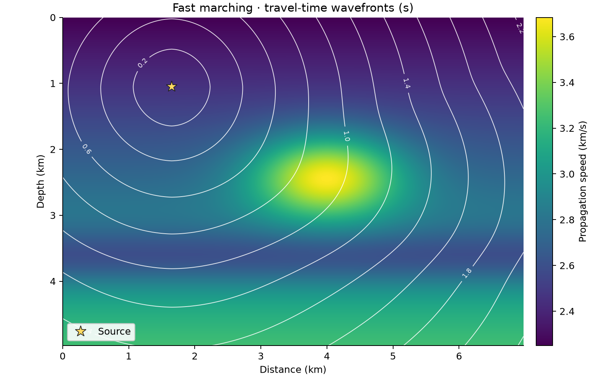

# 24 · Fast marching eikonal solver

**Paths:** MLX and Metal · **Tests:** 144 (all pass on both paths) · **Benchmarked:** yes

First-arrival travel-time contours (0.2 s spacing, white) from a circular source over a smooth heterogeneous speed model, computed by the Metal path at order 1.

## What was built
A fast marching method (FMM) eikonal solver in 2D and 3D, first and second order, with a level-set (`phi`) source: interface nodes are initialised from sign-change crossings, then a narrow band is accepted in increasing time with upwind quadratic updates. Order 1 follows scikit-fmm's conventions (strict sign-change crossings, every frozen axis included); order 2 follows a documented published-style variant (zero-valued neighbours count as crossings, Godunov dimension dropping, order-1 fallback). The **MLX** path, revised to meet the float32 precision policy, still schedules the march on the host with a Python `heapq`. The heap decisions now use NumPy float32 scalars, not float64, and the heap records the winning stencil for each accepted node. MLX then recomputes every returned travel time in float32 on the default device (GPU), layer by dependency layer. Only the discrete heap decisions are detached, so `mx.grad` can differentiate the output with respect to speed and level set along the fixed marching branch. There is no float64 anywhere in the path; the module notes that "No float64 accuracy exception is needed". The **Metal** path runs initialisation as a parallel kernel and the marching itself as a single-thread GPU binary heap in float32 (`marching.metal`), with overflow-safe crossing fractions and a normalised quadratic. FMM is inherently sequential; project 25 is the parallel (sweeping) design.

## Judge and tolerances
- Oracles: scikit-fmm order 1 (float64); an independent float64 transcription of the documented rules (`judge/documented_rules.py`, `second_order.py`) for order 2; analytic homogeneous and constant-gradient media.
- `PARITY_REL` = `CROSS_REL` = 1e-4 (max abs error / max reference time).
- `REFINEMENT_RATIO` = 0.8 per halving (first order; ideal 0.5), `MIN_COARSE_ERROR` = 1e-5.
- `ORDER2_SKFMM_SANITY_REL` = 5e-2: order 2 is only a sanity check against scikit-fmm, because its near-interface rules are undocumented. This replaces the original requirement "matches scikit-fmm at the same order" for order 2 (worst case 0.0338, radial_3d_20).
- `DOCUMENTED_RULES_ATOL` = 1e-10, judge-only self-check of the transcription.
- Judge defects found in review before lock: first, order-2 parity depended on scikit-fmm's compiled internals (three undocumented rules were found by trial; a paper-based second-order FMM missed by 1.0–3.6%); second, the written order-1 rules (zero-valued neighbours as crossings, dimension dropping) missed scikit-fmm by up to 2.7e-2. Both rule sets were rewritten, and an independent FMM written from the docstring alone matched to ≤5.8e-14 (float64) and ≤2.2e-7 (float32) at order 1.

## Parity
- Tests: 56/56 MLX and 56/56 Metal passed: reference parity (32 per path: 16 cases × 2 orders), scikit-fmm order-2 sanity (16), homogeneous planar analytic (4), first-order analytic convergence (4).
- Independent docstring-only float32 build: order 1 ≤ 2.2e-7, order 2 ≤ 4.4e-7; planar analytic 2.5e-7 (float32).
- MLX-vs-Metal cross-checks (separate run, `CROSS_CHECKS.md`): 32/32 passed.
- Bench medium max relative difference vs judge: MLX 2.17e-7 (was 4.73e-8 with the earlier CPU-float64 MLX path), Metal 2.07e-7.

## Benchmark
Wall time is the median of three calls after one warm-up (`bench/results.json`). Speedup = judge wall time ÷ path wall time at the same size; the judge is a correctness oracle, not a tuned competitor. Metal times include process launch, shader compilation and file I/O on every call, so a floor of roughly 40–60 ms dominates small sizes.

| Size | Problem | Judge | MLX | Metal | MLX vs judge | Metal vs judge |
|---|---|---|---|---|---|---|
| small | shape=48×48, spacing_km=0.025×0.025, order=1 | 0.170 ms | 37.3 ms | 49.6 ms | 0.00455× | 0.00342× |
| medium | shape=160×160, spacing_km=0.025×0.025, order=1 | 1.77 ms | 173 ms | 154 ms | 0.0102× | 0.0115× |
| large | shape=480×480, spacing_km=0.025×0.025, order=1 | 17.7 ms | 1.33 s | 1.21 s | 0.0133× | 0.0147× |

| Size | Judge peak mem | MLX peak mem | Metal peak mem |
|---|---|---|---|
| small | 0.0909 | 0.342 | 15.7 |
| medium | 1.00 | 4.41 | 16.7 |
| large | 9.01 | 35.3 | 24.7 |

- Peak memory is in MB as recorded by the harness (decimal MB or MiB per the project notes). Memory methods differ by path and are not comparable across columns. Judge: tracemalloc peak traced Python/NumPy allocations during call. MLX: MLX reset_peak_memory/get_peak_memory; process_rss_mb is process high-water RSS. Metal: fresh worker RUSAGE_CHILDREN ru_maxrss delta (macOS bytes), child RSS high-water.
- Medium-size max relative difference vs judge: MLX 2.17e-07, Metal 2.07e-07.

Both paths are slower than scikit-fmm at every size (large: MLX 0.0133×, Metal 0.0147×). MLX got slower when it was moved to float32 under the precision policy: 1.33 s at large, against 458 ms for the earlier CPU-float64 version. It now runs the Python float32 heap and then replays every stencil layer by layer as MLX float32 operations. The Metal path runs the whole priority queue on one GPU thread, which may be slow on the largest grids. A serial algorithm gains nothing from the GPU on either path.

## Known limitations
- The MLX path now complies with the precision policy (float32 throughout; returned times computed in MLX). Acceptance order and stencil choice are still made serially by a host Python float32 heap, so most of the wall time is host scheduling, not GPU work.
- MLX gradients follow the selected marching branch and are undefined at stencil or topology changes. The locked tests check forward values only, so the new differentiability is untested. Project 28 is the tested differentiable eikonal.
- Metal uses a single GPU thread for the heap; correct but slow. Extreme speeds or spacings can still overflow float32 intermediates.
- Order 2 matches scikit-fmm only to 5e-2 by design; its conventions differ from order 1, and project 25's initialisation matches 24's order-2 convention, not order 1.
- The order-1 negative discriminant is unspecified in the API; both paths guard it (clamp or fallback).

## Papers
- Sethian, fast marching method (the standard second-order FMM).
- scikit-fmm as the oracle.
