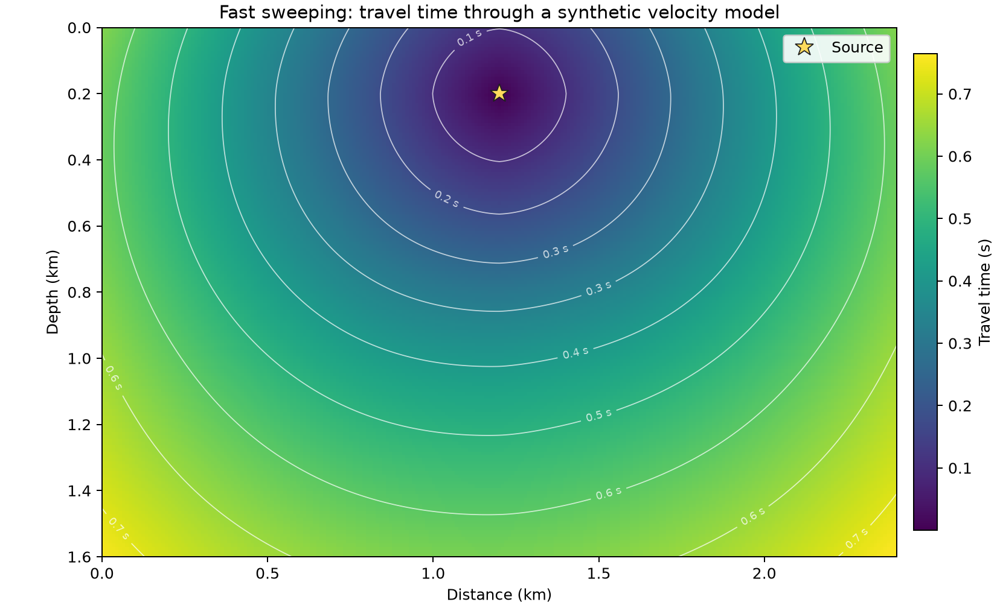

# 25 · Fast sweeping eikonal solver

**Paths:** Metal only (`mlx/` is empty; no MLX reference was built) · **Tests:** 20 (all pass) · **Benchmarked:** yes

Metal travel-time field and contours from a point source through a synthetic model with a vertical gradient, a smooth step at depth and a slow lens.

## What was built
A GPU-parallel eikonal solver in 2D and 3D. Source nodes are initialised from the level set (per-axis nearer crossing distance, inverse-square axis combination, speed at the node, fixed thereafter); every other node is then relaxed with the first-order Godunov upwind update with dimension dropping. Instead of Zhao's 2^d ordered Gauss–Seidel sweeps, the Metal kernel relaxes the grid in red-black (checkerboard) half-sweeps, one thread per node, repeated until a fixed point (with an iteration limit), which exposes full-grid parallelism. Float32 throughout; the quadratic and crossing interpolation are scaled to avoid overflow, and unreached nodes are infinity. No MLX path exists (`mlx/` is empty), so MLX is n/a.

## Judge and tolerances
- Oracle: scikit-fmm order 1 in float64 (same as project 24), plus analytic homogeneous and constant-gradient media for convergence.
- `REFERENCE_REL_MAX` = 1e-4 (max error / max reference time).
- `MIN_OBSERVED_ORDER` = 0.65, `MAX_OBSERVED_ORDER` = 1.35: point-source first-order error has logarithmic corrections (oracle rates 0.67–0.72), a documented loosening of "first-order convergence".
- Judge defects found in review before lock: the source initialisation was only specified as "match scikit-fmm" (a compiled extension whose rules cannot be read from source); two plausible readings missed parity by 1.2e-4 to 4.7e-4. Every grid was square/cubic, so swapped strides would pass. Fixed by writing the exact initialisation rule and adding rectangular fixtures (21×27 and 21×25×29).
- Note: 25's documented rules (zero-valued neighbours as crossings, dimension dropping) differ from scikit-fmm in general; none of these fixtures triggers the difference, so parity is exact here.

## Parity
- Tests: 20/20 Metal passed: scikit-fmm parity (16 cases) and first-order analytic convergence (4).
- Independent docstring-only FSM vs goldens: float32 errors 7.3e-8 to 2.8e-7 across all 12 parity cases (float64 3.5e-11 to 2.4e-8), converging in 1–2 sweep iterations.
- Bench medium max relative difference vs judge: Metal 1.23e-7.

## Benchmark
Wall time is the median of three calls after one warm-up (`bench/results.json`). Speedup = judge wall time ÷ path wall time at the same size; the judge is a correctness oracle, not a tuned competitor. Metal times include process launch, shader compilation and file I/O on every call, so a floor of roughly 40–60 ms dominates small sizes.

| Size | Problem | Judge | Metal | Metal vs judge |
|---|---|---|---|---|
| small | shape=28×28×28, spacing_m=10.0, seed=25 | 3.19 ms | 60.4 ms | 0.0528× |
| medium | shape=64×64×64, spacing_m=10.0, seed=25 | 42.9 ms | 68.2 ms | 0.629× |
| large | shape=128×128×128, spacing_m=10.0, seed=25 | 445 ms | 112 ms | 3.96× |

| Size | Judge peak mem | Metal peak mem |
|---|---|---|
| small | 0.838 | 0.906 |
| medium | 10.0 | 0 (child-RSS delta; see note) |
| large | 80.0 | 0.0625 |

- MLX: n/a, no MLX path was benchmarked for this project (Metal only).
- Peak memory is in MB as recorded by the harness (decimal MB or MiB per the project notes). Memory methods differ by path and are not comparable across columns. Judge: tracemalloc peak allocated during call; excludes untracked native allocations. Metal: RUSAGE_CHILDREN ru_maxrss high-water delta (macOS bytes); may be zero after warmup and excludes GPU allocations.
- Medium-size max relative difference vs judge: Metal 1.23e-07.

The parallel design pays off where serial FMM (project 24) does not: at 128³ Metal is 3.96× faster than scikit-fmm (112 ms vs 445 ms), while the 28³ case is dominated by Metal's startup floor.

## Known limitations
- Convergence window passes automatically once parity passes; the convergence test is weak.
- Inputs are limited to the normal float32 range (spacing/speed, crossing distances, source times); Metal may flush subnormals.
- Return key and spacing type differ from project 24's API; initialisation conventions match 24's order 2, not its order 1.

## Papers
- Zhao (2005), fast sweeping method.
- scikit-fmm as the oracle.
