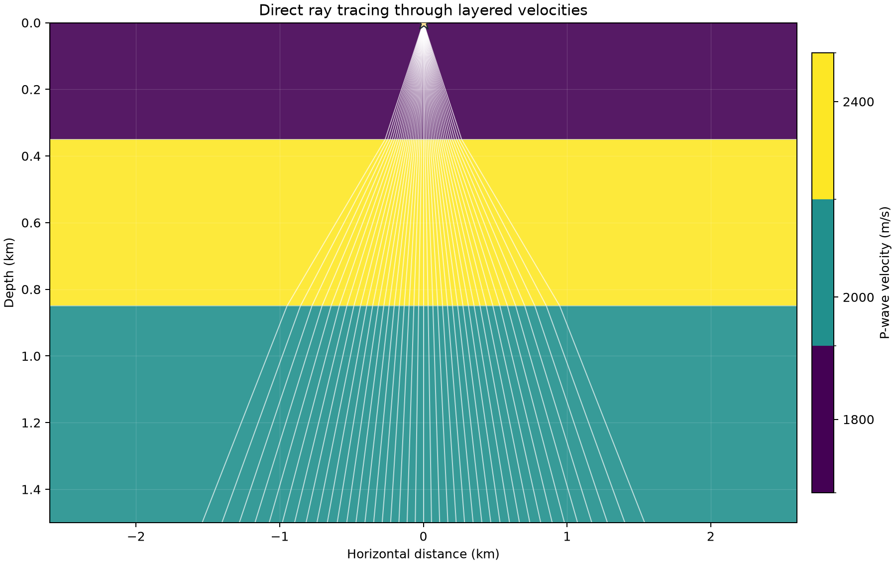

# 26 · Ray tracing (shooting and bending)

**Paths:** MLX and Metal · **Tests:** 42 (all pass on both paths) · **Benchmarked:** yes

Direct downgoing rays from a surface source through a layered velocity model, traced by the implementation.

## What was built
Batched ray shooting (launch angle → endpoint, travel time) and two-point bending (receiver offset → launch angle, travel time) for direct downgoing rays in horizontal layers (Snell's law) and linear v(z) gradients (circular rays). Both paths solve each ray in closed form plus a 1-D root find on the ray parameter p: layered rays sum per-layer `h·u/cos` and `h/(v·cos)` terms, with an analytic derivative for the bending iteration; gradient media use the circular-ray formulas with a g = 0 special case. The **MLX** path vectorises all rays as float32 array operations; the **Metal** path runs one GPU thread per ray in `rays.metal`. Float32 throughout, no CPU float64 step.

## Judge and tolerances
- Oracle: Snell's-law analytic cases and constant-gradient circular rays, float64 goldens from float32-rounded inputs (independently re-derived in closed form to ~1e-15).
- `ENDPOINT_REL` = 1e-4 (endpoint distance error / source–receiver distance), `TIME_REL` = 1e-4, `ANGLE_REL` = 1e-4 on a 1-radian scale, all per ray; `CROSS_FACTOR` = 2 for MLX vs Metal.
- Scope: only layered and linear-v(z) media with transmitted downgoing rays, so no general ODE tracer or path-perturbation bender is exercised. Bend endpoint checks are vacuous by construction (endpoints equal the receivers); bend times and launch angles carry that test. Near-vertical rays get a looser x tolerance (about 0.13 m on a 310 m offset at 1300 m depth).

## Parity
- Tests: 14/14 MLX and 14/14 Metal passed (`test_analytic`, shoot and bend on 7 media: four gradient cases, homogeneous, multi-layer, partial). MLX-vs-Metal cross-checks: 14/14 passed in a separate run (`CROSS_CHECKS.md`).
- Independent hand checks: layered_multi at 0.55 rad gives x = 1021.5107 m, t = 0.794970 s, matching the goldens; largest p·v about 0.85 (no near-critical rays).
- Bench medium max relative difference vs judge: MLX 2.48e-7, Metal 2.34e-7.

## Benchmark
Wall time is the median of three calls after one warm-up (`bench/results.json`). Speedup = judge wall time ÷ path wall time at the same size; the judge is a correctness oracle, not a tuned competitor. Metal times include process launch, shader compilation and file I/O on every call, so a floor of roughly 40–60 ms dominates small sizes.

| Size | Problem | Judge | MLX | Metal | MLX vs judge | Metal vs judge |
|---|---|---|---|---|---|---|
| small | rays=1000, layers=8, batches=1 | 531 ms | 5.77 ms | 35.7 ms | 92.0× | 14.9× |
| medium | rays=10000, layers=8, batches=1 | 4.68 s | 6.50 ms | 36.2 ms | 720× | 129× |
| large | rays=100000, layers=8, batches=10 | n/a (skipped) | 57.9 ms | 405 ms | n/a | n/a |

| Size | Judge peak mem | MLX peak mem | Metal peak mem |
|---|---|---|---|
| small | 0.142 | 2.35 | 0 (child-RSS delta; see note) |
| medium | 0.473 | 24.8 | 0.0156 |
| large | n/a | 233 | 0.0156 |

- Judge large skipped by the benchmark harness: "Scalar SciPy root solves for one million rays may exceed 120 s".
- Peak memory is in MB as recorded by the harness (decimal MB or MiB per the project notes). Memory methods differ by path and are not comparable across columns. Judge: tracemalloc peak after warm-up. MLX: MLX peak allocation after reset; RSS is lifetime high-water. Metal: macOS RUSAGE_CHILDREN ru_maxrss high-water delta after warm-up.
- Medium-size max relative difference vs judge: MLX 2.48e-07, Metal 2.34e-07.

The judge solves each ray with a scalar SciPy root find, so even small batches favour the GPU: at 10,000 rays MLX is 720× and Metal 129× faster. At large (10 batches of 100,000 rays) MLX takes 57.9 ms and Metal 405 ms; there is no judge time.

## Known limitations
- Only analytic media; turning rays, reflections, head waves and 2D/3D smooth media are out of scope.
- Layered shooting keeps float32 sensitivity near critical incidence; no fixture is near critical.
- Very large inputs can overflow float32 intermediate products.

## Papers
- Snell's law and constant-gradient circular-ray formulas (textbook ray theory); no further papers cited in the project files.
