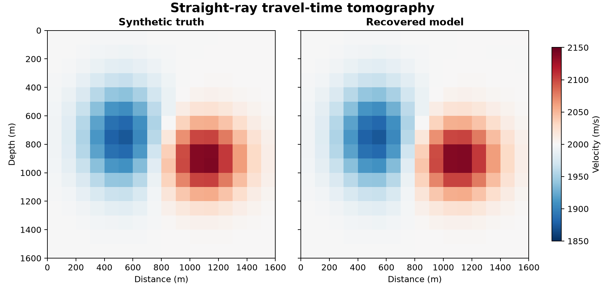

# 27 · Travel-time tomography

**Paths:** MLX and Metal · **Tests:** 35 (all pass on both paths) · **Benchmarked:** yes

Checkerboard resolution test: synthetic checkerboard slowness model (left) and the straight-ray tomographic recovery (right).

## What was built
Straight-ray, cell-wise linear slowness tomography: ray–cell path lengths by slab clipping (`ray_matrix`), a damped least-squares solve toward a reference model, min ‖Gs − t‖² + λ²‖s − s_ref‖², and the objective with its gradient. The **MLX** path builds the matrix with vectorised float32 interval arithmetic, solves the augmented system by QR and a triangular solve on the MLX **CPU stream** in float32 (MLX's linalg QR runs on CPU; no float64), and gets the misfit gradient from `mx.value_and_grad`. The **Metal** path builds the matrix one thread per ray, forms the normal equations on the GPU, and factors them with a float32 Cholesky with compensated sums plus three residual-correction sweeps; the factorisation and triangular solves are single-thread kernels (`factor`, `correction` dispatched as one thread).

## Judge and tolerances
- Oracles: a hand-checked 2-cell, 3-ray system; float64 least squares (augmented SVD); an independent breakpoint/midpoint geometry construction; a checkerboard recovery on a geometry-only mask (80 cells).
- `PARITY_RTOL` = 1e-4 with `GEOMETRY_ATOL_M` = 2.5e-4 m (0.25 mm floor for float32 cancellation at near-coincident corners on a 1.2 km grid; global relative check still applies).
- `SMALL_SYSTEM_RTOL` = 1e-5 (the specified 1e-5, read as relative max error, stricter than absolute).
- `CHECKERBOARD_MIN_CORRELATION` = 0.8; `GRADIENT_FD_RTOL` = 1e-3 with `FD_STEP_S_PER_M` = 1e-5; judge-only `ORACLE_RTOL` 1e-11, `ORACLE_ATOL` 1e-12.
- Scope: fixed straight rays with an inverse crime; although the project was specified as depending on project 24, it does not use the eikonal solver or bend rays (project 28 covers eikonal tomography). The 0.8 correlation gate does no discriminating work here (oracle 0.99999); model parity at 1e-4 carries the test.

## Parity
- Tests: 13/13 MLX and 13/13 Metal passed: ray geometry (3), least squares (4), objective and gradient (2), centered finite differences (2), checkerboard pipeline (2). MLX-vs-Metal cross-checks: 9/9 passed in a separate run (`CROSS_CHECKS.md`).
- Independent hand-solved system: recovered [5.0667e-4, 6.0667e-4] s/m matches the golden. Independent float32 scratch build: slowness errors 2.6e-8 and 4.9e-8 (small, limit 1e-5), 3.5e-7 (checkerboard), FD ≤ 2.6e-5; wrong variants (damping vs damping², damping toward zero) fail.
- Bench medium max relative difference vs judge: MLX 3.89e-7, Metal 2.49e-7.

## Benchmark
Wall time is the median of three calls after one warm-up (`bench/results.json`). Speedup = judge wall time ÷ path wall time at the same size; the judge is a correctness oracle, not a tuned competitor. Metal times include process launch, shader compilation and file I/O on every call, so a floor of roughly 40–60 ms dominates small sizes.

| Size | Problem | Judge | MLX | Metal | MLX vs judge | Metal vs judge |
|---|---|---|---|---|---|---|
| small | nx=12, nz=12, nrays=576 | 1.99 ms | 1.64 ms | 64.4 ms | 1.21× | 0.0309× |
| medium | nx=18, nz=18, nrays=1296 | 9.43 ms | 5.56 ms | 299 ms | 1.70× | 0.0316× |
| large | nx=24, nz=24, nrays=2304 | n/a (skipped) | 18.7 ms | 1.63 s | n/a | n/a |

| Size | Judge peak mem | MLX peak mem | Metal peak mem |
|---|---|---|---|
| small | 2.47 | 1.99 | 0 (child-RSS delta; see note) |
| medium | 12.1 | 9.43 | 0.0164 |
| large | n/a | 29.5 | 0.0655 |

- Judge large skipped by the benchmark harness: "Float64 augmented SVD is expected to exceed 120 s at this size".
- Peak memory is in MB as recorded by the harness (decimal MB or MiB per the project notes). Memory methods differ by path and are not comparable across columns. Judge: tracemalloc peak in separate invocation; native library allocations may be omitted. MLX: MLX peak allocation after reset; process lifetime peak RSS also reported (macOS bytes). Metal: RUSAGE_CHILDREN ru_maxrss high-water delta (macOS bytes); may be zero if an earlier child peaked higher.
- Medium-size max relative difference vs judge: MLX 3.89e-07, Metal 2.49e-07.

MLX is the fastest path (1.70× the float64 judge at medium; 18.7 ms at large). Metal is far slower (1.63 s at large, 87× slower than MLX) because its Cholesky factorisation and triangular solves run on a single GPU thread, so the cubic dense solve is serial.

## Known limitations
- Straight rays and an inverse crime only; no ray bending or eikonal relinearisation.
- The Metal dense solve is serial on one GPU thread; normal equations square the condition number, mitigated by three residual corrections.
- MLX's QR runs on the CPU stream (float32), since MLX linalg QR is CPU-only.
- Judge large size skipped (float64 augmented SVD), so there is no large-size speedup.

## Papers
- Standard damped least-squares straight-ray tomography; no specific papers cited.
