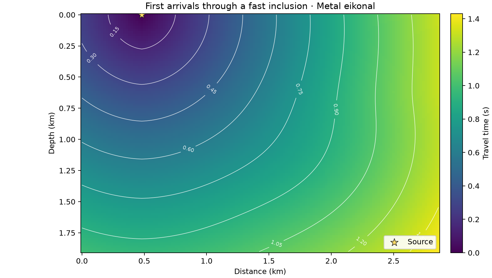

# 28 · Differentiable eikonal tomography

**Paths:** MLX and Metal (MLX autodiff vs Metal hand adjoint) · **Tests:** 57 (all pass on both paths) · **Benchmarked:** yes

First-arrival travel times through a fast inclusion, computed by the Metal eikonal solver.

## What was built
First-order nodal eikonal tomography: a Godunov fast-sweeping solver (point-node Dirichlet sources, nodal slowness, stable increment root T = a + u, swept until arrivals are bitwise unchanged), a weighted travel-time misfit at receivers, and its gradient with respect to slowness. The **MLX** path vectorises Gauss–Seidel sweeps over independent anti-diagonals and shots, then replays the complete deterministic solve inside `mx.value_and_grad`, so the gradient is pure autodiff through every sweep (with a final causal sweep to refresh the graph and `stop_gradient` scaling for extreme increments). The **Metal** path implements the forward sweeps and a hand-written discrete adjoint (`discrete_adjoint` kernel: causal ordering of nodes, back-propagation of residuals through the active upwind stencil), followed by GPU reductions for loss and gradient; sweeping and adjoint ordering are serial within a shot and parallel across shots, with no atomics so results are bitwise repeatable. Float32 throughout; no CPU float64 step.

## Judge and tolerances
- Oracle: float64 heap marching plus a discrete adjoint-state gradient, cross-checked against converged sweeping (`ORACLE_FORWARD_REL` 2e-12), residuals (2e-12) and float64 FD (`ORACLE_FD_REL` 5e-5); sweep stop 1e-14 s.
- `PARITY_REL` = 1e-4; `GRADIENT_COSINE_MIN` = 0.999 vs the adjoint-state gradient (the specified pass criterion); `FD_REL` = 1e-3 with binary-exact steps 2⁻²² and 2⁻²⁰ s/m; zero-loss case exact (`ZERO_ATOL` 0).
- Judge defect found in review before lock: FD pass/fail depended on an unstated choice of root form. The textbook absolute-T quadratic had travel-time parity of 2e-6–8e-6 but failed 8 of 15 FD probes by up to 2.4e-2; the stable increment form passed all with ~2× margin. The stable root was made part of the API contract, and the audit runs full float32 arithmetic.
- Still open: project 24's source/stencil conventions (level set, speed) differ from 28's point-node/slowness contract.

## Parity
- Tests: 27/27 MLX and 27/27 Metal passed: adjoint-reference gradient (3 models), centered FD (15 probes), weight scaling (3), zero residual with bitwise repeatability (3), zero weights (3). MLX-vs-Metal cross-checks: 3/3 passed in a separate run (`CROSS_CHECKS.md`).
- Independent float32 Gauss–Seidel build: worst FD error 4.7e-4 (judge audit 4.96e-4; limit 1e-3), travel-time parity ≤1.4e-7, objective ≤2.4e-7.
- Bench medium max relative difference vs judge: MLX 2.03e-6, Metal 2.46e-6.
- Autodiff vs hand adjoint: both pass the same cosine ≥0.999, FD and parity gates; at medium they agree with the judge to 2.03e-6 (MLX) and 2.46e-6 (Metal).

## Benchmark
Wall time is the median of three calls after one warm-up (`bench/results.json`). Speedup = judge wall time ÷ path wall time at the same size; the judge is a correctness oracle, not a tuned competitor. Metal times include process launch, shader compilation and file I/O on every call, so a floor of roughly 40–60 ms dominates small sizes.

| Size | Problem | Judge | MLX | Metal | MLX vs judge | Metal vs judge |
|---|---|---|---|---|---|---|
| small | nz=10, nx=10, ns=1, nr=10 | 5.59 ms | 133 ms | 39.7 ms | 0.0422× | 0.141× |
| medium | nz=32, nx=32, ns=2, nr=32 | 124 ms | 752 ms | 52.1 ms | 0.165× | 2.38× |
| large | nz=100, nx=100, ns=2, nr=100 | n/a (skipped) | 3.22 s | 166 ms | n/a | n/a |

| Size | Judge peak mem | MLX peak mem | Metal peak mem |
|---|---|---|---|
| small | 0.0107 | 0.0895 | 0 (child-RSS delta; see note) |
| medium | 0.0549 | 1.72 | 0 (child-RSS delta; see note) |
| large | n/a | 21.3 | 0 (child-RSS delta; see note) |

- Judge large skipped by the benchmark harness: "Reference marching constructs a full-grid mask per update; large case may exceed 120 s".
- Peak memory is in MB as recorded by the harness (decimal MB or MiB per the project notes). Memory methods differ by path and are not comparable across columns. Judge: tracemalloc peak traced allocations (MiB). MLX: MLX peak allocated memory (MiB); process RSS is lifetime high-water mark. Metal: RUSAGE_CHILDREN ru_maxrss high-water delta (MiB, macOS); cumulative high-water, may be zero.
- Medium-size max relative difference vs judge: MLX 2.03e-06, Metal 2.46e-06.

This is the clearest autodiff-vs-adjoint result in Outcrop: the hand-written Metal adjoint is 14× faster than MLX autodiff at medium (52.1 ms vs 752 ms) and 19× faster at large (166 ms vs 3.22 s). MLX must replay every sweep inside `value_and_grad` and keep that tape (21.3 MB allocator peak at 100 × 100), whereas the adjoint solves one causal linear pass.

## Known limitations
- MLX autodiff replays the full sweep solve; refresh storage scales with nodes × dependency levels per shot, which is not linear in the worst case.
- Metal sweeping and adjoint are serial within a shot; parallelism comes only from shots and reductions.
- FD margin with the stable root is only ~2×; spacing coefficients must be representable in float32.
- Judge large size skipped (reference marching builds a full-grid mask per update).

## Papers
- Zhao (2005), fast sweeping; adjoint-state travel-time tomography (Leung & Qian 2006, Taillandier et al. 2009, background references not cited in the project files).
- Zhu, Xu, Darve, Beroza (2020/2021), automatic differentiation for seismic inversion (background reading).
