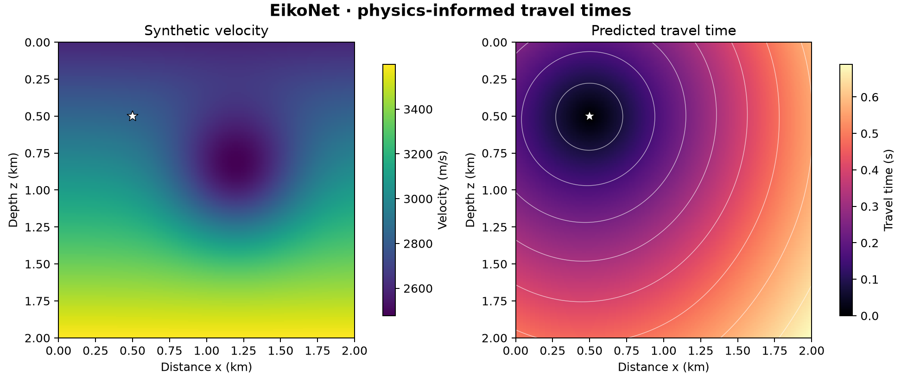

# 29 · EikoNet physics-informed travel times

**Paths:** MLX only · **Tests:** 26 (all pass) · **Benchmarked:** yes

Synthetic velocity model (left) and the travel-time field predicted by the trained EikoNet (right).

## What was built
A small EikoNet-style physics-informed network for source–receiver travel times, trained with no supervised targets: the factored ansatz T = (d / v_ref) · exp(f(x_s, x_r)), with f a width-32, two-tanh-layer MLP (architecture locked by the API; smaller than the paper's), so T(source, source) = 0 algebraically. Training minimises the eikonal residual of the predicted spatial gradient at collocation pairs with full-batch Adam and cosine learning-rate decay; `evaluate` returns travel times and dT/dr. Everything (forward, spatial gradient and parameter gradient by MLX autodiff, i.e. double backprop) is float32 MLX; the public objective uses chunked float32 reductions, training uses ordinary matrix products. No CPU float64 step.

## Judge and tolerances
- Oracle: scikit-fmm order 2, float64, on fine grids (513² and 193³), fixed seed 29012020; float64 analytic network derivatives checked against centered differences (`ORACLE_FD_REL` 1e-4).
- `MEDIAN_TIME_REL` = 0.01 (the specified 1% median), applied per source and per medium; `P95_TIME_REL` = 0.05 extra tail guard. Together they are stricter than the original specification, which set only the 1% median, and were approved at lock.
- `NETWORK_REL` = 1e-4 for fixed-network evaluations, objective and gradients; `OBJECTIVE_SQRT_ATOL` = 1e-6 (compare √loss, since squared residuals cancel near the exact solution); `GRADIENT_FD_REL` = 1e-3 with steps 0.002 (parameters) and 1 m (receivers); `SOURCE_TIME_ATOL` = 1e-7 s.
- Reference-only sanity: FMM homogeneous median 0.5% / p95 1%. The FMM oracle's own point-source error is ~0.31–0.37% median in 3D, so 3D errors much below ~0.3% are not expected.

## Parity
- Tests: 26/26 MLX passed: held-out travel-time accuracy (9: 3 media × 3 sources), fixed-network forward and spatial gradient (2), physics objective and parameter gradient (2), all-parameter and receiver centered differences (4), trained source boundary (3), objective uses returned spatial gradient (3), batch-order invariance (3).
- An independent torch float32 training run (not the MLX code): smooth_2d medians 0.11 / 0.29 / 0.24%, smooth_3d 0.36 / 0.48 / 0.53%, worst p95 1.37%; float32 FD audit errors 2.6e-5 and 8.2e-5.
- The MLX run's held-out medians were not archived; the tests confirm each is ≤1% and p95 ≤5%.
- Bench medium max relative difference vs judge: MLX 2.38e-7.

## Benchmark
Wall time is the median of three calls after one warm-up (`bench/results.json`). Speedup = judge wall time ÷ path wall time at the same size; the judge is a correctness oracle, not a tuned competitor. Metal times include process launch, shader compilation and file I/O on every call, so a floor of roughly 40–60 ms dominates small sizes.

| Size | Problem | Judge | MLX | MLX vs judge |
|---|---|---|---|---|
| small | pairs=5243, dimension=2, width=32 | 1.38 ms | 1.38 ms | 1.00× |
| medium | pairs=65536, dimension=2, width=32 | 18.1 ms | 5.00 ms | 3.62× |
| large | pairs=524288, dimension=2, width=32 | 143 ms | 32.7 ms | 4.37× |

| Size | Judge peak mem | MLX peak mem |
|---|---|---|
| small | 6.92 | 29.0 |
| medium | 86.5 | 360 |
| large | 692 | 2,860 |

- Metal: n/a, no Metal path was benchmarked for this project (MLX only).
- Peak memory is in MB as recorded by the harness (decimal MB or MiB per the project notes). Memory methods differ by path and are not comparable across columns. Judge: tracemalloc peak during call (includes NumPy allocations). MLX: MLX peak allocated memory after reset.
- Medium-size max relative difference vs judge: MLX 2.38e-07.

The benchmark times evaluation plus receiver gradient of a fixed network (not training); MLX is 4.37× faster than the float64 judge at 524,288 pairs.

## Known limitations
- homogeneous_2d starts at the exact solution, so those tests check only that training does not drift; heterogeneous media carry the training tests.
- Tests cannot enforce the ban on supervised targets or FMM calls inside `train`; that is left to code review.
- Small locked architecture (width 32, two tanh layers), not the paper's network; training is not benchmarked.
- Inputs whose exponential exceeds float32 range are not representable.

## Papers
- Smith, Azizzadenesheli, Ross (2020), EikoNet.
- scikit-fmm as the oracle.
