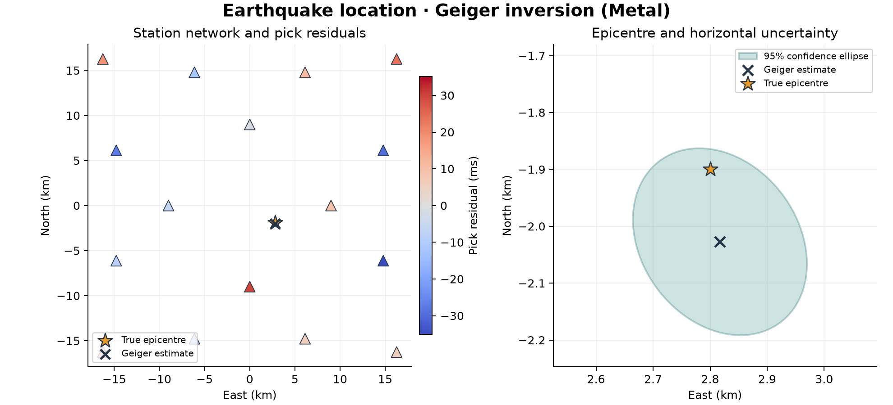

# 30 · Earthquake location

**Paths:** MLX and Metal · **Tests:** 32 (all pass on both paths) · **Benchmarked:** yes

Station network with pick residuals (left) and a zoom on the epicentre with its horizontal 95% uncertainty ellipse (right), from the Metal Geiger inversion.

## What was built
Earthquake location in a homogeneous 6000 m/s medium (east/north/down metres, relative seconds): a 3D grid search that profiles out origin time analytically for every node and event, a weighted least-squares objective and gradient, and Geiger's method (Gauss–Newton) with known heteroscedastic pick sigmas, returning the model, objective, covariance inv(JᵀWJ) and the horizontal-marginal 95% ellipse (χ²₂(0.95) · cov[:2,:2]). The **MLX** path batches events and nodes in memory-bounded chunks, centres the spatial derivatives to eliminate the origin-time intercept before forming the normal matrix (avoiding cancellation from strong depth–t0 correlation), runs 15 loss-decreasing Gauss–Newton steps then 10 undamped steps to stationarity, and inverts with a batched float32 Gauss–Jordan. The **Metal** path does misfit, grid search (per-node kernel plus reduction), gradient and centred QR solves in Metal kernels (`location.metal`). Float32 throughout, with sigma normalisation to protect range; no CPU float64 step.

## Judge and tolerances
- Oracle: analytic t = t0 + |x − s|/v; SciPy TRF least squares (independent of Geiger) in float64 with float32-quantised inputs; covariance at the fit.
- `PARITY_RTOL` = 1e-4 (normwise); `GRID_POSITION_ATOL_M` = 1e-3 m; `TIME_ATOL_S` = 2e-6 s (origin times near 2e-3 s use this floor); `LOSS_ATOL` = 1e-4.
- Specified pass criteria: `GRID_MAX_CELLS` = 1, `GEIGER_MAX_POSITION_M` = 10 m, `GEIGER_MAX_TIME_S` = 0.01 s; coverage of the 95% ellipse in [0.90, 0.99] over `NOISY_TRIALS` = 200; `ELLIPSE_CHI2_95` = 5.991464547107979.
- `GRADIENT_RTOL` = 1e-3 per component with FD steps 8 m and 2 ms; oracle self-checks 1e-6 and 1e-14.
- Binding conventions: known sigma with no residual-variance rescaling and a horizontal-marginal ellipse; a conditional ellipse, 3D quantile or rescaled covariance fails parity by design.

## Parity
- Tests: 14/14 MLX and 14/14 Metal passed: grid reference and within-one-cell, Geiger reference (2) and noise-free recovery, grid-to-Geiger pipeline, objective/gradient reference, centered FD gradient (4), uncertainty definition (2), 200-trial ellipse coverage. MLX-vs-Metal cross-checks: 4/4 passed in a separate run (`CROSS_CHECKS.md`).
- Independent measurements on the saved realisation: coverage 190/200 (nearest trial 0.0046 from the Mahalanobis boundary, so a float32 flip gives 189 or 191, still inside 180–198); max grid error 0.945 cells; best-to-second-best node gap ≥ 2.1 objective units. An independent float32 simulation: location 2.6e-7 (clean) and 7.4e-7 (noisy) normwise, covariance 9e-6, ellipse 1.8e-6, coverage 0.95. East-component FD margin about 4× (1.8e-4–2.4e-4 vs 1e-3).
- Bench medium max relative difference vs judge (grid search): MLX 3.34e-6, Metal 3.34e-6 (identical to every printed digit).

## Benchmark
Wall time is the median of three calls after one warm-up (`bench/results.json`). Speedup = judge wall time ÷ path wall time at the same size; the judge is a correctness oracle, not a tuned competitor. Metal times include process launch, shader compilation and file I/O on every call, so a floor of roughly 40–60 ms dominates small sizes.

| Size | Problem | Judge | MLX | Metal | MLX vs judge | Metal vs judge |
|---|---|---|---|---|---|---|
| small | events=8, stations=32, nx=29, ny=29, nz=29 | 22.8 ms | 3.48 ms | 44.1 ms | 6.55× | 0.517× |
| medium | events=24, stations=32, nx=49, ny=49, nz=49 | 254 ms | 33.9 ms | 93.3 ms | 7.50× | 2.73× |
| large | events=64, stations=32, nx=69, ny=69, nz=69 | 1.65 s | 245 ms | 176 ms | 6.76× | 9.40× |

| Size | Judge peak mem | MLX peak mem | Metal peak mem |
|---|---|---|---|
| small | 48.2 | 16.1 | 0 (child-RSS delta; see note) |
| medium | 232 | 27.3 | 0.125 |
| large | 649 | 25.8 | 0 (child-RSS delta; see note) |

- Peak memory is in MB as recorded by the harness (decimal MB or MiB per the project notes). Memory methods differ by path and are not comparable across columns. Judge: tracemalloc peak traced Python and NumPy allocations. MLX: MLX reset_peak_memory/get_peak_memory; process peak RSS also reported. Metal: RUSAGE_CHILDREN ru_maxrss high-water delta (macOS bytes).
- Medium-size max relative difference vs judge: MLX 3.34e-06, Metal 3.34e-06.

Grid search is embarrassingly parallel: at large (64 events on a 69³ grid) Metal is 9.40× and MLX 6.76× faster than the float64 judge, and Metal overtakes MLX once the grid is big enough to hide its startup floor.

## Known limitations
- Homogeneous velocity only; starting models lie in the local basin, so robustness to arbitrary starts or grid ties is not exercised.
- The ellipse coverage is a property of one saved 200-trial realisation.
- Float32 range: extreme sigma ratios can underflow weights; sigma near 1e20 implies an unrepresentable covariance.
- Only the grid search is benchmarked; Geiger iterations and covariance are not timed.

## Papers
- Geiger's method (Gauss–Newton hypocentre location) and standard χ² confidence ellipses; no specific papers cited.
