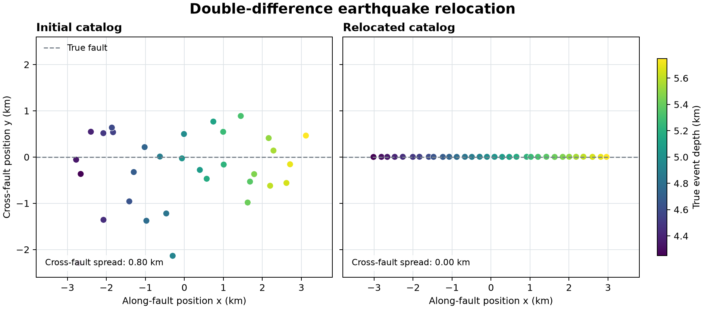

# 31 · Double-difference relocation

**Paths:** MLX only · **Tests:** 6 (all pass) · **Benchmarked:** yes

A 32-event synthetic catalog smeared around a vertical fault (cross-fault spread 0.80 km) collapses onto the fault plane after MLX double-difference relocation (spread 0.00 km at two decimals).

## What was built
Double-difference relative relocation in a homogeneous straight-ray medium: residuals are differences of differential arrival times over all event pairs at all stations, solved by damped Gauss–Newton with a backtracking line search. The MLX path (`mlx/impl.py`) builds the residual and Jacobian in float32, solves the damped augmented system by QR plus triangular solve (avoiding the normal equations), and uses MLX autodiff for the line-search slope. The QR and triangular solve run on MLX's CPU stream (`stream=mx.cpu`) in float32, because MLX linalg factorizations are CPU-only; no float64 is used. The derivative of the station–event distance at exact coincidence uses a zero subgradient.

## Judge and tolerances
- Oracle: `judge/make_goldens.py`, SciPy TRF in float64 on the documented objective (location damping divided by v², origin damping, all pairs, equal weights), clean and noisy (2 ms) cases.
- `SOLUTION_REL = 1e-4`: project-wide float32 bound, scaled by the largest reference value (about 0.58 m absolute on coordinates, about 4e-5 s on origins).
- `RESIDUAL_ABS_SECONDS = 2e-5`: DD values subtract arrival times of several seconds in float32; 20 µs covers cancellation and stopping while still resolving the 2 ms noise.
- `MAX_SPREAD_RATIO = 0.5`: the project's required ≥50% reduction in perpendicular spread.
- Review of the tests noted that the spread criterion is trivially met by the oracle (0.64 → 4.4e-6 km clean, 0.53 → 2.1e-3 km noisy), so the real guard is 1e-4 parity. It showed the tests reject wrong objectives: omitting 1/v² gives 1.7e-3 location error, damping ×10 gives 4.4e-4, dropping origin damping gives ~100 relative origin error.

## Parity
- Tests: 6/6 MLX passed (`test_reference_solution`, `test_differential_arrivals`, `test_fault_spread`, each clean and noisy).
- An independent float32 Gauss–Newton check: 6.6e-7 / 7.6e-7 relative error on locations / origins (clean), 7.8e-7 / 6.1e-7 (noisy); residual 3e-7 s.
- Bench medium (24 events, noisy pairs): MLX max relative difference 4.60e-5 vs the SciPy reference.

## Benchmark
Wall time is the median of three calls after one warm-up (benchmark run, `bench/results.json`). Speedup = judge wall time ÷ path wall time at the same size; the judge is a correctness oracle, not a tuned competitor. Metal times include process launch, shader compilation and file I/O on every call, so a floor of roughly 40–60 ms dominates small sizes.

| Size | Problem | Judge | MLX | MLX vs judge |
|---|---|---|---|---|
| small | events=12, stations=8, pairs=66 | 27.2 ms | 29.5 ms | 0.924× |
| medium | events=24, stations=8, pairs=276 | 101 ms | 54.5 ms | 1.85× |
| large | events=48, stations=8, pairs=1128 | n/a (skipped) | 416 ms | n/a |

| Size | Judge peak mem | MLX peak mem |
|---|---|---|
| small | 1.85 | 0.742 |
| medium | 14.4 | 5.42 |
| large | n/a | 39.7 |

- Judge large skipped by the benchmark harness: "Dense numerical-Jacobian reference may exceed 120 s".
- Metal: n/a, no Metal path was benchmarked for this project (MLX-only project).
- Peak memory is in MB as recorded by the harness (decimal MB or MiB per the project notes). Memory methods differ by path and are not comparable across columns. Judge: tracemalloc peak traced Python/NumPy allocations. MLX: MLX reset_peak_memory/get_peak_memory; process lifetime peak RSS also reported.
- Medium-size max relative difference vs judge: MLX 4.60e-05.

MLX overtakes the dense numerical-Jacobian reference only at medium (1.85×); the problem is small and dominated by per-iteration overhead and CPU-stream QR.

## Known limitations
- Straight rays in a homogeneous medium; noise is independent per pair rather than derived from per-pick errors.
- Fixed iteration and backtracking limits; no guarantee of a global minimum for arbitrary starts.
- The bench medium difference (4.6e-5) is within the 1e-4 gate but well above the 7e-7 of the independent float32 check, so the MLX solve (fixed iterations, float32 CPU-stream QR) lands less tightly on the reference minimum than an ideal float32 solve.
- No Metal path (MLX-only project); linear solves run on the CPU stream.

## Papers
- No papers were specified for this project; the method is the standard double-difference formulation (Waldhauser and Ellsworth, 2000, BSSA), cited here for orientation only.
