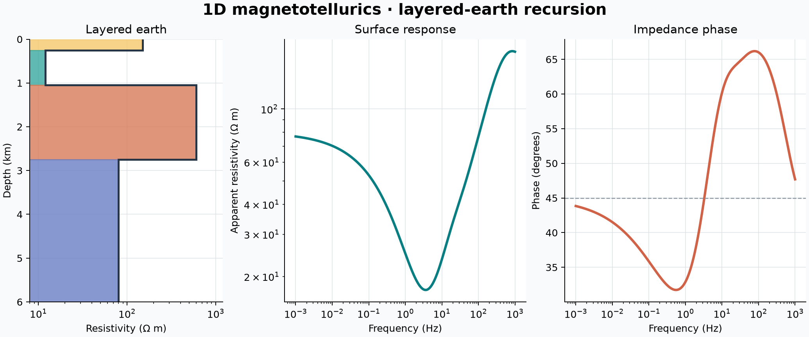

# 32 · 1D magnetotelluric forward model

**Paths:** MLX and Metal · **Tests:** 21 (all pass on both paths) · **Benchmarked:** yes

A four-layer earth (left) and its Metal-computed apparent resistivity and impedance phase from 1e-3 to 1e3 Hz; the dashed line marks the 45° half-space phase.

## What was built
The layered-earth impedance recursion for 1D MT: k = sqrt(iωμ0σ), Z = iωμ0/k at the basal half-space, then Z ← z0 (Z + z0 tanh(kh)) / (z0 + Z tanh(kh)) upward, giving apparent resistivity and phase at the surface (exp(+iωt), Z = −Z_yx, layers surface-first). MLX (`mlx/impl.py`) vectorizes over frequencies in float32 complex arithmetic; Metal (`metal/kernels/mt1d.metal`) runs one thread per frequency with hand-written complex math. Both paths need float32 overflow guards: scaled complex division, normalization of impedance by sqrt(μ0ω), and bounding propagation for optically thick layers before calling tanh/trig. No float64 is used in either path.

## Judge and tolerances
- Oracle: SimPEG's recursive impedance (private `_get_recursive_impedances`, version pinned in `judge/requirements.txt`) plus the analytic half-space (100 Ω·m, 45°), on 7 cases × 7 frequencies (1e-3 to 1e3 Hz).
- `RESPONSE_RTOL = 1e-4`: project-wide elementwise relative-error limit vs float64, atol 0, on both ρa and phase.
- `CROSS_RTOL = 1e-4`: MLX vs Metal, since both are independently rounded float32.
- Review of the tests: an independent float64 recursion matched the goldens to 1e-9 (ρa) and 4e-10 (phase); the same recursion in complex64 reached at most 5.3e-7. It flagged the float32 overflow risk (uniform_layers: 5000 m at 1000 Hz gives kh ≈ 31(1+i)), which both paths handle. The cases catch a wrong time convention (−45°), reversed layer order and wrong thicknesses.

## Parity
- Tests: 7/7 MLX and 7/7 Metal `test_reference` cases passed (half_low, half_high, uniform_layers, conductive_cover, resistive_cover, three_layers, four_layers). MLX-vs-Metal cross-checks: 7/7 passed in a separate cross-check run (`CROSS_CHECKS.md`).
- Bench medium (32 layers, 131,072 frequencies) max relative difference vs SimPEG: MLX 6.73e-6, Metal 7.80e-6.

## Benchmark
Wall time is the median of three calls after one warm-up (benchmark run, `bench/results.json`). Speedup = judge wall time ÷ path wall time at the same size; the judge is a correctness oracle, not a tuned competitor. Metal times include process launch, shader compilation and file I/O on every call, so a floor of roughly 40–60 ms dominates small sizes.

| Size | Problem | Judge | MLX | Metal | MLX vs judge | Metal vs judge |
|---|---|---|---|---|---|---|
| small | layers=16, frequencies=20480 | 5.78 ms | 3.54 ms | 45.5 ms | 1.63× | 0.127× |
| medium | layers=32, frequencies=131072 | 69.0 ms | 6.25 ms | 46.3 ms | 11.0× | 1.49× |
| large | layers=64, frequencies=524288 | 539 ms | 30.1 ms | 50.4 ms | 17.9× | 10.7× |

| Size | Judge peak mem | MLX peak mem | Metal peak mem |
|---|---|---|---|
| small | 19.7 | 24.2 | 14.1 |
| medium | 254 | 157 | 16.9 |
| large | 2,040 | 634 | 25.7 |

- Peak memory is in MB as recorded by the harness (decimal MB or MiB per the project notes). Memory methods differ by path and are not comparable across columns. Judge: tracemalloc peak per call, including NumPy tracked allocations; maximum of repeats. MLX: MLX allocator peak after reset; maximum of repeats. Metal: fresh parent RUSAGE_CHILDREN ru_maxrss delta (macOS bytes); maximum of repeats.
- Medium-size max relative difference vs judge: MLX 6.73e-06, Metal 7.80e-06.

At the large size (64 layers × 524,288 frequencies) MLX is 17.9× and Metal 10.7× faster than the SimPEG reference; Metal's 50 ms includes its process-launch floor, so MLX leads here.

## Known limitations
- Extreme layer contrasts or subnormal conductivities can still underflow/overflow in float32 beyond the locked case ranges (noted for both paths).
- Only 7 frequencies are tested for parity; the benchmark's dense sweeps are checked only through the medium relative difference.
- Positive/finite input validation in MLX applies to NumPy inputs only (to keep autodiff tracers usable).

## Papers
- No papers were specified for this project; the recursion is the standard Wait layered-earth impedance recursion, verified against SimPEG.
