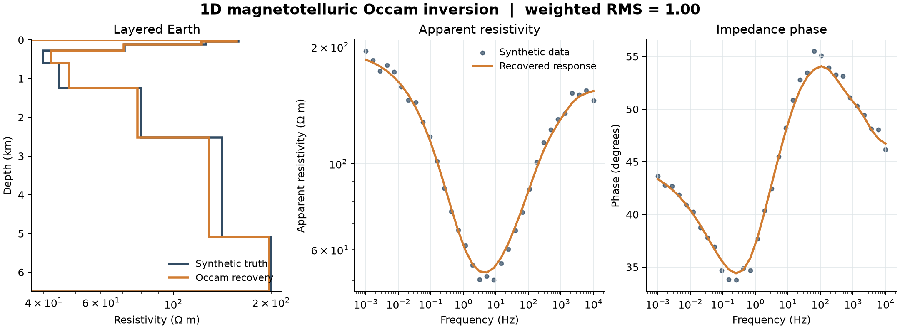

# 33 · 1D MT Occam inversion

**Paths:** MLX only · **Tests:** 12 (all pass) · **Benchmarked:** yes

Occam recovery (orange) of a synthetic layered earth (dark blue) and its fit to noisy apparent-resistivity and phase data at weighted RMS 1.00.

## What was built
Smoothest-model (Occam) 1D MT inversion: minimize roughness ½Σ(Δm)² of the log10-resistivity model subject to weighted RMS ≤ 1, within bounds 1–10,000 Ω·m. The MLX path (`mlx/impl.py`) computes the layered-earth forward response (project 32's recursion, here in log10 ρa and radians, with a saturating complex tanh for thick layers) and the data-misfit objective and gradient by MLX autodiff in float32. To meet the precision policy, the SciPy SLSQP outer loop, which ran in float64 on the CPU, was removed. The inversion is now a bounded Gauss–Newton solve with an Occam multiplier search. The residual Jacobian comes from `mx.jvp`, and a guarded damped elimination solves each step. Everything runs in float32 inside `mx.stream(mx.gpu)`, and the module states there is "no float64 CPU exception". Back substitution reuses the floored pivots from elimination. Returned RMS and roughness are recomputed from the float32 model. The half-space branch is analytic in log10 units (no overflow at ±40), and an earlier 0.995 safety factor on the misfit constraint was removed.

## Judge and tolerances
- Oracle: float64 impedance recursion (`judge/make_goldens.py`), forward goldens on 4 models, objective/gradient goldens, and float64 constrained-minimum inversions (conductor, resistor, constant).
- `FORWARD_RTOL = 1e-4`, `FORWARD_ATOL = 1e-6` on log10 ρa and phase; `OBJECTIVE_RTOL = 1e-4`.
- `GRADIENT_RTOL = 1e-3` (relative L2, project-wide gradient rule), `GRADIENT_ATOL = 1e-5`; `FD_STEP = 2e-3` log10 Ω·m for float32 centered FD.
- `TARGET_RMS = 1.0` with `MISFIT_SLACK = 1e-4`; `MODEL_MAX_ERROR = 0.2` (max |Δlog10 ρ| in the resolved range, layers 0–6, 0–5080 m).
- `ROUGHNESS_RTOL = 0.05` (+`ROUGHNESS_ATOL = 1e-5`): roughness within 5% of an independent float64 constrained minimum. This bound was proposed with the implementation and accepted after review as what makes the test an Occam test (without it any bounded model with RMS ≤ 1 and error ≤ 0.2 would pass).
- Review of the tests flagged that `thick_resistor` drives tanh to |kh| ≈ 5600 (naive complex tanh overflows to NaN), and that the forward tolerance on log10 ρa is about 2e-4 relative in ρa.

## Parity
- Tests: 12/12 MLX passed: forward float64 parity (4 models), objective/gradient parity (3), centered-FD gradient (2), Occam target recovery and smoothness (3).
- An independent complex64 forward: worst error-to-allowance ratio 0.13 (thick_resistor), 2e-7 absolute. Float32 centered FD vs golden gradient: 3.9e-5 relative L2. Oracle inversions: RMS 1.000000000002 / 1.000000000001, max resolved error 0.040 / 0.064.
- Bench medium (48 layers, objective + gradient; unchanged by the precision-policy changes, which touched only the optimizer): max componentwise relative difference 1.69e-4 (denominator floor 1e-8). This is above 1e-4 but is not a gate breach: the bench reference gradient is a float64 centered finite-difference Jacobian (step 1e-5), and the locked gradient criterion is 1e-3 relative L2.

## Benchmark
Wall time is the median of three calls after one warm-up (benchmark run, `bench/results.json`). Speedup = judge wall time ÷ path wall time at the same size; the judge is a correctness oracle, not a tuned competitor. Metal times include process launch, shader compilation and file I/O on every call, so a floor of roughly 40–60 ms dominates small sizes.

| Size | Problem | Judge | MLX | MLX vs judge |
|---|---|---|---|---|
| small | layers=16, frequencies=8192 | 74.1 ms | 6.60 ms | 11.2× |
| medium | layers=48, frequencies=32768 | 2.24 s | 15.5 ms | 144× |
| large | layers=128, frequencies=131072 | n/a (skipped) | 46.1 ms | n/a |

| Size | Judge peak mem | MLX peak mem |
|---|---|---|
| small | 6.32 | 19.3 |
| medium | 73.3 | 169 |
| large | n/a | 1,780 |

- Judge large skipped by the benchmark harness: "Centered finite-difference Jacobian scales quadratically with layer count and is expected to exceed 120 s at this size".
- Metal: n/a, no Metal path was benchmarked for this project (MLX-only project).
- Peak memory is in MB as recorded by the harness (decimal MB or MiB per the project notes). Memory methods differ by path and are not comparable across columns. Judge: tracemalloc peak during call, MiB. MLX: MLX reset_peak_memory/get_peak_memory, MiB.
- Medium-size max relative difference vs judge: MLX 1.69e-04.

The 144× at medium compares MLX autodiff with a judge that builds its gradient from a centered finite-difference Jacobian (2 forward calls per layer), so it mostly measures autodiff vs finite differences, not GPU vs CPU. These timings are close to the pre-policy run (medium 17.0 ms, large 51.8 ms), because the benchmark times the objective and gradient, not the inversion.

## Known limitations
- Precision policy: compliant. The inversion runs in float32 on the GPU, with no SciPy and no float64. The local Gauss–Newton/Occam search does not guarantee a global constrained minimum for arbitrary inputs; the locked cases pass, including roughness within 5% of the float64 optimum. If the iteration budget runs out without a feasible candidate, it returns the lowest-misfit model.
- The multilayer recursion uses float32 linear impedance; extreme multilayer contrasts can still overflow/underflow (only the half-space branch is analytic).
- Only the objective and gradient are benchmarked, not the full inversion, so the new GPU optimizer has no timing.

## Papers
- Constable, Parker and Constable (1987), Occam's inversion (the method this project is named for; no specific paper was specified).
