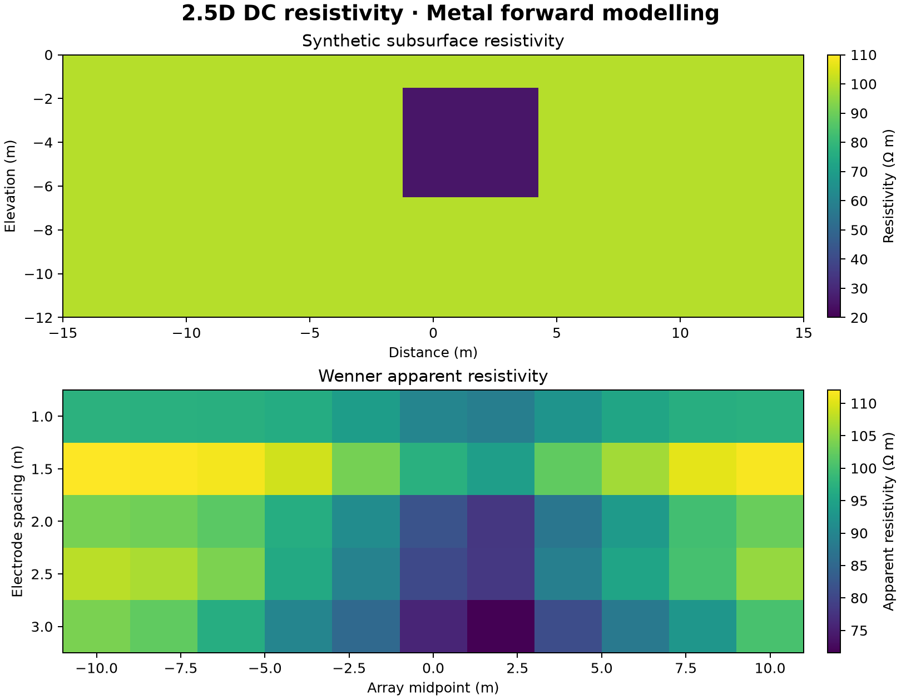

# 34 · 2D DC resistivity forward model

**Paths:** MLX and Metal · **Tests:** 11 (all pass on both paths) · **Benchmarked:** yes

A conductive block in a 100 Ω·m background (top) and the Metal-computed Wenner apparent-resistivity pseudosection over it (bottom).

## What was built
2.5D DC resistivity (point sources over a 2D conductivity) by cell-centred finite volumes: for each Fourier wavenumber ky, solve (−∇·σ∇ + ky²σ)V = I with harmonic face conductances, zero flux at the surface and a Robin condition (α = ky K1/K0 · r̂·n̂) on the sides and bottom, then sum the wavenumber solutions with the supplied quadrature weights. MLX (`mlx/impl.py`) solves all wavenumber systems with a fixed-iteration float32 conjugate-gradient on the GPU; geometry, electrode positions, wavenumbers and the Bessel-ratio boundary factors (SciPy `k0e`/`k1e`) are host-side setup (float64 until the 2026-10-29 update below, now float32). Metal runs a float32 Jacobi-preconditioned CG per system (relative recursive residual 1e-8, at most 4000 iterations, with explicit non-convergence and non-finite errors). To meet the precision policy, `metal/kernels/prepare.metal` was added, and Metal moved the remaining host float64 work onto the GPU in float32: coefficient assembly, the polynomial Bessel-ratio Robin factor, receiver sampling, the Fourier-wavenumber sum and geometric-factor normalization. Kernels are compiled with fast math off, and `metal/src/main.rs` contains no f64. The CPU now handles only validation, mesh coordinates, source indices, dispatch and serialization. MLX's Robin radial origin is the geometric top midpoint; Metal normalizes source currents and uses a relative PCG residual.

## Precision: where each step runs

> **Update 2026-10-29:** float32 was not shown to lose accuracy here (a float32 setup changes the Robin coefficients by at most 3.31e-7 relative), so under the precision policy the host setup now runs in float32 too (`mlx/impl.py` `dc_forward`). The MLX path has no float64 step left. All MLX tests pass after the change. The table below describes the earlier version.
Documented 2026-10-28 from `mlx/impl.py`, `metal/` and the measurements below. Code was not changed.

**MLX path (`mlx/impl.py`, `dc_forward`).** Inputs arrive as float32 (tests and bench both cast them). The code sets no device, so MLX work runs on the default GPU device.

| Step | Where | Precision | Depends on conductivity? |
|---|---|---|---|
| Cast `hx, hz, origin, ky, ab, mn` to float64; cell centres `xc` | host, NumPy | float64 | no |
| Robin factor α = ky·K1(kr)/K0(kr)·(r̂·n̂)/r and ghost-point boundary conductance per unit σ (`_boundary_coefficients`, SciPy `k0e`/`k1e`) | host, NumPy/SciPy | float64, rounded once into a float32 `(nk, nx, nz)` array | no (mesh and ky only) |
| Source injection (nearest cell, ±1) and receiver interpolation matrix (`_receiver_matrix`) | host, NumPy | stored float32; interpolation weights computed from float64 centres | no |
| Face conductances, diagonal assembly (faces + bc·σ + ky²·σ·area), RHS × currents | MLX, GPU | float32 | yes |
| Jacobi-preconditioned CG: 2,500 fixed iterations of the compiled `_cg_step`; each system stops updating once rz ≤ 1e-16·rz₀ | MLX, GPU | float32 | yes |
| Receiver sampling, wavenumber-weighted sum, geometric factor, apparent resistivity | MLX, GPU | float32 | yes |

**Size of the host step.** The host steps above (rows 1–3) took a median of 0.048, 0.112 and 0.258 ms at the small, medium and large bench sizes. That is about 0.03%, 0.06% and 0.02% of the MLX wall times in `bench/results.json` (171 ms, 179 ms, 1.31 s). At large, the float64 Robin step produces 5,736 nonzero coefficients; the GPU CG works on 24 × 121 × 60 × 16 = 2,787,840 unknowns for 2,500 iterations.

These times are a CPU-only scratch measurement (median of 7, 2026-10-28), separate from the benchmark run and possibly taken under background load. The benchmark times the whole call including this setup ("Times include setup and harness serialization" in the `results.json` notes), but does not time the setup separately.

**Why it runs on the host, and why float64.**
- **Host.** MLX 0.32.4 has no modified Bessel functions (none in `dir(mlx.core)`), so the code takes K0/K1 from SciPy.
- **Float64.** The float64 comes from the `np.asarray(..., dtype=np.float64)` casts at the top of `dc_forward`. The inputs are already float32, so float64 here only avoids intermediate rounding; it cannot recover information.
- **Code comment.** The only comment is "Geometry is host-side setup; conductivity and the solve stay in MLX."
- **No recorded accuracy reason.** Nothing in the implementation notes or review records float32 losing accuracy in this step.
- **Measured: float32 is enough.** A strict-float32 copy of `_boundary_coefficients` (float32 arithmetic throughout; SciPy's Bessel routines may evaluate internally in double) differs from the shipped coefficients by at most 2.14e-7, 2.68e-7 and 3.31e-7 relative at small, medium and large. That is float32 rounding level and about 300× below `REFERENCE_REL = 1e-4`.
- **Metal agrees.** The Metal path computes the same factor in float32 on the GPU with a polynomial K1/K0 ratio (`metal/kernels/prepare.metal`). It reaches 3.81e-7 at medium against SimPEG; MLX reaches 5.22e-7.

**Metal path.** All numerical work is float32 on the GPU:
- assembly and the Robin factor (`prepare.metal`);
- PCG (`solve.metal`);
- receiver sampling, the wavenumber sum and the geometric factor.

The CPU handles only validation, mesh coordinates, source indices, dispatch and serialization, and `metal/src/main.rs` contains no f64.

**Policy check (earlier version).** The precision policy allows a CPU float64 step only where float32 is shown to lose accuracy. The step must also be isolated, commented with the reason, documented with the implementation and visible in the benchmarks. For 34 MLX:
- **Isolated: yes.** The step is model-independent setup and is rounded to float32 before any GPU work.
- **Commented: partly.** The comment says the setup is host-side but gives no float64 reason.
- **Documented: partly.** The implementation notes call it "host-side setup", not a precision exception.
- **In the benchmarks: only inside the total.**
- **Float32 loses accuracy: no.** The measurement above shows it does not.

So this was documented host setup, not a justified float64 exception. There were two options:
- accept it as host setup forced by the missing MLX Bessel functions;
- change the setup casts to float32, which changes the coefficients by ≤3.3e-7 relative.

The second option was adopted (see the update above).

## Judge and tolerances
- Oracle: SimPEG 2.5D cell-centred DC on the identical mesh, wavenumbers and weights (homogeneous, block, layered cases), plus the analytic homogeneous half-space.
- `REFERENCE_REL = 1e-4`: project-wide float32 parity at the same mesh, per datum, on voltage and apparent resistivity.
- `ANALYTIC_REL = 1e-2`: the project's required mesh-limited 1% against the analytic half-space (finite-volume and Fourier-quadrature error); the oracle itself reaches 0.584%, leaving 0.42 points of margin.
- `CROSS_PATH_REL = 1e-4`: MLX vs Metal.
- Review of the tests: an independent FV solver written from the API docstring matched the goldens to 1e-15 (3e-8 with float32-rounded inputs). Float32 solver margin is only about 5×: SuperLU in float32 gave up to 2.1e-5 and Jacobi-PCG (residual 1e-7) up to 1.8e-5, because the smallest wavenumber (1e-4 m⁻¹) makes the system nearly singular; loose iterative stopping (~1e-5) would fail.

## Parity
- Tests: 4/4 MLX and 4/4 Metal passed (`test_reference` homogeneous/block/layered, `test_analytic_halfspace`). The 3 locked `test_mlx_metal_crosscheck` tests (homogeneous/block/layered, `CROSS_PATH_REL` 1e-4) select both paths and are not in either single-path run; all 3/3 passed in a separate cross-check run (`CROSS_CHECKS.md`).
- Bench medium (61×32 cells, 12 wavenumbers, 8 sources) max relative difference vs SimPEG: MLX 5.22e-7, Metal 3.81e-7 (1.65e-7 before assembly and accumulation moved to float32 on the GPU).

## Benchmark
Wall time is the median of three calls after one warm-up (benchmark run, `bench/results.json`). Speedup = judge wall time ÷ path wall time at the same size; the judge is a correctness oracle, not a tuned competitor. Metal times include process launch, shader compilation and file I/O on every call, so a floor of roughly 40–60 ms dominates small sizes.

| Size | Problem | Judge | MLX | Metal | MLX vs judge | Metal vs judge |
|---|---|---|---|---|---|---|
| small | nx=25, nz=16, observations=2, wavenumbers=5 | 23.0 ms | 171 ms | 48.7 ms | 0.135× | 0.472× |
| medium | nx=61, nz=32, observations=8, wavenumbers=12 | 71.3 ms | 179 ms | 119 ms | 0.397× | 0.599× |
| large | nx=121, nz=60, observations=16, wavenumbers=24 | n/a (skipped) | 1.31 s | 925 ms | n/a | n/a |

| Size | Judge peak mem | MLX peak mem | Metal peak mem |
|---|---|---|---|
| small | 0.482 | 2.24 | 0 (child-RSS delta; see note) |
| medium | 4.64 | 84.1 | 0 (child-RSS delta; see note) |
| large | n/a | 1,790 | 0.0312 |

- Judge large skipped by the benchmark harness: "Potentially exceeds 120 s for 24 modes and 16 sources".
- Peak memory is in MB as recorded by the harness (decimal MB or MiB per the project notes). Memory methods differ by path and are not comparable across columns. Judge: tracemalloc peak during call (Python allocations). MLX: MLX peak allocated memory after reset; process RSS high-water also reported. Metal: RUSAGE_CHILDREN ru_maxrss delta, macOS bytes; cumulative child high-water mark.
- Medium-size max relative difference vs judge: MLX 5.22e-07, Metal 3.81e-07.

Neither GPU path beats SimPEG at small or medium. At large, Metal (925 ms) is faster than MLX (1.31 s), and MLX's fixed-iteration CG peaks at 1,790 MB of MLX allocations. Both are iterative float32 solvers competing with a sparse direct solver on small 2D meshes. MLX code did not change when Metal moved to float32, so its shift from 1.65 s to 1.31 s at large is run-to-run variation between the two benchmark runs.

## Known limitations
- All test electrodes sit on cell centres, so the general source/receiver interpolation path is untested (noted in review). In the figure, the 1.5 m-spacing row reads above the 100 Ω·m background (up to about 110 Ω·m) away from the block, where electrodes fall between cell centres; this is consistent with that untested path and is not covered by any gate.
- Only symmetric meshes are tested; MLX and Metal may differ on asymmetric non-uniform meshes (Robin origin choice).
- CG convergence uses the recursively updated float32 residual; ill-conditioned systems near ky → 0 have little float32 headroom.
- Precision policy: Metal is fully float32 on the GPU. Before the 2026-10-29 update, MLX prepared geometry, electrode positions, wavenumbers and the SciPy `k1e/k0e` Robin factors in host float64 before its float32 GPU CG. That setup took ≤0.26 ms (≤0.06% of wall time), and float32 changes the coefficients by ≤3.3e-7; it now runs in float32. See "Precision: where each step runs".

## Papers
- No papers were specified for this project; the formulation is SimPEG's 2.5D cell-centred DC discretization, documented in `tests/api.py`.
