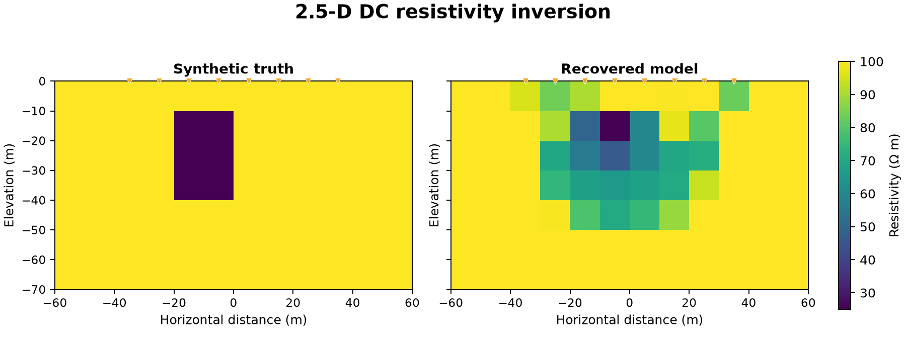

# 35 · 2D DC resistivity inversion

**Paths:** MLX only · **Tests:** 37 (all pass) · **Benchmarked:** yes

A 25 Ω·m conductive block in a 100 Ω·m half-space (left) and the MLX inversion from eight surface electrodes (right). The figure run is capped at 8 optimizer iterations, so it is smoother than the locked recovery tests, which allow 100.

## What was built
2.5D DC resistivity inversion on project 34's cell-centred finite-volume physics: the model is log10 resistivity on active cells, the objective is data misfit plus first-neighbour smoothness, and the optimizer is bounded L-BFGS-B. In the MLX path (`mlx/impl.py`), material mapping, matrix assembly, the batched solves over all sources and wavenumbers, quadrature, the objective and its gradient run in float32 on the GPU. Gradients come from `mx.value_and_grad` through the whole graph, with a custom VJP for the implicit linear solve (an adjoint solve with the transposed matrix). The solver is an equilibrated float32 direct LDLᵀ solve with two residual corrections. Before the 2026-10-29 update below, host-side float64 was used only for fixed geometry, Robin coefficients (SciPy `k0e`/`k1e`), source/receiver projection matrices and SciPy's L-BFGS-B driver; the setup now runs in float32, leaving only the L-BFGS-B driver in float64. No model-dependent computation runs on the CPU. `mx.matmul` may use reduced-precision (TF32-style) arithmetic on the GPU even for float32 inputs, which corrupted the residual corrections and the solve VJP in earlier versions, so all GEMMs were replaced by blocked elementwise float32 products and sums.

## Precision: where each step runs

> **Update 2026-10-29:** float32 was not shown to lose accuracy in the host setup (at most 2.17e-7 relative change in the Robin coefficients), so it now runs in float32 (`mlx/impl.py` `_Problem.__init__`). The only float64 left is SciPy's L-BFGS-B driver, which is double precision by construction (0.134% of inversion time); that is the documented exception. All 37 MLX tests pass after the change. The table below describes the earlier version.
Documented 2026-10-28 from `mlx/impl.py`, the test review and the measurements below. Code was not changed.

Inputs arrive as float32: the tests' `conftest.py` and the bench cast them. The code sets no device, so MLX work runs on the default GPU device.

| Step | Where | Precision | Depends on the model? |
|---|---|---|---|
| `_Problem.__init__`: node and cell coordinates, face half-widths and areas | host, NumPy | float64, uploaded as float32 | no |
| Stencil index tables (`edge_at` n×n, `cell_faces`, face endpoints) | host, NumPy, Python loops | int32 | no |
| Robin coefficients: α = k·K1/K0·(r̂·n̂) from SciPy `k0e`/`k1e`, ghost-point face conductance | host, NumPy/SciPy | float64, rounded once to float32 | no (mesh and quadrature only) |
| Source vectors (nearest cell) and receiver bilinear-interpolation matrix | host, NumPy, Python loops | float64, rounded once to float32 | no |
| Material mapping 10^m, face conductances, matrix assembly | MLX, GPU | float32 | yes |
| Equilibrated LDLᵀ solve with two residual corrections; custom VJP adjoint solve | MLX, GPU | float32, GEMM-free explicit products | yes |
| Receiver differences, quadrature sum, objective, regularization, `value_and_grad` | MLX, GPU | float32 | yes |
| L-BFGS-B driver (`scipy.optimize.minimize`) over the active-cell vector | host, SciPy | float64; the float32 objective and gradient are promoted on return | no; it only proposes trial models, and each one is evaluated in float32 on the GPU |

**Size of the host steps.** These are scratch measurements taken 2026-10-28, separate from `bench/results.json`, and possibly under background load.
- **Whole per-call setup.** All of `_Problem.__init__` (every host row above plus the upload) took a median of 0.704, 1.046 and 3.640 ms at the small, medium and large bench sizes (median of 7). That is about 11%, 12% and 13% of the forward MLX wall times in `bench/results.json` (6.25, 8.54 and 28.5 ms). The benchmark includes this setup in every call ("including per-call problem setup" in the `results.json` notes).
- **What dominates the setup.** A profile at large puts most of it in the Python loops that build the receiver interpolation (`np.clip`/`searchsorted` per electrode) and the index tables. That is interpreter overhead, not float64 arithmetic.
- **The float64 Robin arithmetic alone** (a scratch copy of the same expressions) took 0.029, 0.040 and 0.073 ms, about 0.46%, 0.47% and 0.26% of the forward wall times.
- **The optimizer.** One `dc_invert` on the conductor golden (22×11 mesh, 48 active cells) took 7.553 s: 100 iterations, the cap, with 112 objective/gradient evaluations. 7.510 s of that was inside the MLX float32 evaluations. SciPy's L-BFGS-B bookkeeping took 10.15 ms, 0.134% of the total. The inversion itself is not in the benchmark, which times the forward model only.

**Why it runs on the host, and why float64.**
- **Host.** MLX 0.32.4 has no modified Bessel functions (none in `dir(mlx.core)`), so K0/K1 come from SciPy.
- **Float64.** The setup's float64 comes from the `np.asarray(..., dtype=np.float64)` casts in `_Problem.__init__`. The code comment says: "Accumulate coordinates and evaluate Bessel ratios here, then round the fixed coefficients once to float32." The inputs are already float32, so float64 only avoids intermediate rounding.
- **No recorded accuracy reason.** Nothing in the implementation notes or review records float32 losing accuracy in the setup.
- **Measured: float32 is enough.** A strict-float32 copy of the Robin-coefficient arithmetic differs from the float64-then-rounded coefficients by at most 1.79e-7, 2.17e-7 and 2.14e-7 relative (small, medium, large). That is float32 rounding level.
- **The judge's own audit uses the same pattern.** Its float32 evaluator takes fixed geometric, Robin and projection coefficients from SimPEG, rounds them once to float32 and does everything else in float32. It passes every assertion, with a worst self-FD error of 1.2e-4 against the 1e-3 gate. That shows once-rounded fixed coefficients are adequate; it does not show that float64 is needed to compute them.
- **L-BFGS-B.** It runs in float64 because SciPy's implementation is double precision. It works on a vector of active-cell values (48 in the recovery goldens) and does no physics.

**Policy check (earlier version).** The precision policy allows a CPU float64 step only where float32 is shown to lose accuracy. The step must also be isolated, commented with the reason, documented with the implementation and visible in the benchmarks. For 35:
- **Isolated: yes.** No model-dependent arithmetic runs on the CPU.
- **Commented: yes.** The comments are in the module docstring, `_Problem.__init__` and `evaluate`, though they state what the host does, not an accuracy reason.
- **Documented: partly.** The implementation notes say geometry, Robin coefficients and L-BFGS-B "are retained" and that no float64 model computation was added. They file no exception.
- **In the benchmarks: setup only, inside the total.** The optimizer is not benchmarked.
- **Float32 loses accuracy: no, for the setup.** The measurement above shows it does not. For the optimizer the float64 is SciPy's, not an accuracy choice.

So these were documented host steps, not justified float64 exceptions. The setup was converted to float32 (see the update above); SciPy's L-BFGS-B driver remains the documented float64 exception.

## Judge and tolerances
- Oracle: SimPEG 2.5D DC in float64 on the same mesh (forward, adjoint gradient, TRF inversion), plus a float32 torch audit evaluator built into the judge.
- `PARITY_RTOL = 1e-4` (with `VOLTAGE_ATOL = 1e-10` V, `OBJECTIVE_ATOL = 1e-7`, `GRADIENT_ATOL = 1e-6`).
- `FD_RTOL = 1e-3` at `FD_STEP = 1e-2` dex (oracle: `ORACLE_FD_RTOL = 1e-6` at step 1e-5).
- Recovery: `TARGET_CHI2 = 1.1` (reduced χ²; this reading of "target" was proposed with the implementation and approved); `LOCATION_CELLS = 2.0` (contrast-weighted centroid); `ANOMALY_LOG10_MAX = 0.3` in every true anomaly cell; `BACKGROUND_LOG10_RMS = 0.15` (a guard against blanket anomalies); `MODEL_ATOL = 1e-6`.
- **Judge defect caught after lock (the tests were reopened).** Review found that the centered-FD self-consistency test could not be met by a correct float32 implementation at the original `FD_STEP = 1e-3` dex. Objectives near 1700 move by only 0.04–0.16% per step, so float32 rounding alone gave 2.0e-3 relative error on direction 1. The original audit had rounded only the final objective to float32, which hid this. The fix raised the step to 1e-2 dex with `FD_RTOL` unchanged and replaced the audit with a genuine float32 evaluator. An independent float32 implementation then passed with ≥15× margin.

## Parity
- Tests: 37/37 MLX passed: forward float64 parity (3), objective definition (2), objective/gradient parity (2), 12 centered-FD directions, 6 physical-convention checks, and recovery checks for conductor and resistor (target misfit, anomaly location, per-cell log10 error, localized background, bounds/fixed cells, prediction consistency).
- Independent float32 implementation: self-FD error 1.4e-5 to 6.6e-5; saved-slope error 1.6e-7 to 1.2e-6. Oracle recovery: χ² 0.7265 / 0.6574, centroid error 0.090 / 0.041 cells, anomaly error 0.186 / 0.155 dex, background RMS 0.070 / 0.065 dex.
- Bench medium (forward voltages) max relative difference vs SimPEG: MLX 6.78e-7.

## Benchmark
Wall time is the median of three calls after one warm-up (benchmark run, `bench/results.json`). Speedup = judge wall time ÷ path wall time at the same size; the judge is a correctness oracle, not a tuned competitor. Metal times include process launch, shader compilation and file I/O on every call, so a floor of roughly 40–60 ms dominates small sizes.

| Size | Problem | Judge | MLX | MLX vs judge |
|---|---|---|---|---|
| small | nx=6, nz=5, electrodes=4, quadrature=5 | 20.4 ms | 6.25 ms | 3.26× |
| medium | nx=12, nz=7, electrodes=8, quadrature=13 | 48.1 ms | 8.54 ms | 5.63× |
| large | nx=22, nz=11, electrodes=16, quadrature=25 | 100 ms | 28.5 ms | 3.51× |

| Size | Judge peak mem | MLX peak mem |
|---|---|---|
| small | 0.168 | 0.524 |
| medium | 0.319 | 17.2 |
| large | 1.58 | 591 |

- Metal: n/a, no Metal path was benchmarked for this project (MLX-only project).
- Peak memory is in MB as recorded by the harness (decimal MB or MiB per the project notes). Memory methods differ by path and are not comparable across columns. Judge: tracemalloc peak of traced Python allocations over three repeats. MLX: MLX peak allocated bytes after reset over three repeats.
- Medium-size max relative difference vs judge: MLX 6.78e-07.

These numbers are from a 22:11 re-run with the same code as the first benchmark run; the timings moved only by run-to-run variation (large 27.5 → 28.5 ms MLX, 93.0 → 100 ms judge). Only the forward prediction, including per-call setup, is benchmarked, not the gradient or the inversion. MLX is 3.3–5.6× faster than SimPEG at every size, but its peak allocation grows to 591 MB at large because of the dense direct solve and blocked explicit products.

## Known limitations
- Dense LDLᵀ solve: memory and dispatch cost grow quickly with mesh size, and GEMM-free products are slower than matmul.
- Reciprocity and sign tests rely on electrodes at cell-centre x; off-centre receiver interpolation is not exercised (noted in review).
- `max_iterations` is not observable by the tests; the coarse-mesh apparent-resistivity bias (up to ~33%) is deliberately outside every tolerance.
- Precision policy: every model-dependent computation (assembly, solve, objective, gradient) is float32 on the MLX default GPU device. Before the 2026-10-29 update, host float64 was limited to fixed geometry, Robin coefficients, projection matrices and SciPy's L-BFGS-B bookkeeping over the active-cell vector. Measured float32 sensitivity of the setup is ≤2.2e-7, and L-BFGS-B takes 0.134% of one inversion. See "Precision: where each step runs"; the setup now runs in float32, and L-BFGS-B is the documented float64 exception.
- No Metal path (MLX-only project), so there is no autodiff vs hand-adjoint comparison here.

## Papers
- No papers were specified for this project; the forward operator follows project 34 / SimPEG's 2.5D formulation.
