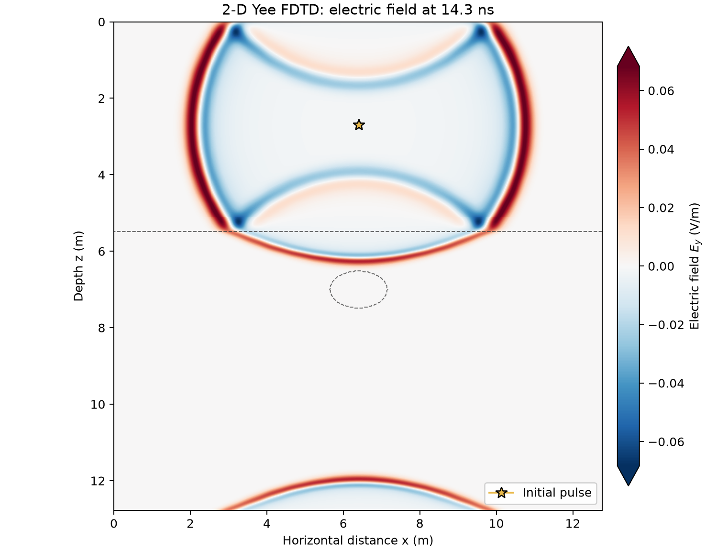

# 36 · GPR FDTD (2D TE Yee)

**Paths:** MLX and Metal · **Tests:** 19 (all pass on both paths) · **Benchmarked:** yes

Snapshot of E_y at 14.3 ns from an initial pulse (star) above a dielectric interface (dashed line) with an embedded object (dashed ellipse). The arc entering at the bottom is the upgoing front wrapping through the periodic boundary.

## What was built
A 2D Maxwell TE-mode finite-difference time-domain propagator on a staggered Yee grid (E_y with H_x, H_z), second order in space and time, with heterogeneous permittivity and periodic boundaries, advanced from given initial fields. MLX (`mlx/impl.py`) expresses the leapfrog updates as float32 array rolls and differences; it stays differentiable in the fields and permittivity. The Courant coefficients c·dt/dx and c·dt/dz are precomputed as host-side scalars before casting to float32, so the update avoids separate float32 reciprocals. Metal (`metal/src/main.rs` + kernels) runs the same updates as float32 compute kernels, with hardened NPY header validation. Neither path uses float64 for field arithmetic.

## Judge and tolerances
- Two judges (FD amendment): (a) an explicit float64 Yee loop on SciPy sparse operators at the same grid and dt; (b) analytic free-space plane-wave convergence under refinement, plus a normal-incidence Fresnel reflection case.
- `PARITY = 1e-4` and `CROSS = 1e-4`: accumulated float32 arithmetic vs the same-grid float64 reference, and MLX vs Metal.
- `ZERO_HZ_ABSOLUTE = 1e-6` V/m: in the x-uniform reflection case H_z is analytically zero, so it gets an absolute bound.
- `CONVERGENCE_RATIO_MAX = 0.30` per grid halving (order ≥ 1.74 for a second-order scheme); the oracle's observed ratios are 0.245 and 0.248.
- `REFLECTION_RELATIVE = 0.02`: the project's required 2% on the reflection coefficient; the oracle's reflected peak is −0.33370 vs −1/3 (0.11%).
- **Judge defect caught during review:** the reflection fixture's `expected_hz` held float64 round-off noise rather than zero, which a relative test cannot handle. The fixed judge asserts noise < 1e-12, stores an exact zero, and compares with the absolute bound.

## Parity
- Tests: 7/7 MLX and 7/7 Metal passed: same-grid reference (wave_24, wave_48, wave_96, reflection, heterogeneous), free-space convergence, reflection coefficient. MLX-vs-Metal cross-checks: 5/5 passed in a separate cross-check run (`CROSS_CHECKS.md`).
- An independent float32 Yee implementation reached 1.2e-7 to 8.6e-7 on every fixture field, with H_z error 0 on the reflection case.
- Bench medium (512², 350 steps) max relative difference vs the float64 reference: MLX 4.90e-6, Metal 4.47e-6.

## Benchmark
Wall time is the median of three calls after one warm-up (benchmark run, `bench/results.json`). Speedup = judge wall time ÷ path wall time at the same size; the judge is a correctness oracle, not a tuned competitor. Metal times include process launch, shader compilation and file I/O on every call, so a floor of roughly 40–60 ms dominates small sizes.

| Size | Problem | Judge | MLX | Metal | MLX vs judge | Metal vs judge |
|---|---|---|---|---|---|---|
| small | nx=256, nz=256, steps=240 | 89.7 ms | 41.4 ms | 42.9 ms | 2.17× | 2.09× |
| medium | nx=512, nz=512, steps=350 | 607 ms | 68.5 ms | 49.3 ms | 8.85× | 12.3× |
| large | nx=1536, nz=1536, steps=700 | n/a (skipped) | 493 ms | 150 ms | n/a | n/a |

| Size | Judge peak mem | MLX peak mem | Metal peak mem |
|---|---|---|---|
| small | 4.30 | 2.62 | 0 (child-RSS delta; see note) |
| medium | 16.9 | 12.6 | 0.0328 |
| large | n/a | 132 | 0 (child-RSS delta; see note) |

- Judge large skipped by the benchmark harness: "Large float64 sparse reference may exceed 120 seconds; medium provides the parity check".
- Peak memory is in MB as recorded by the harness (decimal MB or MiB per the project notes). Memory methods differ by path and are not comparable across columns. Judge: tracemalloc peak Python/NumPy allocations during call (MB). MLX: MLX peak allocated memory after reset (MB); process RSS high-water mark separately. Metal: delta of RUSAGE_CHILDREN ru_maxrss high-water mark (macOS bytes, MB); may be zero after an earlier larger child.
- Medium-size max relative difference vs judge: MLX 4.90e-06, Metal 4.47e-06.

Metal is the fastest path at medium (12.3× the sparse float64 reference) and at large, where it needs 150 ms against MLX's 493 ms for 1536² × 700 steps.

## Known limitations
- Not a full GPR simulator: lossless, periodic boundaries, no source term, no PML, no conductivity.
- Convergence is tested on plane waves in free space; the heterogeneous case is checked only for same-grid parity.
- No gradient tests: MLX is differentiable, but no gradient API is locked for this project.

## Papers
- No papers were specified for this project; the scheme is the standard Yee (1966) staggered-grid FDTD.
