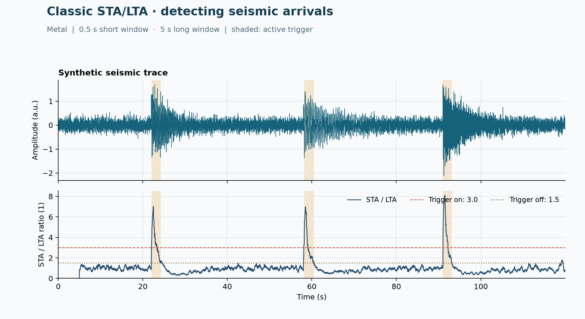

# 37 · STA/LTA event detector

**Paths:** Metal only (`mlx/` is an empty directory) · **Tests:** 5 (all pass) · **Benchmarked:** yes

A synthetic trace with three events (top) and the Metal STA/LTA characteristic function (bottom), with 0.5 s / 5 s windows, on = 3.0, off = 1.5 and active triggers shaded.

## What was built
The classic STA/LTA characteristic function (ratio of short- to long-window mean energy, with ObsPy's startup convention of zeros for the first nlta−1 samples) and `trigger_onset` with inclusive on/off thresholds, for long continuous records. The Metal path (`metal/kernels/sta_lta.metal`, `metal/src/main.rs`) computes window energies on the GPU from a balanced tree of positive partial sums, stored as a float32 mantissa plus an integer exponent so that small energies are not lost by subtraction across large amplitude changes (including subnormal inputs). The tree replaces direct window rescans. Trigger extraction runs on the host. No float64 is used.

## Judge and tolerances
- Oracle: ObsPy 1.5.1 `classic_sta_lta` (C version) and `trigger_onset`, seed 3701; cases: constant, equal windows, impulse, a 65,536-sample `long` trace, and trigger edge cases.
- `CHAR_RTOL = 1e-4`: project-wide float32 accuracy, pointwise on the characteristic function.
- `CHAR_ATOL = 1e-6`: float32 rounding near zero; startup zeros are checked exactly, and trigger indices must be identical.
- **Judge defect caught during review:** the first version of the suite parametrized over both paths and added MLX-vs-Metal cross-checks, so 9 of 14 tests could never pass on a Metal-only project. The suite was restricted to Metal (5 tests).
- Review also measured that a float32 global prefix sum of squares misses 1e-4 on the `long` trace (2.6e-3 excess), so implementations need direct, blocked or compensated sums. Trigger margins: the closest post-startup value is 6.1e-4 relative from `on = 3`, and ±1e-4 perturbations do not change ObsPy's triggers.

## Parity
- Tests: 5/5 Metal passed (`test_characteristic_and_trigger` constant / equal_windows / impulse / long, `test_trigger_boundaries`). Triggers match exactly: [[5003, 5258], [27000, 27257], [65000, 65224]] on `long`, [512, 516] on impulse.
- Bench medium (6.4 M samples) max relative difference vs ObsPy: Metal 2.46e-7.

## Benchmark
Wall time is the median of three calls after one warm-up (benchmark run, `bench/results.json`). Speedup = judge wall time ÷ path wall time at the same size; the judge is a correctness oracle, not a tuned competitor. Metal times include process launch, shader compilation and file I/O on every call, so a floor of roughly 40–60 ms dominates small sizes.

| Size | Problem | Judge | Metal | Metal vs judge |
|---|---|---|---|---|
| small | samples=640000, nsta=40, nlta=400 | 0.505 ms | 82.4 ms | 0.00613× |
| medium | samples=6400000, nsta=40, nlta=400 | 5.05 ms | 133 ms | 0.0380× |
| large | samples=64000000, nsta=40, nlta=400 | 52.3 ms | 371 ms | 0.141× |

| Size | Judge peak mem | Metal peak mem |
|---|---|---|
| small | 9.77 | 43.0 |
| medium | 97.7 | 264 |
| large | 977 | 2,260 |

- MLX: n/a, no MLX path was benchmarked for this project (Metal-only project).
- Peak memory is in MB as recorded by the harness (decimal MB or MiB per the project notes). Memory methods differ by path and are not comparable across columns. Judge: tracemalloc peak during call; input allocated before tracing. Metal: max child ru_maxrss delta across three fresh workers (macOS bytes).
- Medium-size max relative difference vs judge: Metal 2.46e-07.

Metal is slower than ObsPy's single-pass C loop at every size (0.141× at 64 M samples). Each call pays process launch, shader compilation, file transport of the 64 M-sample trace and an O(N log N) energy tree, while ObsPy's C running sum is O(N). This project shows no GPU win as measured.

## Known limitations
- The tree uses `16 × next_power_of_two(N)` bytes and logarithmic work per window; lengths whose tree exceeds uint indexing are rejected.
- A characteristic value below the float32 normal range can flush to zero on Metal (far below `CHAR_ATOL`).
- Silent long windows (zero long-window energy) are out of contract.
- No MLX path (Metal-only project).

## Papers
- No papers were specified for this project; ObsPy's `classic_sta_lta` is the reference definition.
