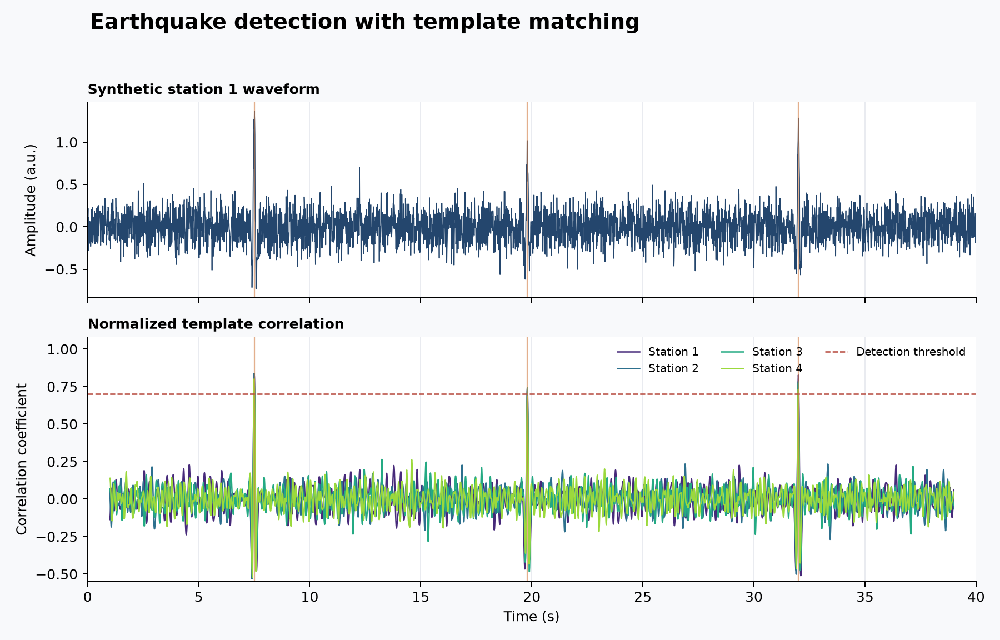

# 38 · Template matching

**Paths:** Metal only (`mlx/` is an empty directory) · **Tests:** 3 (all pass) · **Benchmarked:** yes

A synthetic station waveform with three repeated events (top) and Metal normalized cross-correlation of one template on four stations (bottom), crossing the 0.7 detection threshold at each event.

## What was built
Normalized (Pearson) cross-correlation of many templates against continuous data on many stations, in valid mode with demeaning and full normalization, followed by threshold detections per station (no network stacking or peak picking). The Metal kernel (`metal/kernels/template_match.metal`) is a direct O(T·S·(N−M+1)·M) correlation in float32, one thread per output lag. An independent power-of-two rescaling of each window and template is applied before centering and accumulating, which prevents overflow and underflow at extreme amplitudes, keeps subnormals, and returns exactly zero for constant (zero-variance) windows. The Rust driver uses a local bounds-checked NPY reader and fallible GPU buffer allocation. Inputs given as float64 are rounded to float32; no float64 arithmetic is used.

## Judge and tolerances
- Oracle: ObsPy 1.5.1 `correlate_template` (valid mode, `normalize="full"`, demean), seed 3801; cases `multi`, `edges`, `degenerate`.
- `CORRELATION_ATOL = 1e-4`: absolute, because correlations are bounded by 1 and include exact zeros. Detections above threshold must match exactly, both against the golden and against the implementation's own correlation.
- **Judge defect caught during review:** as in project 37, the first version of the suite required an MLX path and an MLX-vs-Metal cross-check on a Metal-only project. The suite was restricted to Metal (3 tests).
- Review notes: `degenerate` needs exactly 0.0 (not NaN) for zero-variance windows. The tightest detection margin is 0.0038 from threshold (`edges`); a float32 sliding-sum probe reached 2.4e-7.

## Parity
- Tests: 3/3 Metal passed (`test_obspy_parity` multi / edges / degenerate), with detections identical to ObsPy.
- Bench medium max relative difference vs ObsPy: Metal 7.92e-7.

## Benchmark
Wall time is the median of three calls after one warm-up (benchmark run, `bench/results.json`). Speedup = judge wall time ÷ path wall time at the same size; the judge is a correctness oracle, not a tuned competitor. Metal times include process launch, shader compilation and file I/O on every call, so a floor of roughly 40–60 ms dominates small sizes.

| Size | Problem | Judge | Metal | Metal vs judge |
|---|---|---|---|---|
| small | stations=2, samples=8192, templates=4, template_samples=128 | 2.10 ms | 41.8 ms | 0.0502× |
| medium | stations=4, samples=16384, templates=8, template_samples=192 | 16.3 ms | 49.2 ms | 0.332× |
| large | stations=8, samples=32768, templates=16, template_samples=256 | n/a (skipped) | 72.1 ms | n/a |

| Size | Judge peak mem | Metal peak mem |
|---|---|---|
| small | 1.57 | 14.9 |
| medium | 12.4 | 22.7 |
| large | n/a | 80.1 |

- Judge large skipped by the benchmark harness: "Direct float64 correlation may exceed 120 seconds at this size".
- MLX: n/a, no MLX path was benchmarked for this project (Metal-only project).
- Peak memory is in MB as recorded by the harness (decimal MB or MiB per the project notes). Memory methods differ by path and are not comparable across columns. Judge: tracemalloc peak during timed calls (Python and traced NumPy allocations). Metal: RUSAGE_CHILDREN ru_maxrss high-water delta, fresh worker; includes warm-up child.
- Medium-size max relative difference vs judge: Metal 7.92e-07.

The project plan expected this one to be "dramatically fast". As measured it is not: Metal is slower than ObsPy at small (0.0502×) and medium (0.332×) and was never compared at large, where it took 72.1 ms. The benchmark sizes are small enough that Metal's per-call launch and compile cost dominates. The judge's large skip is also conservative: medium took 16.3 ms, and large is about 11× more correlation work.

## Known limitations
- The direct kernel is O(T·S·(N−M+1)·M) with float32 accumulation over the template window; there is no FFT or sliding-sum formulation, so long templates cost proportionally more.
- Coefficients arbitrarily close to the threshold remain rounding-sensitive.
- Per-station coefficients only (no network stacking, no peak picking).
- The 35 extra regression cases in `bench/metal/test_review_cases.py` are optional and were not part of the locked suite.

## Papers
- No papers were specified for this project; ObsPy's `correlate_template` is the reference definition.
