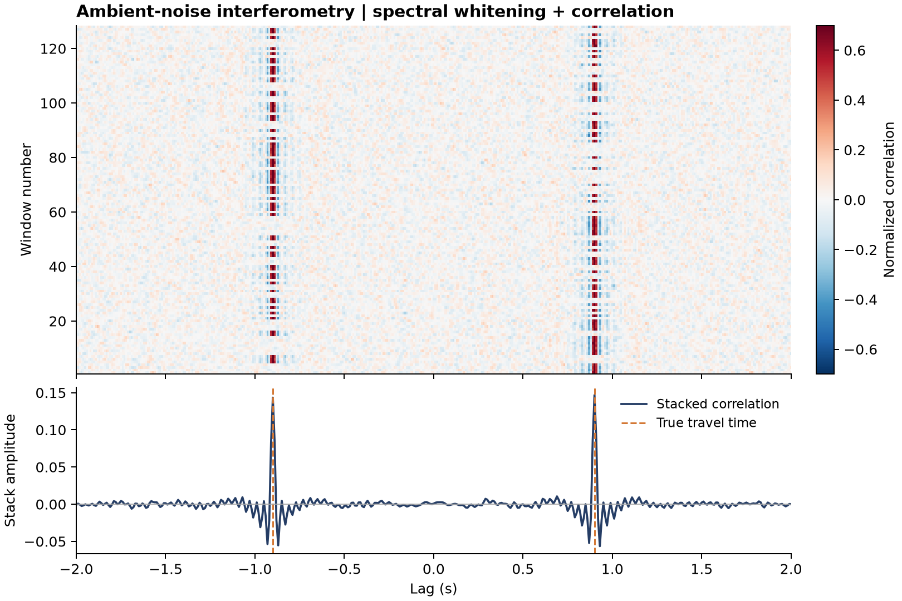

# 39 · Ambient-noise interferometry

**Paths:** MLX and Metal · **Tests:** 11 (all pass on both paths) · **Benchmarked:** yes

Metal-computed whitened cross-correlations for 128 windows of a synthetic two-sided noise field (top). The stack (bottom) peaks at the true ±travel time (dashed).

## What was built
The ambient-noise pipeline: per-window spectral whitening (unit magnitude inside an inclusive 3–25 Hz band, with an `eps` magnitude cutoff), cross-correlation in the frequency domain, FFT shift to zero lag at n//2, and stacking over windows. MLX (`mlx/impl.py`) uses `mx.fft.rfft`/`irfft` in float32 on the GPU; the band mask's bin frequencies k/(N·dt) are evaluated in host float64 so both band edges are included exactly, which is a mask construction rather than bulk compute. Metal (`metal/kernels/ambient.metal`) uses hand-written radix-2 GPU FFTs for power-of-two lengths and O(N²) direct GPU transforms for other lengths (such as the locked 63-sample case), with real-spectrum reconstruction and endpoint weighting; the band mask is likewise built in double precision on the host. The shader avoids the reserved MSL type name `half` as a variable name; using it prevented compilation.

## Judge and tolerances
- Oracle: a float64 NumPy pipeline on synthetic random-source simulations with a known Green's function (cases `diffuse`, `edge`, `nyquist`).
- `FFT_RELATIVE = 1e-4`: peak-normalized error, allowing float32 FFT round-off including near zeros.
- `CROSS_PATH_RELATIVE = 1e-4`: MLX vs Metal.
- `GREEN_CORRELATION_MIN = 0.9`: the project's required Green-function recovery criterion.
- **Judge defect caught during review:** the `edge` case's `eps` was ill-posed for float32. Off-peak bins held FFT round-off of order one float32 ulp, so whether they were whitened depended on the transform. MLX GPU `rfft` left ~2e-6 and an unreduced-angle DFT left 7e-5, above eps. The fixed judge sets the edge cutoff to 0.1 with asserted margins and adds a `nyquist` case.
- Review: both band edges fall exactly on a bin and must be inclusive (an exclusive top edge fails with errors 4.5e-2 and 5.1e-2).

## Parity
- Tests: 4/4 MLX and 4/4 Metal passed (`test_reference` diffuse / edge / nyquist, `test_green_recovery`). MLX-vs-Metal cross-checks: 3/3 passed in a separate cross-check run (`CROSS_CHECKS.md`).
- An independent float32 pipeline: worst error with MLX `rfft` was 8.6e-7 on CPU and 1.5e-6 on GPU; direct DFTs ranged from 2.8e-7 to 5.7e-5, all within 1e-4.
- Bench medium max relative difference vs the float64 reference: MLX 9.94e-6, Metal 2.83e-6.

## Benchmark
Wall time is the median of three calls after one warm-up (benchmark run, `bench/results.json`). Speedup = judge wall time ÷ path wall time at the same size; the judge is a correctness oracle, not a tuned competitor. Metal times include process launch, shader compilation and file I/O on every call, so a floor of roughly 40–60 ms dominates small sizes.

| Size | Problem | Judge | MLX | Metal | MLX vs judge | Metal vs judge |
|---|---|---|---|---|---|---|
| small | windows=128, samples=1024 | 1.75 ms | 1.50 ms | 50.1 ms | 1.17× | 0.0349× |
| medium | windows=512, samples=4096 | 32.9 ms | 3.00 ms | 78.9 ms | 10.9× | 0.417× |
| large | windows=2048, samples=8192 | 339 ms | 20.5 ms | 299 ms | 16.5× | 1.13× |

| Size | Judge peak mem | MLX peak mem | Metal peak mem |
|---|---|---|---|
| small | 4.51 | 3.67 | 24.6 |
| medium | 72.0 | 57.1 | 182 |
| large | 576 | 768 | 1,360 |

- Peak memory is in MB as recorded by the harness (decimal MB or MiB per the project notes). Memory methods differ by path and are not comparable across columns. Judge: tracemalloc peak during reference call, excluding prebuilt inputs. MLX: MLX reset_peak_memory/get_peak_memory; process lifetime peak RSS separately (macOS bytes). Metal: fresh worker RUSAGE_CHILDREN ru_maxrss delta (macOS bytes); binary RSS.
- Medium-size max relative difference vs judge: MLX 9.94e-06, Metal 2.83e-06.

MLX is the fastest path at every size (16.5× the NumPy reference at large). Metal only edges past the reference at large (1.13×), where file transport of 2048 × 8192 windows and process launch weigh heavily.

## Known limitations
- The Green-function recovery test is satisfied by construction (coefficient 1.0). It follows from golden parity and does not show statistical convergence from stacking, so neither this page nor the figure should be read as such a demonstration (noted in review).
- Metal: non-power-of-two windows use O(N²) direct transforms; windows are limited to 65,535 samples.
- Bins very close to `eps` can be whitened differently in float32 than in float64; the locked cases have asserted margins.

## Papers
- No papers were specified for this project.
