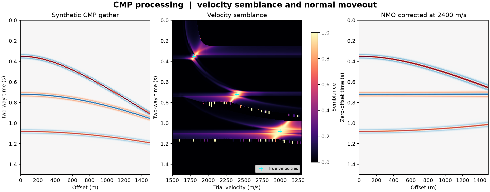

# 40 · CMP processing (NMO, semblance, stack)

**Paths:** MLX and Metal · **Tests:** 17 (all pass on both paths) · **Benchmarked:** yes

A synthetic three-event CMP gather (left), its Metal velocity semblance with the true stacking velocities marked (centre), and the gather NMO-corrected at 2400 m/s (right), which flattens the middle event.

## What was built
Hyperbolic normal-moveout correction with linear interpolation (zero fill only strictly past the last sample), semblance velocity analysis over trial velocities with clipped time windows, and CMP stacking with semblance-maximum velocity picks. MLX (`mlx/impl.py`) computes moveout in sample coordinates, bounds it before squaring, and forms semblance windows from block-local prefix/suffix sums (linear work, with no subtraction of nearly equal global prefix sums), all in float32 on the GPU. Metal (`metal/kernels/cmp.metal`) uses compensated float32 sliding window sums, one dispatch per trial velocity. No float64 in either path.

## Judge and tolerances
- Oracle: analytic hyperbolic Ricker events, float64 `np.interp` NMO and explicit semblance sums, with inputs quantized to float32 before the reference is computed; picks are exactly 1800, 2400 and 3000 m/s. Fixtures `cmp`, `edge` (signed offsets −1, 0, 1, 3 and an exact last-sample hit) and `zero`.
- `ARRAY_REL = 1e-4`: project-wide float32 comparison away from zero.
- `NMO_INDEX_ULPS = 4` (`CROSS_INDEX_ULPS = 8`): NMO/stack floor = ulps × spacing(float32(n_t−1)) × max|Δtrace|, about 7.4e-5 absolute against a unit peak.
- `SEMBLANCE_ABS = 1e-5` (`CROSS_SEMBLANCE_ABS = 2e-5`): float32 reduction error in energetic windows.
- `VELOCITY_REL = 0.03`: the project's required 3% on picked stacking velocities.
- **Judge defect caught during review:** the NMO absolute floor was below float32 index rounding, so correct float32 variants failed (q·(1/dt) at 1.41× the allowance, a float64-t0 cast at 1.20×). The fixed judge derives the floor from the data and adds the `edge` fixture, which catches clamping instead of zero fill (4.2e5×) and an exclusive last sample (9.8e3×).

## Parity
- Tests: 7/7 MLX and 7/7 Metal passed: `test_reference` (nmo, semblance, stack), `test_boundary_and_signed_offsets` (nmo, stack), `test_velocity_picks`, `test_zero_gather`. MLX-vs-Metal cross-checks: 3/3 passed in a separate cross-check run (`CROSS_CHECKS.md`).
- Independent float32 variants: worst error/allowance 0.21 (NMO), 0.07 (stack), 0.21 (semblance); MLX-vs-Metal-style cross-check 0.11.
- Bench medium (semblance) max relative difference vs float64: MLX 3.39e-6, Metal 3.45e-6.

## Benchmark
Wall time is the median of three calls after one warm-up (benchmark run, `bench/results.json`). Speedup = judge wall time ÷ path wall time at the same size; the judge is a correctness oracle, not a tuned competitor. Metal times include process launch, shader compilation and file I/O on every call, so a floor of roughly 40–60 ms dominates small sizes.

| Size | Problem | Judge | MLX | Metal | MLX vs judge | Metal vs judge |
|---|---|---|---|---|---|---|
| small | n_offsets=32, n_time=384, n_velocities=16, dt_s=0.002, half_window=5 | 47.1 ms | 2.98 ms | 40.1 ms | 15.8× | 1.17× |
| medium | n_offsets=64, n_time=1024, n_velocities=64, dt_s=0.002, half_window=5 | 612 ms | 10.3 ms | 43.6 ms | 59.4× | 14.0× |
| large | n_offsets=192, n_time=3072, n_velocities=256, dt_s=0.002, half_window=5 | 8.52 s | 50.1 ms | 48.1 ms | 170× | 177× |

| Size | Judge peak mem | MLX peak mem | Metal peak mem |
|---|---|---|---|
| small | 0.592 | 4.46 | 0 (child-RSS delta; see note) |
| medium | 3.21 | 19.5 | 0.262 |
| large | 30.1 | 213 | 0.0492 |

- Peak memory is in MB as recorded by the harness (decimal MB or MiB per the project notes). Memory methods differ by path and are not comparable across columns. Judge: tracemalloc peak traced allocations during call (MB). MLX: MLX reset_peak_memory/get_peak_memory (MB); process RSS is lifetime high-water mark. Metal: RUSAGE_CHILDREN ru_maxrss high-water delta in macOS bytes (MB); may be zero after warmup.
- Medium-size max relative difference vs judge: MLX 3.39e-06, Metal 3.45e-06.

Only semblance is benchmarked. At large (192 offsets × 3072 samples × 256 velocities) both GPU paths are about 170× faster than the float64 NumPy reference (MLX 50.1 ms, Metal 48.1 ms). Metal's time barely changes from small to large, so it is dominated by its fixed launch cost.

## Known limitations
- In the figure's semblance panel, isolated high-semblance pixels (up to ~1.0) appear along the quiet regions near 0.8 s and 1.15 s, away from any event. These look like near-zero-energy windows, where semblance is an ill-conditioned ratio. The locked semblance test uses a mask and energetic windows, so this behaviour is ungated.
- Interpolation is differentiable only away from knots and the range boundary (MLX); no gradient API is locked.
- Compensated sliding sums (Metal) round differently from independent window sums for inputs with extreme dynamic range.

## Papers
- No papers were specified for this project.
