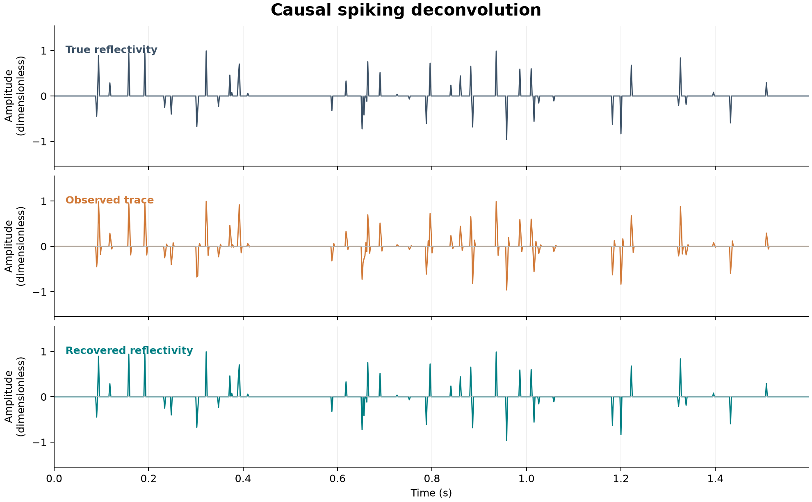

# 41 · Spiking and predictive deconvolution

**Paths:** MLX and Metal · **Tests:** 12 (all pass on both paths) · **Benchmarked:** yes

True reflectivity (48 random spikes), the trace convolved with the minimum-phase wavelet [1, 0.5, −0.2], and the reflectivity recovered by the Metal path's 32-coefficient causal spiking inverse.

## What was built
Two deconvolution operators behind a frozen API. Spiking deconvolution solves the regularized least-squares inverse (AᵀA + λI)h = Aᵀe₀ for a known causal wavelet and convolves it with the trace. Predictive deconvolution forms the biased autocorrelation, solves the relatively loaded Toeplitz normal equations for a prediction filter at a given lag, and applies the prediction-error filter. The MLX path builds both systems in float32 and solves them with `mx.linalg.solve` on the MLX CPU stream (still float32), with a custom VJP for the solve. The Metal path has one thread per lag for the autocorrelation, a parallel kernel to assemble the system, and a parallel kernel to apply the filter. The solve, though, is a dense Gaussian elimination that runs on a **single GPU thread** (`solve` kernel, `if (tid != 0) return;`). All arithmetic is float32 and no float64 step is used.

## Judge and tolerances
- Oracle: SciPy `solve_toeplitz` (float64 Levinson) for the predictive case and a float64 dense regularized least-squares solve for spiking. Seeds are 4101–4103, and inputs are rounded to float32 before the reference is computed.
- `RELATIVE_MAX_ERROR = 1e-4`: max absolute error divided by the reference max, the project-wide float32 limit. Every coefficient's magnitude is below 1, so this also bounds the absolute coefficient error.
- `MIN_CORRELATION = 0.9`: the required threshold for noise-free reflectivity recovery.
- Judge defect caught in review: originally the only spiking fixture used λ = 1e-6, so an implementation that ignored `stabilization` still passed at 2.2e-6. The fix added a `loaded` fixture (wavelet 2×[1, 0.5, −0.2], λ = 0.2, L = 32). Omitting λ now gives 9.4e-2 and a relative λ gives 2.0e-1, about 1000× the tolerance.

## Parity
- Tests: 4/4 MLX passed and 4/4 Metal passed: `test_spiking[recovery, loaded]` and `test_predictive[short, gap]`. MLX-vs-Metal cross-checks: 4/4 passed in the separate cross-check run (`CROSS_CHECKS.md`).
- Measurements on independent float32 reference builds, made during review: the dense spiking solve reached 2.2e-7 and the Toeplitz Levinson reached 1.2e-7 to 3.6e-7. Recovery correlation was 0.999999996, and the predictive systems are well conditioned (κ = 16.6 and 44.8).
- Bench medium max relative difference: MLX 5.59e-05, Metal 5.03e-07. Both are inside 1e-4. The MLX figure is about 100× the Metal one at that size (L = 320).

## Benchmark
Wall time is the median of three calls after one warm-up (benchmark run, `bench/results.json`). Speedup = judge wall time ÷ path wall time at the same size; the judge is a correctness oracle, not a tuned competitor. Metal times include process launch, shader compilation and file I/O on every call, so a floor of roughly 40–60 ms dominates small sizes.

| Size | Problem | Judge | MLX | Metal | MLX vs judge | Metal vs judge |
|---|---|---|---|---|---|---|
| small | trace_length=16384, wavelet_length=3, inverse_length=160 | 0.444 ms | 1.86 ms | 116 ms | 0.238× | 0.00382× |
| medium | trace_length=65536, wavelet_length=3, inverse_length=320 | 2.54 ms | 1.67 ms | 723 ms | 1.52× | 0.00352× |
| large | trace_length=262144, wavelet_length=3, inverse_length=768 | 23.6 ms | 5.84 ms | 9.80 s | 4.04× | 0.00241× |

| Size | Judge peak mem | MLX peak mem | Metal peak mem |
|---|---|---|---|
| small | 0.824 | 1.24 | 0 (abs. child RSS 15.4) |
| medium | 2.48 | 4.48 | 0 (abs. child RSS 16.4) |
| large | 14.2 | 24.8 | 0.377 (abs. child RSS 23.3) |

- Peak memory is in MB as recorded by the harness (decimal MB or MiB per the project notes). Memory methods differ by path and are not comparable across columns. Judge: tracemalloc peak during three calls, bytes / 1e6. MLX: MLX peak allocated bytes after reset, bytes / 1e6. Metal: macOS RUSAGE_CHILDREN ru_maxrss high-water delta after warmup, bytes / 1e6.
- Medium-size max relative difference vs judge: MLX 5.59e-05, Metal 5.03e-07.

MLX is 4.04× faster than the judge at the large size. The Metal path is 400× slower than the judge there (9.80 s), and the cause is clear from the source. The (L×L) system is solved by Gaussian elimination on one GPU thread, an O(L³) serial loop that takes about 4.5×10⁸ multiply-adds at L = 768. Its time grows roughly with L³ (0.116 s → 0.723 s → 9.80 s), which is the signature of that design. It is not a measurement fault.

## Known limitations
- The Metal solve is serial on the GPU. A parallel Cholesky or a GPU Levinson recursion would remove the bottleneck, but this was not attempted because parity was the gate.
- Recovery uses a known minimum-phase wavelet (zeros at 0.262 and −0.762), so the 0.9 correlation gate is near-trivial. Blind wavelet estimation and non-minimum-phase wavelets are not tested.
- The MLX solve runs on the MLX CPU stream because `mx.linalg.solve` has no GPU kernel. It is float32, not float64.
- Zero-pivot detection on Metal is exact, with no tolerance, so nearly singular systems are not classified.

## Papers
- No specific paper is cited for this project. The method is the standard Wiener least-squares / Levinson prediction-error formulation, and SciPy `solve_toeplitz` serves as the oracle.
