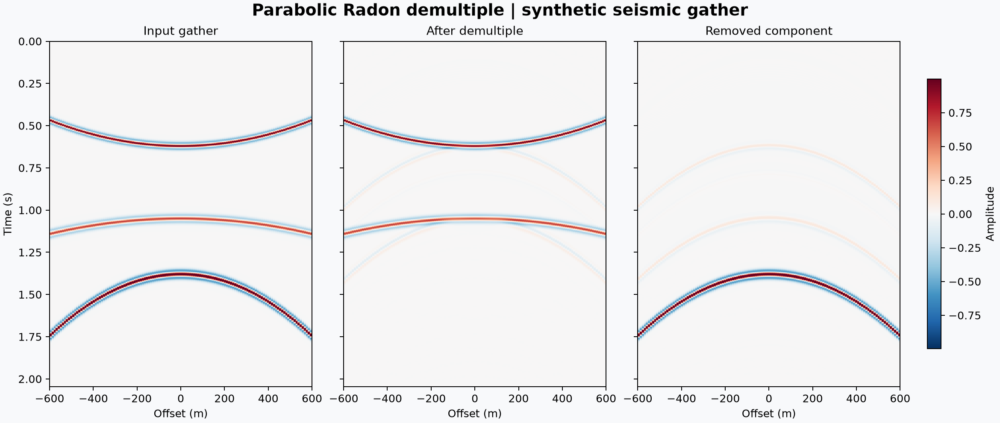

# 42 · f-k filtering and Radon demultiple

**Paths:** MLX and Metal · **Tests:** 16 (all pass on both paths) · **Benchmarked:** yes

A synthetic seismic gather before and after removing one parabolic Radon component (the multiple), with the primaries kept.

## What was built
There are two frequency-domain filters behind a frozen API. `fk_filter` takes the unpadded periodic 2-D DFT of the gather, removes every bin with |f| ≤ v_c·|k| (including DC), and returns the real part of the inverse transform. `radon_demultiple` is, by the locked API, a **single known-slowness** orthogonal projection: at every temporal frequency it subtracts a·(aᴴd)/nx with a[x] = exp(−2πi·f·q·x²). The MLX path uses `mx.fft` and complex projections in float32. It avoids a float32 overflow in the offset-squared term for extreme offsets by using scalar fourth roots computed in host float64. The Metal path is written from scratch: batched radix-2 FFT kernels (with a Bluestein fallback for other lengths), a mask kernel, and a projection that computes (aᴴd)/nx once per frequency and then subtracts it. Its phase and twiddle tables are built on the host in float64 and all transforms run as float32 kernels with fast math disabled. These host float64 steps are small, one-time table setup, documented under the 2026-10-28 mixed-precision policy. The reason is accuracy: Radon phases reach about 1500 rad, which float32 cannot represent well.

## Judge and tolerances
- Oracle: synthetic gathers with known ground roll (f-k) and a known multiple (Radon), evaluated in float64 with NumPy FFTs.
- `PARITY = 1e-4`: normalized max error. FFTs and complex projection accumulate float32 rounding.
- `MAX_RESIDUAL_POWER = 0.01`: the required 20 dB suppression of unwanted energy.
- `PRIMARY_POWER_MIN/MAX = 10^(∓1/10)`: primaries must stay within ±1 dB.
- **Documented scope deviation:** "Radon demultiple" is one known-slowness orthogonal projection. It is not a multi-curvature least-squares parabolic Radon transform with a mute. This was flagged in review and is locked as specified.
- Judge defect caught in review: the original f-k golden had energy in only two (f, k) bins, so k in rad/m and a cutoff ×2 or ×3 all passed at 1.3e-7. The fix added seeded broadband goldens (`fk_broadband`, `radon_broadband`) with energy in every non-boundary bin and at DC and Nyquist. Now k in rad/m fails at 6.0e-1, and a cutoff off by only ×1.05 or ×0.95 fails at 6.0e-2 or 4.6e-2.

## Parity
- Tests: 6/6 MLX passed and 6/6 Metal passed: `test_golden`, `test_broadband_golden` and `test_separation`, each for `fk` and `radon`. MLX-vs-Metal cross-checks: 4/4 passed in the separate cross-check run (`CROSS_CHECKS.md`).
- Separation metrics on the goldens, measured during review: f-k unwanted ratio 4e-30 and primary ratio 1.0. Radon unwanted ratio 2e-28 and primary ratio 0.949 (−0.23 dB).
- Independent float32 reference builds: f-k 1.1e-7 to 1.3e-7. Radon 7.2e-6 with float32 phases and 1.0e-7 with float64 phases.
- Bench medium max relative difference: MLX 1.08e-06, Metal 2.94e-07.

## Benchmark
Wall time is the median of three calls after one warm-up (benchmark run, `bench/results.json`). Speedup = judge wall time ÷ path wall time at the same size; the judge is a correctness oracle, not a tuned competitor. Metal times include process launch, shader compilation and file I/O on every call, so a floor of roughly 40–60 ms dominates small sizes.

| Size | Problem | Judge | MLX | Metal | MLX vs judge | Metal vs judge |
|---|---|---|---|---|---|---|
| small | nx=256, nt=1024, dt_s=0.004, dx_m=10.0 | 8.27 ms | 2.59 ms | 81.3 ms | 3.20× | 0.102× |
| medium | nx=1024, nt=4096, dt_s=0.004, dx_m=10.0 | 184 ms | 9.45 ms | 202 ms | 19.4× | 0.908× |
| large | nx=2048, nt=8192, dt_s=0.004, dx_m=10.0 | 768 ms | 32.5 ms | 406 ms | 23.6× | 1.89× |

| Size | Judge peak mem | MLX peak mem | Metal peak mem |
|---|---|---|---|
| small | 20.3 | 20.2 | 0 (child-RSS delta; see note) |
| medium | 324 | 324 | 3.33 |
| large | 1,300 | 1,680 | 0 (child-RSS delta; see note) |

- Peak memory is in MB as recorded by the harness (decimal MB or MiB per the project notes). Memory methods differ by path and are not comparable across columns. Judge: tracemalloc peak during workload (includes NumPy allocations). MLX: MLX reset_peak_memory/get_peak_memory; process high-water RSS also reported. Metal: RUSAGE_CHILDREN ru_maxrss high-water delta across both child calls.
- Medium-size max relative difference vs judge: MLX 1.08e-06, Metal 2.94e-07.

At the large size MLX is the fastest path, 23.6× faster than the judge. Metal is 1.89× faster than the judge, but each repeat starts two Metal processes, one for each filter.

## Known limitations
- The Radon scope is one known slowness, not a sparse or least-squares Radon over many curvatures, so multiples with unknown moveout are not handled.
- The test grids have power-of-two axes, so the Metal Bluestein path was checked only by code review.
- The tests do not cover inclusive vs exclusive handling of the exact |f| = v_c|k| boundary. The fixtures zero those bins deliberately, and the API fixes the convention.
- `tests/__init__.py` with a relative import could collide in a multi-project pytest session (review note).

## Papers
- No specific paper is cited for this project. The methods are the standard f-k velocity filter and the frequency-domain parabolic Radon projection.
