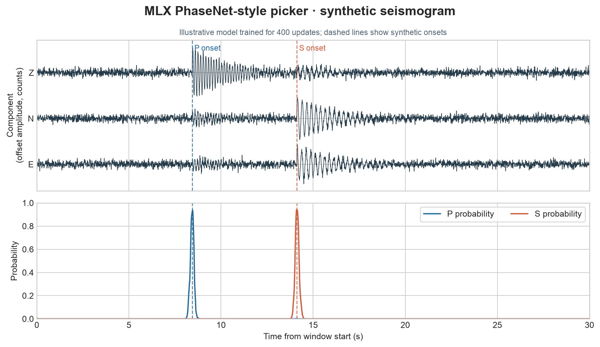

# 43 · PhaseNet-style phase picker

**Paths:** MLX only · **Tests:** 41 (all pass) · **Benchmarked:** yes (loss + gradient only)

An illustrative figure: an MLX picker trained for only 400 updates, run on a synthetic three-component seismogram. It shows the P and S probability traces against the synthetic onsets (dashed). It is not the held-out STEAD evaluation.

## What was built
A PhaseNet-style 1-D U-Net written in MLX. It has encoder widths 16/32/64/128/192, a half-pixel interpolation decoder, and a three-class (noise/P/S) softmax head with 647,971 parameters, as the locked API asserts. Training uses bias-corrected Adam, a warmup-plus-cosine learning rate, and augmentation (shift, polarity, horizontal rotation). The gradients come from MLX autodiff of the cross-entropy loss against Gaussian pick targets. A fixed decoder turns each contiguous region with probability ≥ 0.5 into one pick at its earliest maximum. The data are a STEAD subset (CC BY 4.0): 30000/3000/3000 train/val/test traces from 19799/1993/1978 disjoint events. Training, inference and loss all run in float32 on the GPU, with no CPU float64 step. The whole training waveform array, about 1.08 GB, is held in MLX memory.

## Judge and tolerances
- Oracles: a float64 NumPy loss with analytic gradient for parity, a sealed MLX GPU reference training (three seeds) for the held-out gates, and hand-counted scorer fixtures.
- `PARITY_RTOL = 1e-4` and `PARITY_ATOL = 1e-6`: loss and gradient against float64. The atol floor exists because probabilities near zero have no relative accuracy.
- `GRAD_RTOL = 1e-3` with `FD_STEP = 0.02`: the project-wide centered finite-difference check. h = 0.02 keeps float32 rounding below 2e-4 relative.
- `P_MEDIAN_MAX_S = 0.05` and `S_MEDIAN_MAX_S = 0.1`: the specified median pick-error limits, unchanged. `MATCH_TOLERANCE_S = 0.1` and `PICK_THRESHOLD = 0.5`.
- **Approved deviation (2026-10-28):** no sealed reference seed reaches F1 0.9. The test F1 values per seed (P/S/micro) were 43043: 0.8884/0.7491/0.8214, 43044: 0.8934/0.7536/0.8259, 43045: 0.8880/0.7504/0.8214, at 36000 steps and about 326 s of training per seed on the M5 Max. The gates were set to the worst seed minus 0.02: **P 0.868, S 0.729, micro 0.801**. S is limited by analyst label spread (about 0.05–0.1 s).
- Judge defects caught in review before lock:
  - No real dataset was present, and the FD step of 1e-3 could not be met in float32 (2.0e-3 measured).
  - F1 ≥ 0.9 could not be reached by the bounded procedure. The 53k-parameter reference reached P 0.848 and S 0.706.
  - Adam bias correction (MLX defaults to off, PyTorch is always on) and the bias initialization were unspecified, so a correct MLX build failed about one time in three.
  - All three were fixed in the API before the tests were locked.

## Parity
- Tests: 41/41 MLX passed. Fifteen exercise the implementation: loss/gradient float64 parity, centered FD gradient, extreme-logit stability, logit-shift invariance, probability contract, normalization guard, gain normalization, determinism, batch independence, held-out F1 (P, S, micro) and median pick error (P, S). Twenty-six are judge, data and scorer self-checks, including broken-model rejection.
- Review measurements: MLX self-FD error 3.5e-5 and error against float64 FD 1.7e-6 (limit 1e-3). On independent reference runs made during review, matched medians were P 0.01–0.02 s and S 0.03 s, and broken models (untrained, swapped, half time scale, +0.15 s bias) all scored at least 0.6 F1 below the gates.
- The implementation's own held-out F1 and median values passed the gates, but the test run recorded only pass/fail, not the numbers.
- Bench medium max relative difference (loss and gradient): MLX 2.80e-07.

## Benchmark
Wall time is the median of three calls after one warm-up (benchmark run, `bench/results.json`). Speedup = judge wall time ÷ path wall time at the same size; the judge is a correctness oracle, not a tuned competitor. Metal times include process launch, shader compilation and file I/O on every call, so a floor of roughly 40–60 ms dominates small sizes.

| Size | Problem | Judge | MLX | MLX vs judge |
|---|---|---|---|---|
| small | batch=8, samples=3000, calls=16 | 20.6 ms | 12.9 ms | 1.60× |
| medium | batch=32, samples=3000, calls=64 | 332 ms | 41.3 ms | 8.04× |
| large | batch=128, samples=3000, calls=128 | 2.70 s | 157 ms | 17.2× |

| Size | Judge peak mem | MLX peak mem |
|---|---|---|
| small | 3.85 | 1.97 |
| medium | 15.4 | 7.03 |
| large | 61.5 | 35.3 |

- Metal: n/a, no Metal path was benchmarked for this project (MLX only).
- Peak memory is in MB as recorded by the harness (decimal MB or MiB per the project notes). Memory methods differ by path and are not comparable across columns. Judge: tracemalloc peak during timed calls, including NumPy allocations. MLX: MLX peak allocated bytes since reset; process lifetime peak RSS 201.4 MiB (includes prior work); MLX peak allocated bytes since reset; process lifetime peak RSS 66.1 MiB (includes prior work); MLX peak allocated bytes since reset; process lifetime peak RSS 89.0 MiB (includes prior work).
- Medium-size max relative difference vs judge: MLX 2.80e-07.

The benchmark times only repeated `phase_loss_and_grad` calls (forward, loss and autodiff gradient on fixed batches). **Training and inference are not benchmarked.** At the large size (128 calls on batches of 128), MLX is 17.2× faster than the float64 NumPy judge. For scale, the sealed reference training run took about 326 s per seed on the GPU.

## Known limitations
- The F1 gates sit below the original 0.9 target (see the deviation above). S picks are limited by label quality.
- The STEAD cohort favors early P arrivals and local events, and it has no real noise-only windows.
- Gate calibration uses the test cohort (disclosed). Validation F1 agrees with it.
- The figure comes from a short 400-update illustrative training, not from the model evaluated by the tests.
- The final parameter SHA-256 digest of the trained MLX model was to be recorded after the GPU run. No digest appears in the project files, so it is not reported here.

## Papers
- Zhu and Beroza (2019), PhaseNet (the architecture family).
- Mousavi et al. (2019), STEAD dataset (CC BY 4.0).
