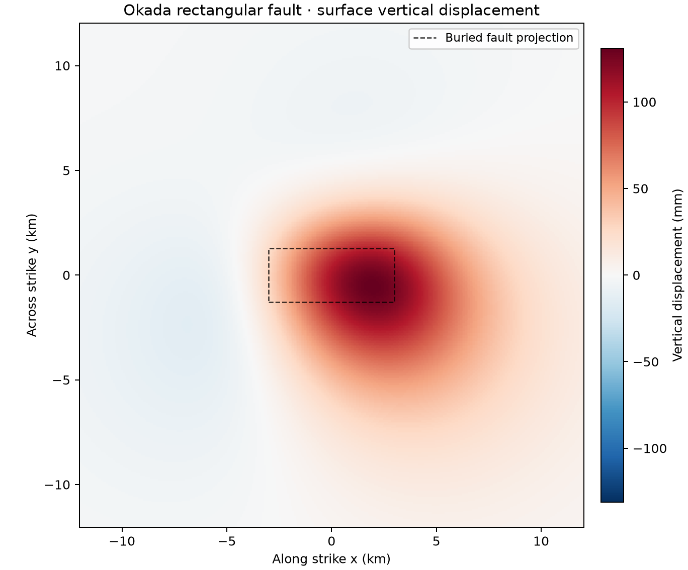

# 44 · Okada dislocation

**Paths:** MLX and Metal · **Tests:** 43 (all pass on both paths) · **Benchmarked:** yes

Surface vertical displacement above a rectangular fault in an elastic half-space.

## What was built
Okada's closed-form half-space solutions (1985 point and rectangle, and 1992 DC3D-style rectangle at depth z ≤ 0). Given strike, dip and tensile slip on a rectangular fault, or potency on a point source, they return displacement and horizontal spatial derivatives, applying Chinnery's four-corner sum and the image term. The singular-case rules are implemented on both paths: snapping, the cos δ = 0 branch, and the KET rule for −log(R−η). The MLX path evaluates the corner formulas as array expressions and gets the **horizontal derivatives by autodiff** (`mx.grad` of the displacement with respect to the observation coordinates). The Metal path has two kernels, `point_surface` and `rectangle`, with one thread per observation, and evaluates the closed-form derivative expressions directly. Metal does not snap point-source coordinates with a unit-dependent 1e-6 (an earlier version did); it uses power-of-two normalization of geometry and potency instead. Everything runs in float32, with no CPU float64 step.

## Judge and tolerances
- Oracles: the 108 printed values of Okada (1985) Table 2 (4 cases × strike/dip/tensile × ux, uy, uz and their x/y derivatives) and the DC3D manual check case from Okada (1992) / NIED. Both are stored in `data/okada/test_values.json`.
- Table 2: half a printed unit plus `TABLE_CANCELLATION_ULPS = 8` × eps32 × L1(slip) × corner_scale. Printed zeros use `TABLE_ZERO_ABS = 1e-6`.
- DC3D manual case: 5e-5 printed half-unit + 5e-5 REAL*4 reference error + 4 × eps32 × S × C. That gives absolute limits of (9.09e-4, 6.31e-4, 3.83e-4) on |u| ≈ (38, 63, 15), about 1e-5 relative.
- Cross-path: `PARITY_REL = 1e-4`, `PARITY_ABS = 1e-6`. FD derivative check: `FD_REL = 1e-3`, `FD_ABS = (1e-6, 2e-6)`, steps (0.01, 0.05), with a cancellation term of 2 ulps on the rectangle.
- **Reviewed threshold exception:** the project specification asks for 1e-4 absolute on the manual case and relative printed precision on the table. Final values that come from four-corner cancellation lose float32 accuracy in absolute terms, so the floors above were accepted after review as exceptions with written reasons. Their cost is that the worst allowance is 2.8e-3 of a printed value (median 2.3e-4), and the rectangle FD check becomes a loose consistency check.
- Stricter thresholds were rejected in review because a correct float32 build could not meet them.

## Parity
- Tests: 15/15 MLX passed and 15/15 Metal passed: 12 `test_table`, 1 `test_dc3d_manual` and 2 `test_horizontal_derivatives_finite_difference`. The 13 cross-path tests are also in the locked suite. MLX-vs-Metal cross-checks: 13/13 passed in the separate cross-check run (`CROSS_CHECKS.md`).
- Review measurements on six independent float32 evaluation orders: Table 2 worst ratio to limit 0.936–0.938, manual 0.13–0.35, FD rectangle 0.28–0.31. With sin δ and cos δ perturbed by ±3 ulps, Table 2 stays ≤ 0.946. Wrong conventions (centroid depth, dip sign, U2 sign, L/W swap) fail by 1430× to 4.2e5×.
- Bench medium max relative difference: MLX 6.13e-06, Metal 4.67e-06.

## Benchmark
Wall time is the median of three calls after one warm-up (benchmark run, `bench/results.json`). Speedup = judge wall time ÷ path wall time at the same size; the judge is a correctness oracle, not a tuned competitor. Metal times include process launch, shader compilation and file I/O on every call, so a floor of roughly 40–60 ms dominates small sizes.

| Size | Problem | Judge | MLX | Metal | MLX vs judge | Metal vs judge |
|---|---|---|---|---|---|---|
| small | n_observations=512 | 99.2 ms | 42.1 ms | 40.9 ms | 2.36× | 2.43× |
| medium | n_observations=2048 | 388 ms | 41.0 ms | 41.2 ms | 9.46× | 9.42× |
| large | n_observations=131072 | 25.0 s | 42.1 ms | 37.7 ms | 594× | 663× |

| Size | Judge peak mem | MLX peak mem | Metal peak mem |
|---|---|---|---|
| small | 0.145 | 2.50 | 0 (child-RSS delta; see note) |
| medium | 0.580 | 10.8 | 0 (child-RSS delta; see note) |
| large | 37.1 | 651 | 0 (child-RSS delta; see note) |

- Peak memory is in MB as recorded by the harness (decimal MB or MiB per the project notes). Memory methods differ by path and are not comparable across columns. Judge: tracemalloc peak during a separate reference call. MLX: MLX allocator peak after reset; process peak RSS also reported. Metal: RUSAGE_CHILDREN ru_maxrss high-water delta after warmup (macOS bytes).
- Medium-size max relative difference vs judge: MLX 6.13e-06, Metal 4.67e-06.

Both GPU paths take a flat 38–42 ms from 512 to 131,072 observations. That makes them 594× (MLX) and 663× (Metal) faster than the scalar float64 judge at the large size. The flat time comes from fixed overhead and is not a timing error. The Metal floor is the process launch, and MLX rebuilds its lazy graph (eight corner evaluations plus three `mx.grad` passes) in Python on every call. `run_bench.py` converts MLX outputs to NumPy inside the timer, so the GPU work does finish, and MLX peak memory grows from 2.50 to 651 MB with problem size.

## Known limitations
- Thresholds are cancellation-aware absolute floors, not the literal project-wide 1e-4 (see the exception above).
- Outputs, inputs and intermediates have float32 range limits. Extreme aspect ratios or lengths can overflow or underflow (noted for the MLX path).
- The benchmark covers the finite rectangle at the surface only.

## Papers
- Okada (1985), Surface deformation due to shear and tensile faults in a half-space, BSSA 75(4).
- Okada (1992), Internal deformation due to shear and tensile faults in a half-space, BSSA 82(2) (DC3D).
