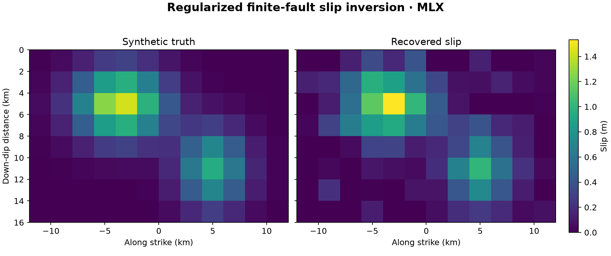

# 45 · Fault slip inversion (InSAR + GPS)

**Paths:** MLX only · **Tests:** 27 (all pass) · **Benchmarked:** yes

The true and recovered slip on the patched fault from the regularized MLX inversion.

## What was built
A regularized, linear finite-fault slip inversion. The data are InSAR line-of-sight and three-component GPS displacements, and the Green's matrix built from Okada rectangular dislocations (supplied by the judge) maps unit slip on each patch to the data. The MLX path whitens G and d by σ and appends damping × L (a smoothing operator). It then solves the augmented least-squares system by **QR followed by a triangular solve** rather than the float32 normal equations, so the condition number is not squared. Predictions and the scalar moment μ·Σ A|s| follow. A custom VJP differentiates the least-squares solution through QR, and `misfit_and_grad` uses `mx.value_and_grad`. **Precision:** everything is float32. Whitening, augmentation, predictions, moment and the whole `misfit_and_grad` calculation run under `mx.stream(mx.gpu)`. Only the `mx.linalg.qr` and `solve_triangular` primitives, in the forward solve and in its custom VJP, are sent to `stream=mx.cpu`, because MLX has no GPU kernels for them. This is commented in the code as "the isolated float32 solve exception". Nothing runs in float64.

## Judge and tolerances
- Oracle: three synthetic cases (noiseless, noisy, alternate geometry with strike 72°, dip 42°, rake 110°). Each has 207 observations and a known slip on Okada rectangular patches (L = 4 km, W = 2.5 km). The answers are float64 lstsq solutions, and before any fixture is written the judge's Okada module is self-validated against all 81 finite-source values in Okada (1985) Table 2.
- `PARITY_RTOL = 1e-4`: max-reference-norm parity against float64.
- `GRADIENT_RTOL = 1e-3` with `FD_STEP_M = 1e-2`: centered FD. A quadratic objective has no truncation error, and 1 cm avoids float32 cancellation.
- `MIN_SLIP_CORRELATION = 0.8` and `MAX_MOMENT_REL_ERROR = 0.10`: the project's required recovery gates, unchanged.
- `OBJECTIVE_RTOL = 1e-4` with `OBJECTIVE_FLOOR = 1.0`. The Okada checklist uses `OKADA_PRINTED_HALF_UNIT = 0.5` and `OKADA_CHECK_ATOL = 1e-9`.
- Judge defect caught in review: the first fixtures used a 2-D anti-plane screw-dislocation kernel. Only u_N was nonzero, the second InSAR look was exactly −1× the first, and 38 of 203 rows were zero. They were rebuilt from true Okada rectangles, and all 207×6 kernels were recomputed independently during review, with a maximum difference of 6e-16.

## Parity
- Tests: 27/27 MLX passed: `test_recovery_and_parity` (3 cases), `test_objective_gradient_parity` (6), `test_centered_finite_difference` (6) and `test_inverse_variants` (12: zero, negative, permuted and strong damping).
- Float32 simulation run during review: lstsq parity ≤ 9e-8 and normal-equation parity ≤ 2.4e-6. FD error against the golden gradient was ≤ 1.1e-5 (limit 1e-3). Recovery correlations were 1.0, 0.9995 and 0.99995, and moment errors 3e-9, 5.1e-3 and 1.5e-3.
- Bench medium max relative difference: MLX 1.53e-6 (1.60e-6 before the surrounding arithmetic moved to the GPU).

## Benchmark
Wall time is the median of three calls after one warm-up (benchmark run, `bench/results.json`). Speedup = judge wall time ÷ path wall time at the same size; the judge is a correctness oracle, not a tuned competitor. Metal times include process launch, shader compilation and file I/O on every call, so a floor of roughly 40–60 ms dominates small sizes.

| Size | Problem | Judge | MLX | MLX vs judge |
|---|---|---|---|---|
| small | npatch=224, nobs=448, nreg=224 | 3.94 ms | 3.75 ms | 1.05× |
| medium | npatch=512, nobs=1024, nreg=512 | 26.9 ms | 12.5 ms | 2.15× |
| large | npatch=1024, nobs=2048, nreg=1024 | n/a (skipped) | 57.6 ms | n/a |

| Size | Judge peak mem | MLX peak mem |
|---|---|---|
| small | 3.62 | 3.35 |
| medium | 18.9 | 17.0 |
| large | n/a | 67.6 |

- Judge large skipped by the benchmark harness: "Float64 SVD may exceed 120 seconds at this size".
- Metal: n/a, no Metal path was benchmarked for this project (MLX only).
- Peak memory is in MB as recorded by the harness (decimal MB or MiB per the project notes). Memory methods differ by path and are not comparable across columns. Judge: tracemalloc peak during call; native allocations may be omitted. MLX: MLX peak allocation after reset; process RSS is lifetime high-water mark.
- Medium-size max relative difference vs judge: MLX 1.53e-06.

The benchmark times `invert_slip`, which includes the QR factorisation on the MLX CPU stream; the float64 judge uses SVD. MLX is 1.05× the judge at small and 2.15× at medium. The large-size judge run was skipped, so there is no large-size speedup. Moving the surrounding arithmetic to the GPU did not speed it up: large is 57.6 ms now, against 55.9 ms before. CPU/GPU synchronization may add overhead.

## Known limitations
- Precision policy: compliant as an isolated, documented step. Only the float32 QR and triangular solves run on the MLX CPU stream, because MLX has no GPU QR or triangular solve; everything else is float32 on the GPU.
- Only full-column-rank systems are supported; there is no rank-deficient fallback.
- The zero-data and zero-damping pure-penalty fixtures require outputs that are exactly zero, which a direct solve gives and an iterative one would not.
- The inversion is linear and unconstrained: slip may be negative, and fault geometry and rake are fixed.

## Papers
- Okada (1985), BSSA 75(4), and Okada (1992), BSSA 82(2): the Green's functions and the Table 2 checklist.
