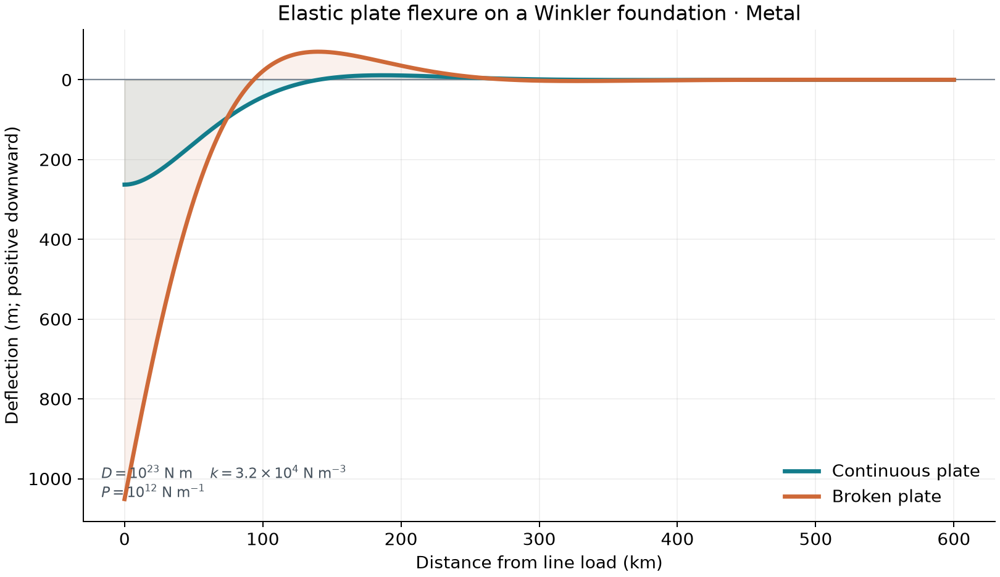

# 46 · Elastic plate flexure

**Paths:** MLX and Metal · **Tests:** 18 (all pass on both paths) · **Benchmarked:** yes

Line-load deflection profiles of a continuous plate and a broken plate on an elastic foundation.

## What was built
These are the closed-form deflections for a line load on a thin elastic plate over a Winkler foundation, D·w'''' + k·w = 0, with the flexural parameter α = √2·D^¼/k^¼. For the continuous plate, w = (Pα³/8D)·e^(−|x|/α)(cos + sin). For the broken plate (zero edge moment, full edge shear), w = (Pα³/2D)·e^(−x/α)·cos(x/α). The MLX path evaluates these in float32 and computes α as √2·D^¼/k^¼, because 4D/k overflows float32 for extreme rigidities. On the Metal path, the host does only O(1) scalar setup in float64 (`scalar_parameters` in `metal/src/main.rs`): fourth roots for α, the amplitude (with a log fallback), and α split into a float32 mantissa and an integer exponent. The stated reason, commented in the code, is that Python scalars such as D = k = P = 1e308 would overflow if cast straight to float32. One float32 GPU thread per point then forms u = ldexp(|x|/mantissa, −exponent) and evaluates e^(−u)·(cos u + sin u) (continuous) or e^(−u)·cos u (broken). An earlier O(n) host float64 coordinate pass was removed.

## Judge and tolerances
- Oracle: the analytic closed forms (Turcotte and Schubert) in float64, over six cases: three continuous and three broken, including a zero load.
- `RELATIVE_MAX_NORM = 1e-4`: max error divided by peak |w|. A pointwise relative error would be singular at the flexural nodes.
- `ZERO_ABSOLUTE_M = 1e-7`: the zero-load cases (0.1 µm).
- `CROSS_PATH_RELATIVE_MAX_NORM = 1e-4`.
- Judge defect caught in review: the API originally stated −D·w'''(0) = P for the broken plate, but the goldens satisfy D·w'''(0) = +P. Force balance requires k∫w = P, which was confirmed with sympy. The fix corrected the contract and made the continuous plate's shear-jump sign and the "full P on one edge" convention explicit.

## Parity
- Tests: 6/6 MLX passed and 6/6 Metal passed (`test_analytic`, cases 0–5, continuous and broken). The locked suite also has 6 `test_mlx_metal_cross_check` cases. All 6/6 passed in the follow-up cross-check run (`CROSS_CHECKS.md`).
- Review check: a float32 closed-form build had a peak-normalized error of 8.5e-8 to 1.3e-7 on cases 0–3.
- Bench medium max relative difference: MLX 3.11e-07, Metal 3.11e-07. The two values are identical to every printed digit (3.1075236874477655e-07). Both paths evaluate the same closed form on float32-rounded inputs, so the worst peak-normalized error is plausibly set by the same float32 rounding at the same sample. This is not evidence of copied output, but it is not separately verified either.

## Benchmark
Wall time is the median of three calls after one warm-up (benchmark run, `bench/results.json`). Speedup = judge wall time ÷ path wall time at the same size; the judge is a correctness oracle, not a tuned competitor. Metal times include process launch, shader compilation and file I/O on every call, so a floor of roughly 40–60 ms dominates small sizes.

| Size | Problem | Judge | MLX | Metal | MLX vs judge | Metal vs judge |
|---|---|---|---|---|---|---|
| small | n=800000, extent_km=600 | 4.70 ms | 1.29 ms | 39.6 ms | 3.64× | 0.119× |
| medium | n=8000000, extent_km=600 | 47.6 ms | 5.78 ms | 61.5 ms | 8.25× | 0.774× |
| large | n=80000000, extent_km=600 | 474 ms | 36.5 ms | 280 ms | 13.0× | 1.69× |

| Size | Judge peak mem | MLX peak mem | Metal peak mem |
|---|---|---|---|
| small | 30.5 | 12.3 | 0 (abs. child RSS 34.3) |
| medium | 305 | 122 | 0 (abs. child RSS 171) |
| large | 3,050 | 1,220 | 0 (abs. child RSS 1,540) |

- Peak memory is in MB as recorded by the harness (decimal MB or MiB per the project notes). Memory methods differ by path and are not comparable across columns. Judge: tracemalloc peak bytes during call, including NumPy allocations. MLX: MLX reset_peak_memory/get_peak_memory; process RSS high-water separately. Metal: RUSAGE_CHILDREN ru_maxrss high-water delta (macOS bytes).
- Medium-size max relative difference vs judge: MLX 3.11e-07, Metal 3.11e-07.

MLX is the fastest path at the large size (80 million points), 13.0× faster than the judge. Metal is 1.69× faster than the judge (280 ms, against 295 ms before the host coordinate pass moved to the GPU). Metal's time still includes moving 80 million values through files to and from the child process.

## Known limitations
- Precision policy: compliant. Per-point work is float32 on the GPU (Metal) and float32 in MLX. Metal's only float64 is O(1) scalar setup, commented in the code.
- Deflections outside the float32 range cannot be represented on either path.
- There is constant rigidity only: no variable-thickness plate, no 2-D load, and no viscoelastic relaxation.

## Papers
- Turcotte and Schubert, *Geodynamics*, the line-load solutions for continuous and broken plates (the goldens follow them, with the edge-load convention stated in the API).
