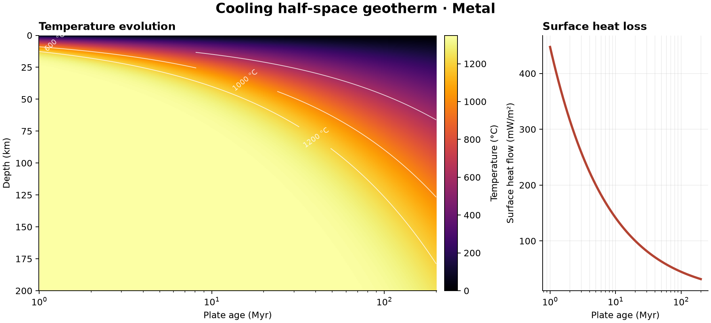

# 47 · Conductive geotherm and heat-flow age inversion

**Paths:** MLX and Metal · **Tests:** 14 (all pass on both paths) · **Benchmarked:** yes

Cooling half-space temperature evolution with age, and surface heat loss against age, from the Metal path.

## What was built
The model is a cooling half-space: T(z, t) = Ts + (Tm − Ts)·erf(z / 2√(κt)) with surface heat flow q = k(Tm − Ts)/√(πκt). There are three API functions. The forward geotherm returns an (age × depth) temperature grid and the surface flux. `invert_age` applies the closed-form inverse t = (k·ΔT/q)²/(πκ) to each observation. `heat_flow_misfit_and_grad` returns the least-squares heat-flow objective and its gradient with respect to age. The MLX path uses its own float32 erf approximation on nonnegative arguments and gets the gradient from **autodiff** (`mx.value_and_grad`). It orders the √(κt) computation to avoid float32 overflow. The Metal path computes each observation's residual and **hand-written age derivative** in its own thread. It uses a balanced four-way tree reduction for the mean, which replaced a long sequential float32 sum flagged in an audit. Both paths compute in float32 on the GPU. Metal builds only scalar constants on the host in float64 (seconds per Julian Myr and the flux coefficient).

## Judge and tolerances
- Oracle: the analytic erf solution in float64 for two parameter sets, the exact noise-free heat-flow ages, and a float64 analytic gradient checked against centered differences.
- `FORWARD_RTOL = 1e-4` (the project-wide forward limit). `TEMPERATURE_ATOL_C = 1e-5` applies at the exact 0 °C surface, and `FLUX_ATOL_W_M2 = 1e-9`.
- `AGE_RECOVERY_RTOL = 0.05` (the required 5%) plus `AGE_EXACT_RTOL = 1e-4`, because noise-free closed-form inversion has only float32 rounding error. Path-to-path tolerance is `AGE_ATOL_MYR = 1e-5`.
- `GRADIENT_RTOL = 1e-3` against float64 centered differences with a 0.01 Myr step. `GRADIENT_ATOL = 0` and `OBJECTIVE_ATOL = 1e-7`.
- Judge defect caught in review: the 5% age gate alone passed wrong inversions. Ignoring Ts gave 1.9% error and flipping the sign of Ts gave 3.8%. `test_recover_age_exact` at 1e-4 was added, and it catches a 365-day year (6.8e-4) and an ignored Ts (1.9%). A correct float32 closed form gives 9.5e-8.

## Parity
- Tests: 5/5 MLX passed and 5/5 Metal passed: `test_forward` (two parameter sets), `test_recover_age`, `test_recover_age_exact` and `test_misfit_gradient_centered_difference`. MLX-vs-Metal cross-checks: 4/4 passed in the separate cross-check run (`CROSS_CHECKS.md`).
- Review checks: a naive float32 forward used at most 1.3% of the allowed budget. The analytic gradient matched the float64 centered difference to 1.7e-5, and the golden objective 0.03598681 reproduced exactly.
- Gradients: MLX autodiff and Metal's hand-written per-observation derivative both pass the same 1e-3 FD gate. The test runs recorded pass/fail only, so there are no separate error numbers for each path.
- Bench medium max relative difference (forward): MLX 3.78e-07, Metal 2.70e-07.

## Benchmark
Wall time is the median of three calls after one warm-up (benchmark run, `bench/results.json`). Speedup = judge wall time ÷ path wall time at the same size; the judge is a correctness oracle, not a tuned competitor. Metal times include process launch, shader compilation and file I/O on every call, so a floor of roughly 40–60 ms dominates small sizes.

| Size | Problem | Judge | MLX | Metal | MLX vs judge | Metal vs judge |
|---|---|---|---|---|---|---|
| small | n_age=1200, n_depth=1200 | 10.3 ms | 3.32 ms | 47.6 ms | 3.09× | 0.215× |
| medium | n_age=4000, n_depth=4000 | 95.0 ms | 17.2 ms | 91.4 ms | 5.54× | 1.04× |
| large | n_age=12000, n_depth=12000 | 839 ms | 144 ms | 443 ms | 5.82× | 1.89× |

| Size | Judge peak mem | MLX peak mem | Metal peak mem |
|---|---|---|---|
| small | 46.2 | 41.8 | 42.7 |
| medium | 512 | 464 | 276 |
| large | 4,610 | 4,180 | 2,320 |

- Peak memory is in MB as recorded by the harness (decimal MB or MiB per the project notes). Memory methods differ by path and are not comparable across columns. Judge: tracemalloc peak during repeats, including traced NumPy allocations. MLX: MLX get_peak_memory after reset; process peak RSS 1001.0 MB (ru_maxrss, macOS bytes); MLX get_peak_memory after reset; process peak RSS 166.9 MB (ru_maxrss, macOS bytes); MLX get_peak_memory after reset; process peak RSS 8490.3 MB (ru_maxrss, macOS bytes). Metal: Metal child RUSAGE_CHILDREN ru_maxrss delta in a fresh worker, bytes on macOS; maximum of repeats.
- Medium-size max relative difference vs judge: MLX 3.78e-07, Metal 2.70e-07.

Only the forward geotherm is timed, on grids up to 12,000 × 12,000 (144 million temperatures). At the large size MLX is 5.82× faster than the judge and Metal is 1.89× faster. Metal's time includes passing the full float32 temperature grid back through files.

## Known limitations
- The inversion is per observation, closed form and noise free, with known material properties. It does not estimate a joint age and κ, and it has no noise model. The project specification leaves this choice open, and it is documented.
- The model is a half-space only, with no plate-model cooling and no radiogenic heat.
- MLX uses a custom erf approximation. It passed at 1e-4, but no error bound is stated.

## Papers
- No specific paper is cited for this project. The model is the standard cooling half-space solution (e.g. Turcotte and Schubert, *Geodynamics*).
