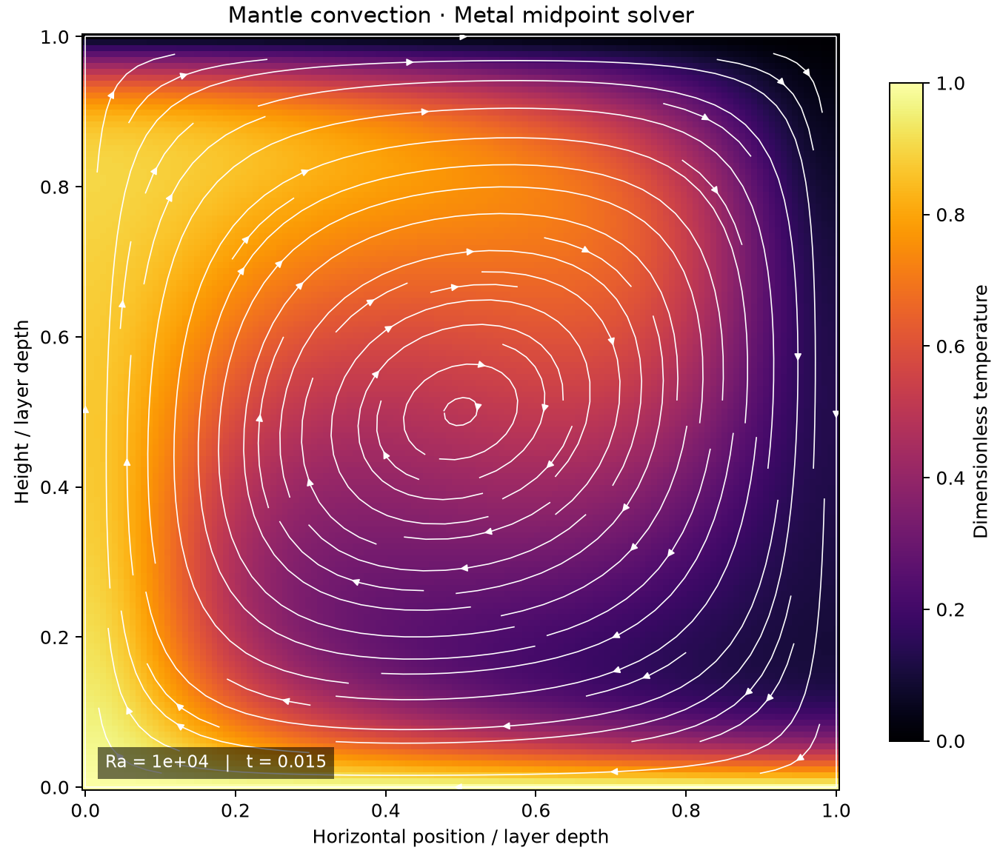

# 48 · 2-D mantle convection (Blankenbach case 1a)

**Paths:** MLX and Metal · **Tests:** 74 (all pass on both paths) · **Benchmarked:** yes

The temperature field of isoviscous convection at Ra = 1e4 from the Metal midpoint solver.

## What was built
The model is isoviscous Boussinesq convection in a unit box on an (N+1)² nodal grid. It solves the Stokes biharmonic ∇⁴ψ = Ra·∂T/∂x as two Dirichlet Poisson solves through DST-I, takes u = ψ_z and w = −ψ_x by centered differences, and advances temperature by explicit centered advection-diffusion with reflected side ghosts. Time stepping is midpoint RK2 with a fresh Stokes solve at each stage. The model reports the top and bottom Nusselt numbers and the trapezoidal v_rms. The MLX path does the DST-I with real FFTs of odd extensions, all in float32/complex64. This replaced the dense DST matmuls of an earlier version, which had given Stokes errors of about 0.002–0.003. It uses `mx.compile` and evaluates every 32 steps. The Metal path has kernels for the thermal step, velocity, diagnostics, and a radix FFT-based DST for power-of-two N ≤ 128. Other sizes fall back to a dense sine table. The host builds its twiddles, sine tables and Laplacian eigenvalues in float64 once and rounds them to float32. All time stepping is float32 on the GPU, and the only CPU float64 use is that constant-table setup.

## Judge and tolerances
- Oracles. (a) A float64 NumPy/SciPy reference written for this project at the same grid, stencil and dt, since no external convection code is installed. It was accepted in review as a "justified equivalent", backed by an independent dense float64 re-implementation that matches to ≤ 1.1e-14. (b) Blankenbach et al. (1989) case 1a: Nu = 4.884409 and v_rms = 42.864947. (c) Analytic Stokes and heat modes for convergence.
- Parity: `PARITY_RTOL = 1e-4` (global infinity norm), `TRAJECTORY_RTOL = 1e-4` for long runs, `CROSS_RTOL = 2e-4` between paths, and zero allowances `ZERO_ATOL = 1e-6` and `CROSS_ZERO_ATOL = 2e-6`.
- Benchmark: `BENCHMARK_RTOL = 0.01` (the required 1%, applied to both wall Nu values and to v_rms). Steady-state checks use `STEADY_RESIDUAL_RTOL = 5e-4` and `HEAT_BALANCE_RTOL = 0.005`.
- FD amendment: `MIN_SPATIAL_ORDER = 1.8` and `MIN_TEMPORAL_ORDER = 1.8` (second-order scheme and RK2), with fine-grid error caps of 0.003. Also `DIVERGENCE_RTOL = 2e-6` and `TEMPERATURE_ATOL = 1e-5`.
- Review notes:
  - The float64 reference Nu at N = 128 is 0.38% above the published value (v_rms 0.017%), which leaves about 0.6% of the 1% budget.
  - "Midpoint RK2, not Heun" is enforced by the contract only. Heun differs from midpoint by 2.7e-5, under the 1e-4 tolerance. A stale stage-2 Stokes solve is caught at 7.4e-3.

## Parity
- Tests: 27/27 MLX passed and 27/27 Metal passed: case 1a published values and steady state, 14 same-grid convection cases, 6 same-grid Stokes cases, and Stokes (ψ, u, w), heat, coupled and RK2 temporal convergence. All 20 MLX-vs-Metal cross-checks are in the locked suite. MLX-vs-Metal cross-checks: 20/20 passed in the separate cross-check run (`CROSS_CHECKS.md`).
- Float32 replay run during review: case 1a parity 2.2e-5 and small cases 1.6e-6. The float64 reference reached Nu_top = Nu_bottom = 4.90317 and v_rms = 42.8578, with steady residual 2.7e-5.
- The Nu and v_rms values reached by the MLX and Metal case 1a runs are not recorded (the test runs record pass/fail only). They passed the 1% gate.
- Bench medium max relative difference: MLX 3.91e-06, Metal 3.75e-06.

## Benchmark
Wall time is the median of three calls after one warm-up (benchmark run, `bench/results.json`). Speedup = judge wall time ÷ path wall time at the same size; the judge is a correctness oracle, not a tuned competitor. Metal times include process launch, shader compilation and file I/O on every call, so a floor of roughly 40–60 ms dominates small sizes.

| Size | Problem | Judge | MLX | Metal | MLX vs judge | Metal vs judge |
|---|---|---|---|---|---|---|
| small | n=32, steps=30, dt=1e-05, rayleigh=10000.0 | 3.27 ms | 7.52 ms | 43.2 ms | 0.435× | 0.0757× |
| medium | n=64, steps=250, dt=1e-05, rayleigh=10000.0 | 57.1 ms | 55.0 ms | 41.5 ms | 1.04× | 1.37× |
| large | n=128, steps=1500, dt=1e-05, rayleigh=10000.0 | 1.04 s | 323 ms | 93.1 ms | 3.22× | 11.2× |

| Size | Judge peak mem | MLX peak mem | Metal peak mem |
|---|---|---|---|
| small | 0.165 | 0.884 | 0 (child-RSS delta; see note) |
| medium | 0.611 | 6.80 | 0 (child-RSS delta; see note) |
| large | 2.41 | 13.9 | 0.0781 |

- Peak memory is in MB as recorded by the harness (decimal MB or MiB per the project notes). Memory methods differ by path and are not comparable across columns. Judge: tracemalloc peak, separate untimed call (MiB). MLX: MLX reset_peak_memory/get_peak_memory; process lifetime peak RSS also reported (MiB, macOS). Metal: RUSAGE_CHILDREN ru_maxrss high-water delta (MiB, macOS).
- Medium-size max relative difference vs judge: MLX 3.91e-06, Metal 3.75e-06.

At the large size (N = 128, 1500 RK2 steps), Metal is 11.2× faster than the judge and MLX is 3.22× faster. Metal is the fastest path here even though its time includes process startup.

## Known limitations
- The judge is an in-house float64 reference rather than an external code, though it is validated as described above.
- Only isoviscous case 1a is benchmarked against published values. Cases 1b/1c and the temperature-dependent-viscosity cases are not covered.
- Metal uses an O(N²)-per-line dense sine-table fallback when N is not a power of two or exceeds 128.
- The RK2 variant is pinned by the contract, not by a test.

## Papers
- Blankenbach et al. (1989), A benchmark comparison for mantle convection codes, GJI 98.
