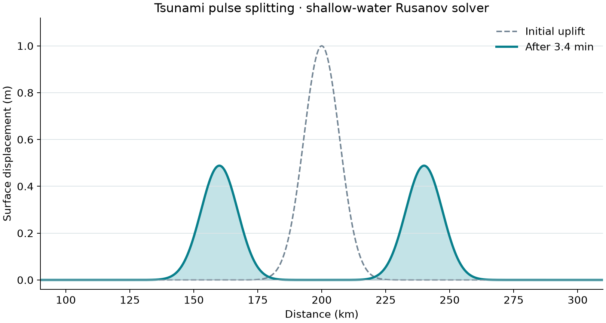

# 49 · Tsunami propagation (shallow water)

**Paths:** MLX and Metal · **Tests:** 42 (all pass on both paths) · **Benchmarked:** yes (re-run after the deep-water fix)

A synthetic deep-water pulse splitting into left- and right-going waves, from the Metal shallow-water Rusanov solver.

## What was built
A 1-D shallow-water solver on a periodic flat bed, with two modes:
- **Linear:** state (η, q), flux F = (q, gH·η).
- **Nonlinear:** state (h, q), flux F = (q, q²/h + ½gh²).

Both modes use a first-order Rusanov interface flux, ½(F_i + F_{i+1} − a(U_{i+1} − U_i)), with forward Euler steps. `objective_and_grad` returns a weighted objective on the final state and its gradient with respect to the initial state.

**Deep-water fix.** In nonlinear mode, both paths now:
1. evolve the perturbation e = h − H_ref about an internal constant H_ref, the first cell's initial depth;
2. write the momentum flux with the constant hydrostatic term g·H_ref²/2 removed: q²/(H_ref + e) + g·e·(H_ref + e/2);
3. restore total depth only when returning.

The `depth` argument is still ignored in nonlinear mode.

Gradients:
- **MLX** gets the gradient by `mx.value_and_grad` through the time loop. Autodiff includes the derivative of H_ref, whose contributions cancel analytically.
- **Metal** has a forward kernel that stores the full perturbation trajectory (O(n·steps), no checkpointing) and a **hand-written adjoint** in perturbation coordinates. The hydrostatic derivative is g·(H_ref + e) = g·h, ties go to the left branch, and the derivative of |·| at zero is taken as zero.

Both paths are float32 on the GPU with no CPU float64 step.

## Judge and tolerances
- **Oracles:**
  - a self-authored float64 implementation of exactly this scheme; review reproduced every reference with 0 difference;
  - analytic convergence for a linear right-going wave and for a dam break (h* = 2.2069877, shock speed 5.8920729 m/s);
  - the linear long-wave speed.
- **Original constants:**
  - `PARITY = 1e-4` and `CROSS_PATH = 1e-4`.
  - `GRADIENT = 1e-3` against centered float64 FD.
  - `OBJECTIVE = 1e-4` and `MASS = 1e-5`.
  - `LINEAR_ORDER_MIN = 0.85`.
  - `DAM_ORDER_MIN = 0.45`, a reviewed exception for the shock; the golden orders are 0.60 and 0.67.
  - `SPEED_RELATIVE = 0.01`.
- **Deep-water additions, made after the benchmark run found 5.6e-3 at 1000 m:**
  - New deep fixtures, linear and nonlinear at 1000 m and 4000 m, on the benchmark's small geometry: 65,536 cells, dx 100 m, 80 steps, dt = 0.25·dx/√(g(depth+3)).
  - `DEEP_PARITY = 1e-4`, measured as max error over the peak surface perturbation and the peak discharge.
  - `DEEP_CROSS_PATH = 2e-4`, the triangle bound for two independently rounded float32 depth outputs.
- **Float32 variants on the deep fixtures, run during review:**
  - The eta form with hydrostatic removed passes: 1.53e-5 at 1000 m and 6.06e-5 at 4000 m (surface).
  - Naive total depth fails (q error 1.85e-3 and 2.25e-2).
  - The eta form without hydrostatic removal fails (5.5e-4 and 4.1e-3).
  - The 4000 m margin is 1.65×, set by half a float32 ULP of the 4000 m output.
- **Scope and review caveats:**
  - The deep fixtures test precision, not physics; the shallow fixtures still catch physics errors.
  - The medium and large horizons (200 and 512 steps) are not locked.
  - The scope is 1-D, flat bed and periodic.

## Parity
- **Tests:** 15/15 MLX and 15/15 Metal passed:
  - `test_same_grid_reference`: linear and dam break at 100, 200 and 400 cells;
  - `test_analytic_convergence`: linear and nonlinear;
  - `test_linear_wave_speed`;
  - `test_centered_finite_difference_gradient`: linear and nonlinear;
  - `test_deep_same_grid_reference`: linear and nonlinear at 1000 and 4000 m.
- **Cross-checks:** 12/12 MLX-vs-Metal cross-checks, including the 4 deep `test_deep_cross_mlx_metal_state` cases added with the deep fixtures, passed in the follow-up cross-check run (`CROSS_CHECKS.md`). The first cross-check run, before the deep fixtures were added, ran 8/8.
- **Review checks:** float32 shallow parity ≤ 3.4e-7; measured speed 9.90435 m/s against √98.1 = 9.90454 m/s. Both gradient paths pass the 1e-3 FD gate on a tie-free fixture. The test runs recorded no per-path error values.
- **Bench medium** (nonlinear, 1000 m, 262,144 cells, 200 steps): MLX 8.69e-6, Metal 6.58e-6. Before the fix these were 5.62e-3 and 5.33e-3.

## Benchmark
Wall time is the median of three calls after one warm-up (benchmark run, `bench/results.json`). Speedup = judge wall time ÷ path wall time at the same size; the judge is a correctness oracle, not a tuned competitor. Metal times include process launch, shader compilation and file I/O on every call, so a floor of roughly 40–60 ms dominates small sizes.

| Size | Problem | Judge | MLX | Metal | MLX vs judge | Metal vs judge |
|---|---|---|---|---|---|---|
| small | n=65536, steps=80, dx_m=100.0, depth_m=1000.0 | 67.4 ms | 6.85 ms | 37.2 ms | 9.83× | 1.81× |
| medium | n=262144, steps=200, dx_m=100.0, depth_m=1000.0 | 617 ms | 21.2 ms | 41.7 ms | 29.0× | 14.8× |
| large | n=1048576, steps=512, dx_m=100.0, depth_m=1000.0 | 6.14 s | 284 ms | 54.9 ms | 21.6× | 112× |

| Size | Judge peak mem | MLX peak mem | Metal peak mem |
|---|---|---|---|
| small | 9.57 | 69.3 | 0 (child-RSS delta; see note) |
| medium | 38.1 | 277 | 0.0938 |
| large | 152 | 1,110 | 0 (child-RSS delta; see note) |

- Peak memory is in MB as recorded by the harness (decimal MB or MiB per the project notes). Memory methods differ by path and are not comparable across columns. Judge: tracemalloc peak traced bytes during call, including NumPy allocations. MLX: MLX peak allocated bytes after reset; process RSS high-water also reported. Metal: RUSAGE_CHILDREN ru_maxrss high-water delta, macOS bytes (not per-call RSS).
- Medium-size max relative difference vs judge: MLX 8.69e-06, Metal 6.58e-06.

At the large size (1,048,576 cells × 512 steps), Metal is 112× faster than the judge at 54.9 ms including process startup, and MLX is 21.6× faster at 284 ms.

## Known limitations
- The scope is 1-D, flat bed, periodic and wet-only, with no bathymetry, shoaling or inundation. Extending it needs a relock.
- The deep fixtures cover 80 steps. The medium-horizon parity (200 steps, 8.69e-6 / 6.58e-6) comes from the benchmark, and the large-horizon parity is not recorded.
- The 4000 m deep-parity margin is about 1.65×, limited by float32 rounding of the returned total depth.
- The Metal adjoint stores the whole trajectory: memory is O(n·steps) with no checkpointing, and requests above the device working set return an error.
- The scheme is first-order Rusanov with Euler steps, so it is diffusive by design.

## Papers
- No specific paper is cited for this project. The methods are the standard Rusanov (local Lax–Friedrichs) finite-volume flux and the Stoker dam-break solution (not cited in the project files).
