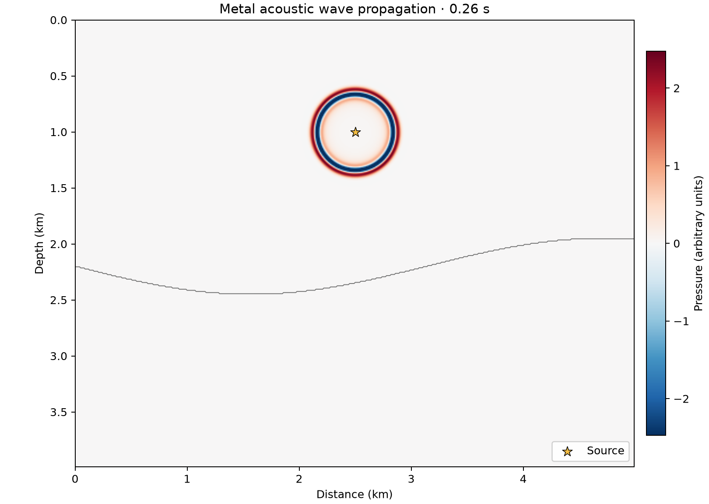

# 50 · Wave sandbox (headless Metal core)

**Paths:** Metal only (`mlx/` is an empty directory) · **Tests:** 26 (all pass) · **Benchmarked:** yes

A Metal acoustic wavefield at 0.26 s, rendered through the sandbox's colormap path.

## What was built
This is the GPU core of the wave sandbox, written as Rust driving hand-written MSL kernels. `run_frames` steps 2-D acoustic propagation with 2nd/4th/6th/8th-order stencils and a CFS-PML (the same written scheme as project 13, with per-axis spacing) and records receivers. **Every frame** it renders the pressure into an RGBA32Float texture and samples probes from it, with blending and multisampling disabled. `misfit_and_grad` provides the "live FWI" step: a summed L2 objective and its velocity gradient from a **hand-written adjoint** kernel, the same physics as project 16. The FWI path stores one right-hand-side plane per time step and does no checkpointing. Everything is float32 on the GPU. **Not built:** the implementation is the headless CLI API only. It has no interactive macOS window, no mouse painting of velocity, and no FWI toggle, so the planned interactive app, meant to be checked by hand, does not exist yet. The locked judge only ever tested headless behaviour.

## Judge and tolerances
- Oracles: Deepwave 0.1.0 `scalar` (float64 CPU) at the same grid, stencil, dt and PML for physics parity and the FWI objective, gradient and direction. There is also an exact-recurrence calibration, a periodic analytic refinement test, and a timed headless throughput test.
- `PARITY_REL = 1e-4`, normalized by max |ref|. Render tolerance: `render_abs_tolerance = 1e-4 × peak|u| / render_scale + 4·2⁻²³` (color units), with `RENDER_AUDIT_MARGIN_MIN = 3`. `EXACT_ABS = 0` for zero fields, interior projections and the constant green and alpha channels.
- `GRAD_FD_REL = 1e-3` with `FD_STEP_MPS = 2.0`, plus `GRAD_COS_MIN = 0.999` against Deepwave (project 16's rule). `DESCENT_RATIO_MAX = 0.99` for one live FWI step.
- `CONVERGENCE_ORDER = 2.0 ± 0.2`: 4th-order space with leapfrog time at dt ∝ h gives combined order 2, per the 2026-10-28 rule on combined space-time order.
- `MIN_STEPS_PER_SECOND = 60` on a 1000×1000 grid for `PERFORMANCE_STEPS = 240`, simulation plus render to texture. No startup time is subtracted.
- Oracle-only audits: `ORACLE_CALIBRATION_REL = 1e-14` and `ORACLE_SCHEME_REL = 1e-10` (written recurrence against Deepwave).
- Judge defects caught in review:
  - The PML memory channels were originally defined only by reference to Deepwave internals. SCHEME.md now writes the scheme out.
  - Render parity was originally 11–23× stricter than the project-wide pressure rule (an arbitrary ratio). It was replaced by the propagated budget above.
  - Remaining note: a float16 render target would still pass, so RGBA32Float is enforced only by code review.

## Parity
- Tests: 26/26 Metal passed: Deepwave physics parity (one-step and evolved, orders 2/4/6/8), every-frame render and texture orientation (8 cases), rest and source-sign calibration, centered velocity gradient (3), live-FWI objective, gradient and direction against Deepwave, an FWI step that reduces misfit, second-order analytic refinement, locked-metadata check, and the **1000² simulation-and-render at ≥ 60 steps/s** test.
- The throughput test passed, but the test run recorded pass/fail only. The exact steps/s figure from that test is not recorded.
- Float32 replays run during review: evolved-case errors were 2–6e-5 against render bounds of 1.9–2.2e-3 (rgba) and 1.0–1.3e-2 (texture samples). Worst margins were 32× and 14× (torch float32) and 30× and 191× (Deepwave float32).
- Bench medium max relative difference: Metal 1.15e-05.

## Benchmark
Wall time is the median of three calls after one warm-up (benchmark run, `bench/results.json`). Speedup = judge wall time ÷ path wall time at the same size; the judge is a correctness oracle, not a tuned competitor. Metal times include process launch, shader compilation and file I/O on every call, so a floor of roughly 40–60 ms dominates small sizes.

| Size | Problem | Judge | Metal | Metal vs judge |
|---|---|---|---|---|
| small | ny=160, nx=160, nt=140, nr=64, pml_width=12 | 7.78 ms | 51.3 ms | 0.152× |
| medium | ny=320, nx=320, nt=240, nr=128, pml_width=12 | 28.5 ms | 59.2 ms | 0.481× |
| large | ny=1000, nx=1000, nt=360, nr=256, pml_width=12 | n/a (skipped) | 112 ms | n/a |

| Size | Judge peak mem | Metal peak mem |
|---|---|---|
| small | 3.39 | 0.0781 |
| medium | 12.7 | 0 (child-RSS delta; see note) |
| large | n/a | 0.0469 |

- Judge large skipped by the benchmark harness: "Large float64 CPU reference may exceed 120 s".
- MLX: n/a, no MLX path was benchmarked for this project (Metal only).
- Peak memory is in MB as recorded by the harness (decimal MB or MiB per the project notes). Memory methods differ by path and are not comparable across columns. Judge: tracemalloc peak; excludes native Torch allocations. Metal: RUSAGE_CHILDREN ru_maxrss high-water delta, macOS bytes; may be zero after warm-up.
- Medium-size max relative difference vs judge: Metal 1.15e-05.

The large case runs 360 frames on a 1000×1000 grid, with 256 receivers and per-frame rendering, in 112 ms of wall time. That is about 3,200 steps/s including process launch, shader compilation and file transport, far above the 60 steps/s requirement. At the small and medium sizes the CPU judge is faster, because Metal's fixed startup cost dominates.

## Known limitations
- **No interactive app:** no window, mouse velocity painting or live FWI toggle has been built, so the planned hand check of the interactive app cannot be done yet.
- The RGBA32Float target is not test-enforced, since a float16 target would pass.
- In the performance case the PML memories are zero, so the timed run pays the PML's cost without exercising it. The evolved cases cover PML correctness.
- The FWI path stores one plane per time step with no checkpointing.

## Papers
- Builds on the kernels of project 13 (acoustic 2-D, CFS-PML) and project 16 (FWI adjoint). Project 16's papers apply: Tarantola (1984), Richardson (2018) and Zhu et al. (2020).
